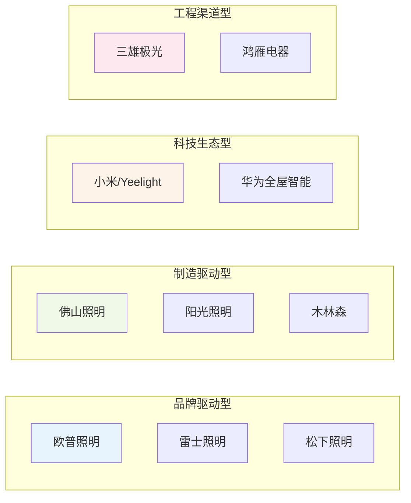
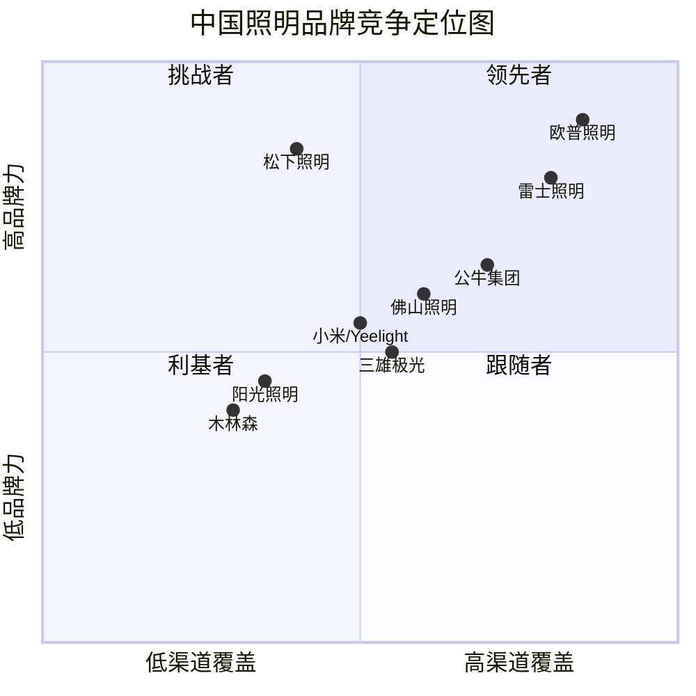

# 第四章 竞争格局总览

## 4.1 市场份额与梯队划分

### 4.1.1 中国家用照明市场份额格局

中国家用照明市场是竞争最为激烈的照明细分领域。根据中国照明电器协会（CLAA）行业数据与多家市场研究机构综合估算，2024 年中国家用照明市场规模约为 1,200–1,400 亿元。在这一市场中，品牌集中度（CRn）呈现"一超多强"的格局：

| 梯队 | 品牌 | 预估市场份额 | 年营收（约） | 核心特征 |
|------|------|-------------|-------------|----------|
| 第一梯队 | 欧普照明 | ~12–15% | 70–75 亿元 | 品牌认知度最高、渠道覆盖最广 |
| 第一梯队 | 雷士照明 | ~10–13% | 50–60 亿元 [待核实] | 商业照明品牌力强、渠道覆盖广 |
| 第一梯队 | 佛山照明 | ~8–10% | 40–50 亿元 [待核实] | 制造成本优势、光源品类强 |
| 第二梯队 | 三雄极光 | ~5–7% | 15–20 亿元 [待核实] | 工程渠道优势、商业照明强 |
| 第二梯队 | 松下照明（中国） | ~4–6% | 20–30 亿元 [待核实] | 日系高端品牌、品质口碑好 |
| 第二梯队 | 公牛集团（照明） | ~3–5% | 10–15 亿元 [待核实] | 渠道协同、增长迅速 |
| 第二梯队 | 小米/Yeelight | ~3–5% | 10–15 亿元 [待核实] | 智能照明、年轻用户群体 |
| 第三梯队 | 阳光照明、木林森等 | ~5–8% | 各 10–20 亿元 [待核实] | 出口导向、制造驱动 |
| 长尾 | 地方品牌/白牌 | ~30–40% | — | 价格竞争、低品牌认知 |

> 数据来源：中国照明电器协会（CLAA）行业数据、中商产业研究院《2024 年中国照明行业市场竞争格局报告》、奥维云网（AVC）零售监测数据、各上市公司年报。市场份额数据为综合估算值，标注 [待核实] 项需以行业报告最终数据为准。

> 数据来源解读：中国家用照明市场 CR3（前三大品牌份额之和）约为 30–38%，CR5 约为 40–48%。这一集中度水平表明，中国家用照明市场仍处于"品牌分散、竞争激烈"的阶段，与家电行业（CR5 超过 60%）相比，照明行业的品牌集中度仍有较大提升空间。欧普照明以 12–15% 的份额位居第一，但领先优势并不显著——雷士照明、佛山照明与其差距不大。这意味着欧普照明需要通过持续的品牌建设、产品创新与渠道优化来巩固领先地位。

### 4.1.2 市场份额趋势变化（2021–2025）

近年来，中国家用照明市场份额格局正在发生以下变化：

1. **欧普照明份额缓慢下降**：从 2021 年的约 15–17% 下降至 2024 年的 12–15%，主要受房地产下行与电商价格战影响。
2. **公牛集团照明份额快速上升**：从 2021 年的不足 2% 上升至 2024 年的 3–5%，得益于其强大的五金渠道（80 万+ 网点）与品牌协同效应。
3. **小米/Yeelight 份额稳步增长**：从 2021 年的约 1–2% 上升至 2024 年的 3–5%，受益于智能家居普及与年轻消费者偏好。
4. **白牌/地方品牌份额持续萎缩**：从 2021 年的约 45–50% 下降至 2024 年的 30–40%，品牌化趋势不可逆转。

> 数据来源：奥维云网（AVC）零售监测数据、中商产业研究院。趋势数据为估算值，标注 [待核实]。

> 数据来源解读：市场份额的变化趋势反映了中国照明行业的结构性变化——品牌化、智能化、渠道整合正在加速行业洗牌。白牌/地方品牌的份额持续萎缩，说明消费者越来越倾向于选择有品牌保障的产品。公牛与小米的份额上升，反映了渠道协同与智能生态在竞争中的重要性日益提升。

### 4.1.3 不同品类的市场份额差异

不同照明品类的市场集中度存在显著差异：

| 品类 | CR3 | CR5 | 集中度特征 | 领导品牌 |
|------|-----|-----|-----------|----------|
| 吸顶灯 | ~20–25% | ~30–35% | 中等集中 | 欧普照明 |
| 筒射灯 | ~15–20% | ~25–30% | 中等集中 | 欧普照明、雷士照明 |
| 装饰灯 | ~10–15% | ~20–25% | 低集中 | 品牌分散 |
| 智能照明 | ~25–30% | ~40–45% | 较高集中 | 小米/Yeelight、欧普照明 |
| 光源（灯泡/灯管） | ~20–25% | ~35–40% | 中等集中 | 佛山照明、欧普照明 |
| 厨卫灯 | ~15–20% | ~25–30% | 中等集中 | 欧普照明、松下 |
| 电工电料（开关插座） | ~30–35% | ~45–50% | 较高集中 | 公牛、德力西、正泰 |

> 数据来源：奥维云网（AVC）零售监测数据、各品类行业报告。数据为估算值，标注 [待核实]。

> 数据来源解读：智能照明与电工电料品类的集中度相对较高，说明这些品类更容易形成品牌壁垒。智能照明领域，小米/Yeelight 凭借米家生态占据了领先地位；电工电料领域，公牛集团凭借渠道优势占据绝对领先地位。相比之下，装饰灯品类集中度最低，说明这一品类更依赖设计而非品牌，是进入壁垒最低的细分领域。

---

## 4.2 竞争五力分析

### 4.2.1 现有竞争者之间的竞争强度

中国照明行业的现有竞争强度**非常高**，主要体现在以下几个方面：

**1. 企业数量众多，市场分散**

中国照明企业数量超过 5,000 家，其中规模以上企业约 1,000 家。大量中小企业的存在导致市场竞争激烈，价格战频发。在电商平台上，同一品类的照明产品往往有数十个品牌、数百个 SKU  competing for the same customers.

**2. 产品同质化程度较高**

尽管各品牌在产品设计与功能上有所差异，但 LED 照明产品的核心技术（LED 芯片、驱动电源、散热设计）已高度成熟，产品同质化程度较高。消费者在选购时，品牌认知与价格成为最主要的决策因素。

**3. 渠道竞争白热化**

线下渠道：品牌专卖店之间的竞争日益激烈，租金与人力成本上升压缩了经销商利润空间。

电商渠道：天猫、京东等平台的照明品类价格透明度极高，消费者可以轻松比价。电商平台上的"百亿补贴"、"限时秒杀"等活动进一步加剧了价格竞争。

**4. 品牌投入持续增加**

为在竞争中脱颖而出，各品牌持续增加品牌投入。欧普照明长期聘请明星代言人（如林志颖等），雷士照明在体育赛事营销上投入巨大，松下照明则依靠日系品质口碑维持品牌溢价。

> 数据来源：中国照明电器协会（CLAA）行业数据、电商平台价格监测数据、品牌广告投放数据。

> 数据来源解读：现有竞争者之间的竞争强度非常高，这是中国照明行业最核心的竞争特征。高竞争强度导致行业整体利润率偏低，只有具备规模效应、品牌溢价或渠道优势的企业才能维持较好的盈利水平。欧普照明凭借品牌与渠道优势，在竞争中处于相对有利地位，但仍需持续投入以维持竞争优势。

### 4.2.2 新进入者的威胁

新进入者威胁**中等偏高**，但威胁来源正在发生变化：

**传统新进入者威胁较低**：

- **规模经济壁垒**：LED 照明制造需要较大的生产规模才能降低成本，新进入者难以在短期内达到规模经济。
- **渠道壁垒**：建立覆盖全国的经销网络需要大量资金与时间投入，新进入者难以快速建立渠道优势。
- **品牌壁垒**：消费者对照明品牌的认知需要长期积累，新进入者需要大量品牌投入才能建立品牌认知。

**科技品牌跨界进入威胁较高**：

- **小米/Yeelight**：作为小米生态链企业，Yeelight 凭借米家生态与小米品牌影响力，快速进入智能照明市场。小米的 AIoT 平台拥有数亿级用户，为 Yeelight 提供了巨大的流量入口。
- **华为全屋智能**：华为通过鸿蒙操作系统（HarmonyOS）与全屋智能解决方案，正在进入智能照明领域。华为的品牌影响力与技术实力使其成为照明行业的重要潜在竞争者。
- **其他科技品牌**：百度（小度）、阿里巴巴（天猫精灵）、腾讯（微信生态）等科技巨头也在智能家居领域有所布局，可能通过生态合作方式进入照明市场。

> 数据来源：小米/Yeelight 公开数据、华为全屋智能官方信息、各科技品牌智能家居战略报告。

> 数据来源解读：传统照明企业的新进入者威胁较低，但科技品牌的跨界进入正在改变竞争格局。小米/Yeelight 与华为全屋智能的进入，使照明行业的竞争从"产品竞争"升级为"生态竞争"。对于欧普照明而言，科技品牌的跨界进入是最大的潜在威胁之一。

### 4.2.3 替代品的威胁

照明行业的"替代品"主要来自两个方面：

**1. 技术替代：LED 替代传统光源**

这一替代过程已基本完成。LED 渗透率在发达国家已超过 80%，在中国已超过 70%。未来 LED 替代的空间主要来自新兴市场与替换市场。

**2. 消费习惯替代：无主灯设计替代传统主灯**

"无主灯设计"（Main-light-free Design）是近年来中国家装照明领域最重要的趋势之一。传统照明方案以单一主灯（如大吊灯）为核心，辅以少量辅助照明；而无主灯设计采用多个筒灯、射灯、灯带组合，实现均匀、层次化的照明效果。

无主灯设计的兴起对照明行业产生了深远影响：

- **产品形态变化**：传统大吊灯需求下降，筒射灯、灯带需求上升。
- **客单价变化**：无主灯设计通常需要 10–20 个灯具组合，客单价高于传统单灯方案。
- **设计服务需求**：无主灯设计需要专业的光环境设计服务，推动了照明企业从"卖产品"向"卖服务"转型。

> 数据来源：中国室内装饰协会（CIDA）家装趋势报告、各品牌产品销量数据、家装设计平台数据。

> 数据来源解读：无主灯设计趋势对照明企业既是挑战也是机遇。挑战在于传统主打大吊灯的品牌需要调整产品结构；机遇在于无主灯设计的客单价更高，且需要专业设计服务，这为具备设计能力的品牌（如欧普、松下）提供了差异化竞争的机会。

### 4.2.4 供应商的议价能力

LED 照明产业链上游（LED 芯片、驱动 IC）的供应商议价能力**中等**：

**LED 芯片供应商**：

- 三安光电、华灿光电等头部芯片厂商在中低端市场产能充足，议价能力有限。
- 在高端市场（高亮度、高显色、Mini LED），日亚化学（Nichia）等国际厂商仍具有技术优势，议价能力较强。

**驱动 IC 供应商**：

- TI、PI、MPS 等国际厂商在高端驱动 IC 市场占据主导地位，议价能力较强。
- 中国厂商（晶丰明源、富满微）在中低端市场逐步实现替代，正在削弱国际厂商的议价能力。

**铝基板、散热器、光学透镜等通用部件**：

- 中国供应链高度完善，供应商众多，议价能力较弱。

> 数据来源：各上游企业年报、行业分析报告、供应链调研数据。

> 数据来源解读：LED 照明上游供应商的议价能力整体中等。对于欧普照明这类规模较大的企业，其采购量足以对供应商形成一定的议价能力。然而，在高端 LED 芯片与驱动 IC 领域，国际厂商仍具有技术壁垒，欧普照明需要与上游供应商建立长期合作关系以确保供应链安全。

### 4.2.5 买方的议价能力

照明行业买方的议价能力**较高**：

**零售消费者**：

- 消费者面对众多品牌选择，品牌转换成本低。
- 电商渠道价格透明，消费者可以轻松比价。
- 消费者对价格的敏感度较高，尤其在通用照明品类。

**工程客户（房地产商、政府）**：

- 大型房地产商（如万科、碧桂园）与政府集采项目具有强大的议价能力。
- 工程渠道的招标制度使价格成为最重要的竞争因素之一。
- 工程客户的回款周期长（6–18 个月），增加了照明企业的资金压力。

**经销商**：

- 大型经销商/代理商对品牌方具有一定的议价能力，尤其是在其区域市场具有较强渠道控制力的情况下。
- 然而，照明品牌方通常通过区域独家代理制度来平衡经销商议价能力。

> 数据来源：电商平台价格监测数据、工程招投标数据、经销商访谈数据。

> 数据来源解读：买方议价能力较高是照明行业利润率偏低的重要原因。对于欧普照明而言，提升品牌溢价能力（使消费者愿意为品牌支付溢价）是降低买方议价能力影响的关键策略。

---

## 4.3 战略群组分析

### 4.3.1 四大战略群组识别

基于产品定位、渠道结构、技术能力与竞争策略，中国照明行业可识别出四大战略群组：

> 数据来源：各公司年报、官网信息、行业分析报告、战略管理理论（Porter, 1980）。

> 数据来源解读：四大战略群组反映了中国照明行业不同的竞争逻辑。品牌驱动型群组以品牌建设、渠道覆盖、消费者心智占领为核心；制造驱动型群组以规模制造、成本控制、出口能力为核心；科技生态型群组以智能生态、AIoT 平台、用户数据为核心；工程渠道型群组以工程集采、商业照明、B2B 渠道为核心。各群组之间的竞争逻辑不同，移动壁垒也不同。

### 4.3.2 各战略群组详细分析

**群组一：品牌驱动型（欧普照明、雷士照明、松下照明）**

- **核心竞争策略**：品牌建设、渠道覆盖、消费者心智占领
- **典型特征**：高品牌投入、广泛渠道覆盖、大众消费市场
- **进入壁垒**：品牌认知度（高）、渠道网络（高）、资金实力（高）
- **代表企业**：
  - 欧普照明：中国家用照明第一品牌，渠道覆盖最广
  - 雷士照明：商业照明品牌力强，渠道覆盖广
  - 松下照明：日系高端品牌，品质口碑好

**群组二：制造驱动型（佛山照明、阳光照明、木林森）**

- **核心竞争策略**：规模制造、成本控制、出口能力
- **典型特征**：垂直整合程度高、成本优势明显、出口占比较高
- **进入壁垒**：制造规模（高）、供应链整合（中高）、成本控制（高）
- **代表企业**：
  - 佛山照明：LED 封装+通用照明，制造成本优势
  - 阳光照明：出口导向型 LED 企业，OEM/ODM 规模大
  - 木林森：LED 封装→照明品牌，上游供应链优势

**群组三：科技生态型（小米/Yeelight、华为全屋智能）**

- **核心竞争策略**：智能生态、AIoT 平台、用户数据
- **典型特征**：智能协议生态、用户数据积累、互联网思维
- **进入壁垒**：生态平台（极高）、用户基数（极高）、技术实力（高）
- **代表企业**：
  - 小米/Yeelight：米家 AIoT 生态，智能照明领先
  - 华为全屋智能：鸿蒙操作系统，全屋智能解决方案

**群组四：工程渠道型（三雄极光、鸿雁电器）**

- **核心竞争策略**：工程集采、商业照明、B2B 渠道
- **典型特征**：工程渠道积累深、商业照明产品强、B2B 销售团队
- **进入壁垒**：工程渠道关系（高）、商业照明资质（中高）、项目经验（高）
- **代表企业**：
  - 三雄极光：工程渠道优势明显，商业照明产品丰富
  - 鸿雁电器：电工+照明，工程渠道与品牌协同

### 4.3.3 战略群组间的移动壁垒

不同战略群组之间的移动壁垒差异显著：

| 从群组 → 到群组 | 品牌驱动型 | 制造驱动型 | 科技生态型 | 工程渠道型 |
|-----------------|-----------|-----------|-----------|-----------|
| 品牌驱动型 | — | 中 | 极高 | 中高 |
| 制造驱动型 | 高 | — | 极高 | 中 |
| 科技生态型 | 高 | 中 | — | 高 |
| 工程渠道型 | 中高 | 中 | 高 | — |

> 数据来源：战略管理理论（Porter, 1980），结合照明行业实际情况分析。

> 数据来源解读：科技生态型群组的移动壁垒最高——要建立一个智能家居生态平台需要巨大的资金投入与时间积累，这是照明企业最难跨越的壁垒。品牌驱动型向制造驱动型移动壁垒较低（如欧普照明自建吴江生产基地），但反向移动（制造驱动型向品牌驱动型）需要长期的品牌建设投入。工程渠道型向品牌驱动型移动需要在家用市场建立品牌认知，这也是三雄极光等工程渠道型企业拓展家用市场的挑战所在。

---

## 4.4 竞争维度矩阵

### 4.4.1 价格带分布矩阵

各品牌在不同价格带的覆盖情况：

| 品牌 | 低端 (<100元) | 中端 (100–500元) | 高端 (>500元) | 主力价格带 |
|------|--------------|-----------------|--------------|-----------|
| 欧普照明 | ✅ 覆盖 | ✅ 主力 | ✅ 覆盖 | 100–300 元 |
| 雷士照明 | ✅ 覆盖 | ✅ 主力 | ✅ 覆盖 | 150–400 元 |
| 佛山照明 | ✅ 覆盖 | ✅ 主力 | ⚠️ 有限 | 50–200 元 |
| 三雄极光 | ⚠️ 有限 | ✅ 覆盖 | ✅ 覆盖 | 200–600 元 |
| 松下照明 | ❌ 基本无 | ✅ 覆盖 | ✅ 主力 | 300–1,500 元 |
| 公牛集团 | ✅ 覆盖 | ✅ 主力 | ⚠️ 有限 | 100–300 元 |
| 小米/Yeelight | ✅ 覆盖 | ✅ 主力 | ⚠️ 有限 | 50–300 元 |
| 阳光照明 | ✅ 覆盖 | ✅ 主力 | ❌ 基本无 | 50–200 元 |
| 木林森 | ✅ 覆盖 | ✅ 主力 | ⚠️ 有限 | 80–250 元 |

> 数据来源：电商平台（天猫、京东）各品牌店铺价格数据、行业分析报告。价格带划分基于 2025 年 10 月市场情况。

> 数据来源解读：欧普照明在三个价格带均有覆盖，主力价格带在 100–300 元，定位准确——既避免了低端市场的白牌价格战，又未过度依赖高端市场。松下照明是少数在高端市场（>500 元）具有显著优势的品牌，其品牌溢价能力在中国照明品牌中独一无二。佛山照明、阳光照明的主力价格带偏低，品牌溢价能力相对较弱。

### 4.4.2 品牌力 × 渠道覆盖二维定位

> 数据来源：品牌认知度调查数据（CLAA）、渠道覆盖数据（各公司年报）、行业分析报告。定位为综合估算值。

> 数据来源解读：欧普照明在品牌力与渠道覆盖两个维度上均处于领先地位，是典型的"领先者"。雷士照明紧随其后，在品牌力上略逊于欧普但渠道覆盖相当。松下照明品牌力高但渠道覆盖有限，属于"挑战者"定位。小米/Yeelight 品牌力与渠道覆盖均在中等水平，但在年轻消费者群体中品牌力正在快速提升。

### 4.4.3 关键成功因素（KSF）分析

基于战略群组分析与竞争维度矩阵，中国家用照明行业的关键成功因素（Key Success Factors, KSF）包括：

| 关键成功因素 | 重要性 | 说明 |
|-------------|--------|------|
| 品牌认知度 | ⭐⭐⭐⭐⭐ | 消费者决策的首要因素，影响溢价能力与渠道议价能力 |
| 渠道覆盖广度 | ⭐⭐⭐⭐⭐ | 决定产品触达消费者的能力，尤其在家用照明市场 |
| 产品品质与可靠性 | ⭐⭐⭐⭐ | 影响复购率与口碑传播 |
| 智能技术能力 | ⭐⭐⭐⭐ | 智能照明是未来增长引擎，技术能力决定竞争力 |
| 成本控制能力 | ⭐⭐⭐⭐ | 在价格竞争中保持利润的关键 |
| 供应链整合能力 | ⭐⭐⭐ | 影响产品质量稳定性与交付能力 |
| 工程设计能力 | ⭐⭐⭐ | 无主灯设计趋势下，设计能力成为差异化因素 |
| 海外市场能力 | ⭐⭐⭐ | 出口市场是重要的增长补充 |

> 数据来源：战略管理理论（KSF 分析框架）、行业专家访谈、各公司年报分析。

> 数据来源解读：品牌认知度与渠道覆盖是家用照明行业最重要的两个关键成功因素，欧普照明在这两个维度上均具有显著优势。智能技术能力正在成为新的关键成功因素，小米/Yeelight 在这一维度上具有领先优势。成本控制能力在价格竞争激烈的市场中尤为重要，佛山照明、阳光照明等制造驱动型企业在这一维度上具有优势。

### 4.4.4 竞争格局总结：欧普照明的相对竞争地位

综合以上分析，欧普照明在中国家用照明市场的竞争地位可概括为：

**优势**：
1. 品牌认知度第一：在消费者心中"照明=欧普"的心智关联最强
2. 渠道覆盖最广：线下数万家终端网点，覆盖全国绝大多数地级市与县级市
3. 产品线最全："照明+电工+智能"三位一体，覆盖从基础照明到智能照明的全品类
4. 资金实力雄厚：净现金约 53–57 亿元，为战略转型提供充足资金

**劣势**：
1. 智能生态落后：相比小米/Yeelight 的米家生态，欧普在智能平台与 AIoT 方面存在明显差距
2. 高端品牌力不足：在 500 元以上价格带，品牌力弱于飞利浦、松下
3. 工程渠道薄弱：相比三雄极光等工程渠道型企业，欧普在工程集采市场的积累不足
4. 海外市场薄弱：海外营收占比仅约 10%，国际化程度远低于阳光照明、木林森

**竞争地位判断**：欧普照明在中国家用照明市场处于**领导地位**，但这一地位正面临多重挑战。房地产下行导致传统照明需求萎缩，科技品牌跨界进入改变了竞争逻辑，智能照明赛道的竞争正在从"产品竞争"升级为"生态竞争"。欧普照明需要在巩固传统优势的同时，加速智能转型与生态建设。

> 数据来源：本章各节分析综合。

> 数据来源解读：欧普照明的领导地位建立在品牌与渠道两大核心优势之上，这两大优势在短期内难以被竞争对手复制。然而，智能生态的落后、高端品牌力的不足、工程渠道的薄弱、海外市场的薄弱，构成了欧普照明的四大战略短板。未来 3–5 年，欧普照明的竞争地位将取决于其在这四个短板上的改善速度。

### 4.4.5 竞争格局的未来演变趋势

基于当前竞争格局分析，中国家用照明行业竞争格局在未来 3–5 年可能呈现以下演变趋势：

**趋势一：品牌集中度持续提升**

白牌/地方品牌的份额将持续萎缩，品牌化趋势不可逆转。预计 2028 年 CR5 将从目前的 40–48% 提升至 50–55%。欧普照明、雷士照明、佛山照明等头部品牌将通过并购、渠道整合等方式进一步扩大市场份额。

**趋势二：智能照明成为竞争主战场**

智能照明市场的快速增长（CAGR 20–25%）使其成为照明行业最重要的增长引擎。小米/Yeelight、华为全屋智能等科技品牌在智能生态方面的优势将对其形成持续压力。欧普照明需要在智能协议适配（特别是 Matter）、智能场景联动、AI 光环境自适应等方面加大投入。

**趋势三：渠道融合加速**

线下渠道与电商渠道的边界正在模糊。欧普照明等品牌正在推进"线上引流+线下体验"的 O2O 模式，消费者在线上下单、线下门店体验与安装。渠道融合将重塑照明企业的渠道策略。

**趋势四：国际化加速**

随着国内市场竞争加剧，中国照明企业的国际化步伐正在加快。欧普照明、佛山照明、公牛集团等企业正在加大海外市场拓展力度。预计未来 3–5 年，中国照明品牌在海外市场的份额将显著提升。

> 数据来源：行业趋势分析，基于本章竞争格局分析综合推断。

> 数据来源解读：竞争格局的演变趋势对欧普照明具有深远影响。品牌集中度提升有利于欧普巩固领导地位；智能照明成为主战场既是机遇也是挑战——欧普需要加速智能转型以应对科技品牌的竞争；渠道融合为欧普的线下渠道优势提供了新的价值；国际化加速则为欧普提供了新的增长空间。