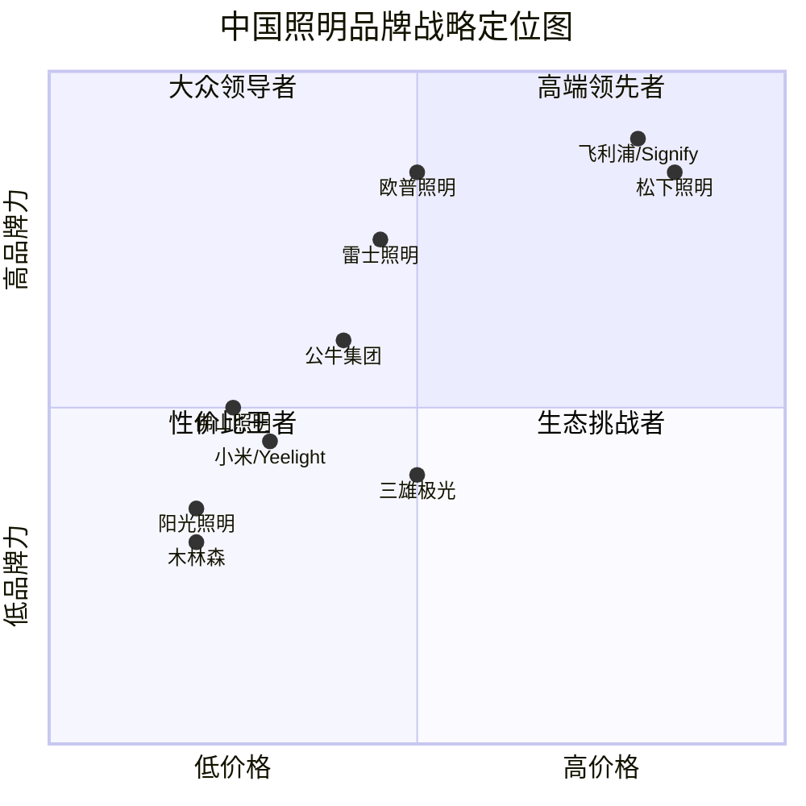
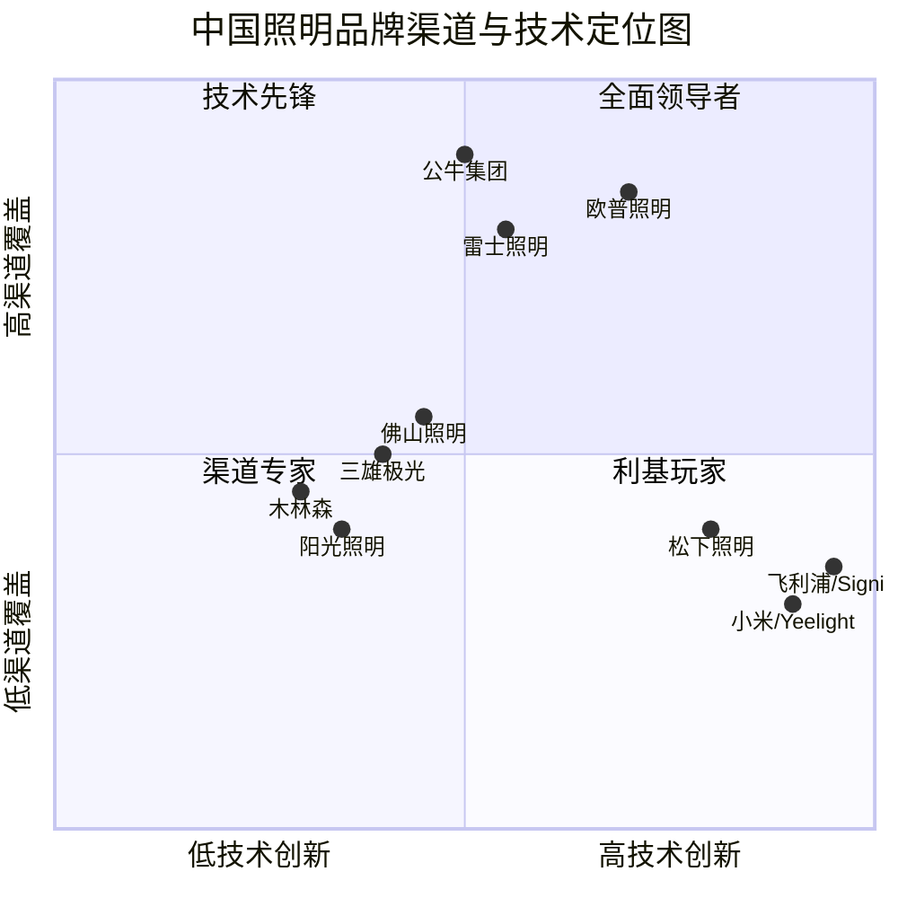

# 第十章 SWOT 与战略群组分析

## 10.1 欧普照明 SWOT 分析

### 10.1.1 优势（Strengths）

**S1：品牌认知度第一**

欧普照明是中国家用照明市场品牌认知度最高的品牌。根据中国照明电器协会（CLAA）行业数据与多家市场研究机构综合估算，欧普照明在中国家用照明市场的品牌认知度超过 80%，是消费者选购照明产品时的第一联想品牌之一。这一品牌优势使欧普照明在渠道谈判、产品定价、消费者信任等方面具有显著优势。

> 数据来源：中国照明电器协会（CLAA）行业数据、品牌认知度调查。品牌认知度数据为估算值，标注 [待核实]。

**S2：渠道覆盖最广**

欧普照明拥有 6,000–8,000 家终端网点，覆盖全国绝大多数地级市与县级市。这一渠道覆盖广度在中国照明行业中处于领先地位，使欧普照明能够触达最广泛的消费者群体。渠道优势是欧普照明最核心的竞争壁垒之一，需要数十年积累，难以被新进入者快速复制。

> 数据来源：欧普照明年报、行业估算。网点数量为估算值，标注 [待核实]。

**S3：产品线最全**

欧普照明的"照明+电工+智能"三位一体产品矩阵覆盖了从基础照明到智能照明的全品类，能够满足消费者一站式购物需求。电工电料品类已成为欧普照明的第二增长曲线，2024 年营收预计超过 10 亿元。

> 数据来源：欧普照明年报、行业估算。

**S4：资金实力雄厚**

欧普照明拥有约 53–57 亿元的净现金，资产负债率仅约 10–15%，几乎没有有息负债压力。这一资金实力为欧普照明的战略转型（智能照明研发、渠道数字化转型、海外市场拓展）提供了充足的资金保障。

> 数据来源：StockAnalysis.com（数据源：S&P Global Market Intelligence）。

**S5：制造能力完善**

欧普照明的吴江（苏州）生产基地是亚洲最大的照明产品生产基地之一，占地面积约 500 亩，建筑面积超过 30 万平方米。这一制造能力使欧普照明能够实现产品质量控制与供应链响应速度的优势。

> 数据来源：欧普照明 2024 年 ESG 报告。

### 10.1.2 劣势（Weaknesses）

**W1：智能生态落后**

相比小米/Yeelight 的米家生态与华为全屋智能，欧普照明在智能生态平台方面存在明显差距。欧普照明的智能产品主要依赖第三方平台（米家、华为、天猫精灵），缺乏自主的智能家居平台与用户数据积累。智能生态的落后使欧普照明在智能照明赛道的竞争中处于不利地位。

> 数据来源：本章各节分析综合。

**W2：高端品牌力不足**

在 500 元以上高端价格带，欧普照明的品牌力弱于飞利浦（Signify）与松下照明。欧普照明在高端市场的份额较低，品牌溢价能力有限。

> 数据来源：第六章产品线与技术参数对比。

**W3：工程渠道薄弱**

相比三雄极光等工程渠道型企业，欧普照明在工程集采市场的积累不足。欧普照明的工程渠道占比仅约 15%，主要面向房地产精装配套，受房地产下行影响较大。

> 数据来源：第七章渠道与营销对比。

**W4：海外市场薄弱**

欧普照明的海外营收占比仅约 10%，远低于阳光照明（60–70%）与飞利浦（Signify，70%）。海外市场拓展是欧普照明重要的增长方向，但目前的国际化程度较低。

> 数据来源：第三章欧普照明公司深度剖析。

**W5：营收持续下滑**

欧普照明的营收从 2021 年的 88.47 亿元连续四年下滑至 2025 年的 69.70 亿元，累计降幅约 21.2%。营收持续下滑反映了欧普照明在应对行业结构性变化方面的不足。

> 数据来源：StockAnalysis.com（数据源：S&P Global Market Intelligence）。

### 10.1.3 机会（Opportunities）

**O1：智能照明市场高速增长**

中国智能照明市场 2021–2025 年复合年增长率约 30%，预计 2026–2028 年仍将保持 30% 以上的增速。智能照明是欧普照明最重要的增长机会。

> 数据来源：GGII 高工产业研究院、中商产业研究院。

**O2：以旧换新政策**

2024–2025 年，中国政府推出大规模设备更新与消费品以旧换新政策，照明产品作为家居消费品的重要品类，有望从中受益。

> 数据来源：中国政府网、国家发改委政策文件。

**O3：无主灯设计趋势**

无主灯设计趋势正在推动筒射灯、灯带等智能照明产品的需求增长。欧普照明的全品类产品矩阵使其能够抓住这一趋势带来的增长机会。

> 数据来源：中国室内装饰协会（CIDA）家装趋势报告。

**O4：海外市场拓展空间**

欧普照明的海外营收占比仅约 10%，海外市场拓展空间巨大。通过品牌建设、渠道合作、本地化运营等方式，欧普照明可以提升海外市场份额。

> 数据来源：第三章欧普照明公司深度剖析。

**O5：健康照明需求增长**

随着消费者对健康照明的关注度提升，人因照明（HCL）、高显色照明等健康照明产品需求正在增长。欧普照明可以通过加大健康照明产品研发与推广来抓住这一机会。

> 数据来源：第八章智能照明与新技术布局对比。

### 10.1.4 威胁（Threats）

**T1：房地产下行**

中国房地产新开工面积从 2021 年的约 18 亿平方米持续下滑至 2024 年的约 7–8 亿平方米，累计降幅超过 50%。房地产下行是欧普照明营收下滑的最主要原因。

> 数据来源：国家统计局、克而瑞房地产数据。

**T2：电商价格战**

电商平台上的价格透明化与白牌/低价品牌竞争，压缩了欧普照明的利润空间。电商价格战是欧普照明面临的重要竞争威胁。

> 数据来源：第七章渠道与营销对比。

**T3：科技品牌跨界进入**

小米/Yeelight、华为全屋智能等科技品牌的跨界进入正在改变照明行业的竞争逻辑。科技品牌的生态优势与用户数据积累是传统照明品牌难以复制的。

> 数据来源：第五章重点竞品逐家深度分析。

**T4：公牛集团的渠道威胁**

公牛集团的 80 万+ 五金渠道网点是照明行业最大的渠道变量。如果公牛成功将照明业务规模化，其渠道优势可能颠覆现有竞争格局。

> 数据来源：第五章重点竞品逐家深度分析。

**T5：国际贸易环境变化**

贸易摩擦与关税风险可能影响欧普照明的出口业务。欧普照明需要建立多元化的出口市场结构，降低对单一市场的依赖。

> 数据来源：第七章渠道与营销对比。

---

## 10.2 主要竞品 SWOT 摘要

### 10.2.1 雷士照明

| 优势 | 劣势 |
|------|------|
| 商业照明品牌力强 | 非上市公司，财务不透明 |
| 渠道覆盖广（5,000–7,000 家） | 智能转型相对滞后 |
| 商业照明工程渠道优势 | 家用品牌力略逊于欧普 |

| 机会 | 威胁 |
|------|------|
| 商业空间照明升级需求 | 欧普照明的渠道与品牌挤压 |
| 智能照明市场增长 | 科技品牌跨界进入 |

### 10.2.2 公牛集团

| 优势 | 劣势 |
|------|------|
| 80 万+ 五金渠道网点 | 照明品牌认知度低于欧普 |
| 品牌协同效应强 | 照明产品线相对单一 |
| 资金实力雄厚 | 工程渠道积累不足 |

| 机会 | 威胁 |
|------|------|
| 照明市场快速增长 | 欧普照明的电工电料竞争 |
| 智能家居入口 | 专业照明品牌的渠道反击 |

### 10.2.3 小米/Yeelight

| 优势 | 劣势 |
|------|------|
| 米家 AIoT 生态 | 线下渠道薄弱 |
| 高性价比 | 品牌溢价能力弱 |
| 年轻用户群体 | 工程渠道几乎为零 |

| 机会 | 威胁 |
|------|------|
| 智能家居普及 | 欧普照明的智能转型 |
| 全屋智能趋势 | 华为全屋智能竞争 |

---

## 10.3 战略群组定位图

### 10.3.1 价格 × 品牌力二维定位

> 数据来源：第六章产品线与技术参数对比、第四章竞争格局总览。定位为综合估算值。

> 数据来源解读：从战略定位图可以看出，欧普照明位于"大众领导者"象限——品牌力高、价格适中，这是其最理想的竞争定位。松下照明与飞利浦（Signify）位于"高端领先者"象限——品牌力高、价格高。小米/Yeelight 位于"生态挑战者"象限——品牌力中等、价格低，但凭借生态优势正在快速提升品牌力。佛山照明、阳光照明、木林森位于"性价比王者"象限——价格低、品牌力低，通过性价比竞争。

### 10.3.2 渠道覆盖 × 技术创新二维定位

> 数据来源：各公司年报、行业分析报告。定位为综合估算值。

> 数据来源解读：从渠道与技术定位图可以看出，欧普照明位于"全面领导者"象限——渠道覆盖广、技术创新能力较强。小米/Yeelight 位于"技术先锋"象限——技术创新能力最强，但渠道覆盖有限。公牛集团位于"渠道专家"象限——渠道覆盖最广，但技术创新能力相对较弱。松下照明与飞利浦（Signify）位于"技术先锋"象限，但渠道覆盖有限。

---

## 10.4 竞争态势总结

### 10.4.1 欧普照明的相对竞争地位

综合以上 SWOT 分析与战略群组分析，欧普照明在中国家用照明市场的竞争地位可概括为：

**领导地位稳固但面临挑战**。欧普照明在品牌认知度、渠道覆盖、产品线广度等方面仍具有综合优势，短期内其领导地位难以被单一竞争对手取代。然而，公牛集团的渠道碾压与小米/Yeelight 的智能生态优势正在侵蚀欧普的市场份额。

**核心竞争优势**：品牌认知度第一、渠道覆盖最广、产品线最全、资金实力雄厚。

**核心竞争劣势**：智能生态落后、高端品牌力不足、工程渠道薄弱、海外市场薄弱。

**最大机会**：智能照明市场高速增长、以旧换新政策、无主灯设计趋势、海外市场拓展空间、健康照明需求增长。

**最大威胁**：房地产下行、电商价格战、科技品牌跨界进入、公牛集团的渠道威胁、国际贸易环境变化。

> 数据来源：本章各节分析综合。

> 数据来源解读：欧普照明的领导地位建立在品牌与渠道两大核心优势之上。未来 3–5 年，欧普照明需要在智能转型、高端化、国际化三个方向上加速推进，以应对新兴竞争者的挑战与行业结构性变化。公牛集团与小米/Yeelight 是最需要关注的竞争变量。

### 10.4.2 SWOT 交叉分析（TOWS 矩阵）

SWOT 分析的更高阶应用是 TOWS 矩阵——通过优势-机会（SO）、优势-威胁（ST）、劣势-机会（WO）、劣势-威胁（WT）的交叉分析，生成可执行的战略选项：

**SO 战略（利用优势抓住机会）**：
- SO1：利用品牌认知度优势 + 智能照明市场增长 → 加速智能照明产品推广，提升智能产品占比
- SO2：利用渠道覆盖优势 + 以旧换新政策 → 通过线下渠道推广以旧换新活动
- SO3：利用产品线广度 + 无主灯设计趋势 → 推出无主灯设计套餐产品
- SO4：利用资金实力 + 海外市场拓展 → 加大海外市场品牌建设与渠道合作投入

**ST 战略（利用优势应对威胁）**：
- ST1：利用品牌认知度优势 + 电商价格战 → 通过线上线下差异化产品策略避免价格竞争
- ST2：利用渠道覆盖优势 + 公牛集团渠道威胁 → 强化品牌专卖店体验功能，提升渠道价值
- ST3：利用产品线广度 + 科技品牌跨界 → 通过"照明+电工+智能"三位一体策略对抗单一品类竞争

**WO 战略（克服劣势抓住机会）**：
- WO1：克服智能生态落后 + 智能照明市场增长 → 加强与华为、米家等平台的生态合作
- WO2：克服高端品牌力不足 + 健康照明需求增长 → 推出高端健康照明子品牌
- WO3：克服工程渠道薄弱 + 公共建筑照明升级 → 拓展公共建筑与城市更新项目
- WO4：克服海外市场薄弱 + 海外市场拓展空间 → 通过并购或合资方式加速海外扩张

**WT 战略（减少劣势避免威胁）**：
- WT1：克服智能生态落后 + 科技品牌跨界 → 建立智能照明联合实验室，加速技术追赶
- WT2：克服工程渠道薄弱 + 房地产下行 → 降低对房地产精装配套的依赖，拓展公共建筑渠道
- WT3：克服高端品牌力不足 + 电商价格战 → 通过设计升级与品牌故事建设提升品牌溢价
- WT4：克服海外市场薄弱 + 国际贸易环境变化 → 建立多元化出口市场结构

> 数据来源：战略管理理论（TOWS 矩阵），结合本章分析综合推断。

> 数据来源解读：TOWS 矩阵生成了 12 个可执行的战略选项。其中，SO1（利用品牌优势 + 智能照明增长）与 WO1（克服智能生态落后 + 智能照明增长）是最核心的战略方向——智能照明是欧普照明未来增长的核心引擎，需要在品牌、渠道、生态合作等多个维度加大投入。ST1（通过线上线下差异化产品策略避免价格竞争）与 WT2（降低对房地产精装配套的依赖）是应对当前挑战的关键战略。

### 10.4.3 战略优先级排序

基于影响程度与实施难度，对 TOWS 矩阵中的战略选项进行优先级排序：

| 优先级 | 战略选项 | 影响程度 | 实施难度 | 建议时间 |
|--------|---------|---------|---------|---------|
| P0（最高） | SO1：智能照明产品推广 | 高 | 中 | 1–2 年 |
| P0（最高） | WO1：加强生态合作 | 高 | 中 | 1–2 年 |
| P1（高） | SO2：以旧换新渠道推广 | 中 | 低 | 1 年 |
| P1（高） | ST1：线上线下差异化产品 | 中 | 中 | 1 年 |
| P1（高） | WT2：降低房地产依赖 | 高 | 高 | 2–3 年 |
| P2（中） | SO3：无主灯设计套餐 | 中 | 低 | 1–2 年 |
| P2（中） | WO2：高端健康照明子品牌 | 中 | 中 | 2–3 年 |
| P2（中） | SO4：海外市场拓展 | 高 | 高 | 3–5 年 |
| P3（低） | 其他战略选项 | 低 | 中 | 3–5 年 |

> 数据来源：战略管理理论，结合本章分析综合推断。

> 数据来源解读：战略优先级排序表明，欧普照明的最高优先级战略是智能照明产品推广（SO1）与加强生态合作（WO1）——这两项战略的影响程度最高，实施难度中等，且时间窗口紧迫。以旧换新渠道推广（SO2）与线上线下差异化产品策略（ST1）是短期可执行的战略选项。降低房地产依赖（WT2）与海外市场拓展（SO4）是中长期战略方向，需要持续投入。

### 10.4.4 战略群组移动分析

战略群组分析的一个重要应用是识别不同群组之间的移动壁垒与移动可能性。欧普照明目前位于"品牌驱动型"群组，未来可能的战略群组移动包括：

**向"科技生态型"群组移动**：
- 可能性：中等
- 壁垒：极高（需要建立智能家居平台与用户数据积累）
- 策略：通过生态合作（华为、米家）而非自建平台的方式实现移动
- 时间：3–5 年

**向"制造驱动型"群组移动**：
- 可能性：低
- 壁垒：中（欧普已具备制造能力）
- 策略：通过吴江生产基地的规模效应进一步降低成本
- 时间：1–2 年

**向"工程渠道型"群组移动**：
- 可能性：中等
- 壁垒：高（需要建立工程渠道团队与客户关系）
- 策略：通过并购或合作方式快速建立工程渠道能力
- 时间：2–3 年

> 数据来源：战略管理理论（Porter, 1980），结合本章分析综合推断。

> 数据来源解读：欧普照明最可能的战略群组移动方向是向"科技生态型"群组移动——通过生态合作而非自建平台的方式实现。这一移动方向与欧普照明的资源禀赋（资金实力雄厚、品牌认知度高）最为匹配。向"制造驱动型"群组移动的可能性较低，因为欧普已经具备制造能力，且制造驱动不是其核心竞争优势。向"工程渠道型"群组移动需要建立工程渠道团队与客户关系，壁垒较高。

### 10.4.5 数据可靠性说明

本章 SWOT 分析基于前文各章的分析结果综合推断。市场份额、品牌认知度等数据为行业估算值，标注 [待核实]。TOWS 矩阵与战略优先级排序为基于战略管理理论的分析推断，适用于战略方向判断，但不宜作为精确的决策依据。