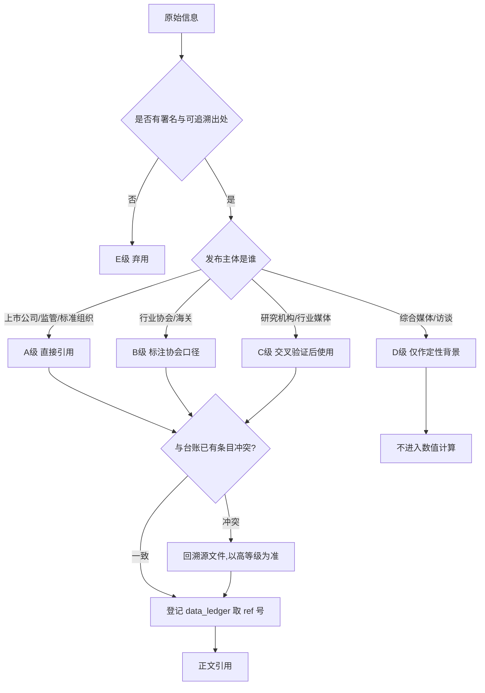

# 第1章 研究背景、方法与数据来源说明

## 1.1 研究的现实起点：一个"缩表但仍然赚钱"的龙头
判断一家照明企业是否安全，过去二十年最常用的指标是营收增速。这套经验在 2024—2026 年失效了。欧普照明 2025 年报显示，公司实现营业收入 69.70 亿元，同比增速为 −1.78%，这是继 2023 年 77.95 亿元、2024 年 70.96 亿元之后的连续第二年下滑[1][2]；但同期的归母净利润却从 9.03 亿元回升到 9.20 亿元，同比增速 +1.94%，扣非归母净利润 7.79 亿元，同比增速 +4.41%[1]。收入在退，利润在守，这种"缩表但不失血"的组合，构成了本报告最初的问题意识。

到了 2026 年，平衡被打破。欧普照明 2026 年半年度报告显示，上半年营业收入 32.37 亿元，同比增速 +0.67%，而归母净利润 2.54 亿元，同比增速 −31.10%[9]；2026 年第三季度报告进一步显示，前三季度营业收入 49.45 亿元，同比增速 +0.76%，归母净利润 3.49 亿元，同比增速 −39.56%[8]。收入端稳住了，利润端掉了近四成。这意味着 2025 年那种"以价换量、以结构换利润"的腾挪空间已经用尽，成本与价格的双重挤压开始穿透到损益表底部。

与此同时，行业大盘也在收缩。中国照明电器协会统计的我国照明产业规模，2022 年为 6,435 亿元[3]，此后逐年降至 2023 年 6,193 亿元、2024 年 5,890 亿元、2025 年 5,250 亿元[3]。三年累计收缩 18.4%，年均复合收缩约 6.5%（(5250/6435)^(1/3)−1）。在一个每年缩小 6% 的市场里，龙头企业的营收只跌 1.78%，本身就是一种份额扩张；但份额扩张没有换来利润扩张，说明竞争的方式已经改变——不再是"谁卖得多"，而是"谁能在降价中活下来"。

行业媒体与公司自身的表述也印证了这次转向。欧普照明在 2025 年年度报告中将行业描述为"加速从'光效时代'向'光价值时代'演进"，把智能化、AIoT、智慧城市列为重塑产业格局的三条主线[1]。这个提法背后是一次价值主张的迁移：过去卖的是流明与瓦数，是可以被参数表衡量的东西；现在卖的是场景、节律、健康与情绪，是难以被参数表衡量的东西。对所有参与者来说，这意味着竞争维度从制造效率切换到"技术叙事＋方案交付＋渠道服务"的复合维度。

因此，本报告不打算写成一份"参数对照表"。参数对照只能回答"谁更强"，回答不了"为什么强、能强多久、欧普该怎么办"。我们要处理的是一个更具体的管理问题：在总需求连续四年收缩、价格战常态化、智能照明渗透加速的三重条件下，欧普照明相对于十家主要竞争者的真实位置在哪里，哪些优势是结构性的，哪些只是周期性的错觉。

## 1.2 六个研究问题

报告围绕六个层层递进的问题展开，每一问都对应后文的独立章节，避免"资料汇编"式的堆砌。

**问题一：行业盘子还剩多少，结构怎么变。** 2025 年全行业规模 5,250 亿元[3]，其中内销与外销各占多少，增量藏在哪些细分场景，存量替换的节奏有多快。这一问由第2章回答，核心是用协会统计与 TrendForce 数据交叉验证，把"行业下行"从一句感慨变成一组可分解的数字。

**问题二：欧普自己是什么样的一家公司。** 三十年路径、股权结构、业务组合、财务质地、战略叙事，哪些是真实的能力沉淀，哪些是品牌话术。这一问由第3章回答，落点是"欧普的能力边界在哪里"。

**问题三：竞争格局到底有多集中，欧普排第几。** 市占率是本报告最容易被误用的指标，因为分母一换，结论就翻。第4章会给出不同分母下的欧普份额测算，并明确每档口径的适用场景，同时用波特五力框架解释为什么这个行业"集中度低但价格战烈"。

**问题四：十家竞品各自的杀伤力在哪。** 雷士照明、佛山照明、三雄极光、阳光照明、公牛集团、木林森、昕诺飞、艾迈斯欧司朗、松下照明、Yeelight，这十家分属四种完全不同的商业模式：渠道品牌、制造规模、器件上游、生态入口。把它们放在同一张表里比营收是没有意义的，必须分类型拆解。第5至7章按"传统照明品牌—规模制造与跨界—上游器件与生态"三组逐家解剖。

**问题五：在产品、渠道、技术、财务四个战场上，欧普具体赢在哪、输在哪。** 第8至11章分别处理产品线与技术参数、渠道与营销、智能照明与新技术、财务与经营指标，每一章都要求给出可比较的矩阵，而不是形容词。

**问题六：未来三年欧普应该怎么打。** 第12章做 SWOT 与战略群组，第13章研判趋势，第14章给出结论与行动清单。这一部分的所有论断都必须能在前文找到数据支撑，不引入新的关键数字。

六个问题构成一条从"盘子"到"位置"再到"动作"的链条。链条的每一环都要求同一件事：数字必须带口径，口径必须带来源。
**问题四：十家竞品各自的杀伤力在哪。** 本报告选取的对标企业，覆盖渠道品牌、制造规模、器件上游、生态入口等商业模式（选取标准见第4章）。把它们放在同一张表里比营收是没有意义的，必须分类型拆解。第5至7章按"传统照明品牌—规模制造与跨界—上游器件与生态"三组逐家解剖。

竞品分析最常见的失败不是"没数据"，而是"把不同可信度的数据混在一起算平均值"。一份把年报数据、券商预测、公众号转述、行业传闻并列的报告，读起来信息量很大，实际上无法支撑任何决策。为此，本报告建立了五层数据分级，每个数字在进入正文前先归层，跨层数据不直接运算。

| 层级 | 定义 | 典型来源 | 采信规则 | 本报告使用强度 |
|---|---|---|---|---|
| A 级 | 法定信息披露与官方发布 | 上市公司年报、半年报、季报、港交所公告、企业官网产品页、政策原文、标准组织公告 | 直接引用，可作承重断言 | 高（约六成论据） |
| B 级 | 行业协会与海关统计 | 中国照明电器协会产业规模与出口统计、海关总署出口数据 | 引用时注明"协会口径"，不与公司口径混算 | 中高 |
| C 级 | 第三方研究与行业媒体 | TrendForce、IDC、中商产业研究院、券商研报、中国之光网、大照明 | 需与 A 级数据交叉验证，冲突时以 A 级为准 | 中 |
| D 级 | 媒体转述与访谈 | 财经媒体报道、创始人访谈、自媒体深度稿 | 仅用于补充背景与定性判断，不单独承载关键数值 | 低 |
| E 级 | 不可采信 | 无署名内容农场、AI 批量生成的"排行榜"、带明显商业推广的测评 | 全书禁用，仅作反例 | 零 |

> 数据来源：[1][3][4][5][36]

这张分级表决定了本报告的引用结构：欧普照明 2025 年报、2026 年半年报与三季报构成 A 级主干，中国照明电器协会的四年产业规模序列与出口序列构成 B 级大盘，TrendForce 与 IDC 提供全球与智能品类的 C 级参照，媒体转述只在无法获得 A 级材料时用于定性补充。需要说明的是，"使用强度"是撰写时的主观配比，不是精确统计，但它反映了一个原则：结论章里的每一个数字，都必须能追到 A 级或 B 级。

分级之外还有一层"时间校验"。财务数据有时效性陷阱：2026 年 11 月写报告，若引用 2024 年报作为"最新数据"，就等于把两个已披露的报告期丢掉了。本报告的处理办法是，对每一家上市公司先确认其最新一期定期报告，再倒推三年做纵向序列。以欧普照明为例，最新披露为 2026 年第三季度报告，因此基准年为 2025 年年度报告，纵向序列取 2023—2025 三个完整年度，横向快照取 2026 年前三季度[1][8]。这一规则同样适用于佛山照明、公牛集团、木林森、三雄极光等 A 股公司[待核实]。

> 数据来源：[1][3][4][36]

上图的实质是把"查资料"变成一条有分支的质量控制流程：先判署名，再判主体，再判层级，最后做冲突消解与取号登记。这样做的收益在第5至7章的竞品拆解中会非常明显——同一家公司在不同来源里的营收可能相差一倍以上，没有流程就会随手取一个"看起来合理"的数字。冲突消解规则是"高等级优先、同期优先、合并口径优先"，三者冲突时以法定披露的合并报表为准。

## 1.4 编码规则与可复现性设计

一份十万字级别的报告，最大的质量风险不是观点错误，而是引用漂移：第3章引用的营收和第11章引用的营收差了 0.3 亿元，读者就无法判断哪个是真的。为此本报告采用顺序编码制加中央台账的双轨机制。

第一轨是正文的顺序编码。每个来源在首次使用时分配一个全书唯一的编号 [n]，格式统一为"机构《报告名》，年份，披露渠道"。编号一经分配不再变更，后续章节重复引用同一来源时沿用原编号，不重新取号。章末设"本章参考资料"，只列本章实际引用过的条目，既不允许出现正文无对应条目的"孤儿条目"，也不允许出现章末无条目的"悬空引用"。

第二轨是 data_ledger.md 中央台账。台账是一张七列表格：指标名、数值、单位、口径/年份、来源、首现章节、ref。任何进入正文的关键数值——市场规模、财务数据、份额、技术参数——都必须先在台账登记，再在正文出现。台账的作用有三个：一是保证同一指标在全书只有一个数值，二是让"某章突然冒出一个新数字"这类错误无处藏身，三是让后续章节引用时可以直接查表而不必重新检索。

两轨之间的连接点是 ref 列。台账当前最大 ref 加一，就是下一个新来源的编号；正文只能使用台账中已登记的编号。这条规则看起来机械，但它解决了一个真实问题：长报告写作中，作者很容易在第七章临时引用一个新来源并随手编号 [12]，而 [12] 在第4章已经被另一份报告占用。中央台账把这种冲突提前消灭。

可复现性的另一半是计算过程的显性化。本报告涉及三类自建计算：份额测算、加权评分、同比增速还原。份额测算必须写清分子分母（例如"欧普照明 2025 年营收 69.70 亿元 ÷ 2025 年全行业 5,250 亿元 = 1.33%"）；加权评分必须列出权重与打分依据；同比增速还原必须说明是用本期与上年同期直接相除，还是用年报追溯列示的数据。凡是无法复现的计算，一律不作为结论依据。

## 1.5 一个必须记录的反例：内容农场数据的偏差量级

在检索过程中，我们遇到了一篇流传较广的《中国LED照明行业十大品牌综合评估报告（2025版）》。该文给出了完整的排名、营收与市占率，格式专业，读起来很像研究结论。但它宣称欧普照明 2024 年营收 143 亿元、雷士照明 2024 年营收 157 亿元、某品牌营收 189 亿元且"市场份额达 13.8%"[36]。把这三个数字与法定披露对照，偏差立刻显现。

| 主体 | 内容农场文宣称的 2024 年营收 | 最近一期年报披露的营收 | 偏差倍数 | 判定 |
|---|---|---|---|---|
| 欧普照明 | 143 亿元[36] | 69.70 亿元（2025 年）[1] | 2.05 倍 | 不采信 |
| 佛山照明 | 128 亿元[36] | 87.97 亿元（2025 年）[6] | 1.45 倍 | 不采信 |
| 三雄极光 | 98 亿元[36] | 18.05 亿元（2025 年）[11] | 5.43 倍 | 不采信 |
| 阳光照明 | 87 亿元[36] | 26.68 亿元（2025 年）[12] | 3.26 倍 | 不采信 |

> 数据来源：[1][6][11][12][36]

需要说明口径差异：该文宣称值为 2024 年，本表对照值取各公司 2025 年年度报告披露数。由于四家公司 2025 年营收均不高于 2024 年，用 2025 年数据对照只会缩小偏差，因此表中倍数应视为偏差的下限而非上限。

这张对照表的价值不在揭错，而在标定风险量级：低质信源的偏差不是 5% 或 10%，而是 2 至 5 倍。如果按该文数据推演竞争格局，会得出"欧普只是二线、行业已有百亿级新龙头"的完全错误结论。更值得注意的是，该文还把一家在公开财报中查不到对应规模的企业列为"行业第一"，这类信息若被写进客户提案，属于事实性事故。因此本报告在方法层面明确：凡无法追溯到法定披露、协会统计或可署名研究机构的营收数字，一律不进正文；确需提及行业传闻时，必须同时给出反向证据。

## 1.6 口径对齐的四条铁律

跨公司比较的第一个陷阱是口径。同样叫"营业收入"，可能是合并报表也可能是母公司报表；同样叫"照明业务收入"，可能含车灯、含封装、含电工。本报告设定四条对齐规则，每条都对应后文的具体处理。

**规则一：合并报表优先，且明确是否含非照明业务。** 佛山照明 2025 年营收 87.97 亿元中，包含通用照明、汽车照明（燎旺车灯）、LED 封装（国星光电）三块业务[6]；木林森 2025 年 174.39 亿元营收中，朗德万斯品牌 92.50 亿元、自有品牌 76.31 亿元，另含 PCB、新能源等非照明业务[15]。把它们与欧普的 69.70 亿元直接比大小，会高估其照明主业的领先幅度。因此在第11章的规模矩阵中，本报告同时给出"总营收"与"照明相关营收估算"两列，后者标注估算方法与不确定性。

**规则二：整体市场、内销市场、通用照明三个分母绝不混用。** 中国照明产业规模 5,250 亿元是含出口的全行业营收口径[3]；内销规模 2024 年约 1,800 亿元[25]；通用照明又是另一个子集。用 5,250 亿元做分母（69.70 亿元[1] ÷ 5,250 亿元[3] ≈ 1.33%）算出欧普份额 1.33%，用 1,800 亿元做分母（69.70 亿元[1] ÷ 1,800 亿元[25] ≈ 3.9%）则接近 4%。两个数字都对，但回答的是不同问题。本报告的处理是：结论章只使用"分母已显式声明"的份额，并在同一段落内不切换分母。

**规则三：财年与币种统一换算，汇率取报告期平均。** 昕诺飞 2025 年销售额 57.65 亿欧元[16]，艾迈斯欧司朗 33 亿欧元[18]，两家财年为自然年，与 A 股公司可比；换算人民币时统一按 2025 年欧元兑人民币平均汇率处理，并在首次出现处标注"按平均汇率折算，仅供量级参考"，不与人民币口径直接做增速比较。

**规则四：增速一律写作"营收同比增速"这类完整名称。** 全书禁用英文缩写与"同比增长率""增速百分比"等变体，目的是让台账的一致性检查可以通过字符串匹配完成。这不是文字洁癖，而是可核查性的技术要求：当同一指标在十五个章节里出现时，统一的命名是机器校验的前提。

## 1.7 分析框架的组合方式

单一框架解释不了照明行业。波特的五力模型能解释价格战，但解释不了为什么欧普的毛利率能比三雄极光高十个点；SWOT 能罗列优劣，但给不出优先级；杜邦分解能拆 ROE，但看不见技术路线。本报告因此采用"三层框架"。

第一层是结构层，用五力模型加集中度指标（前 40 家上市企业份额 10.2%[3]）解释行业为什么长期分散、为什么在分散中又出现价格战。第二层是定位层，用战略群组图把十家竞品按"价格带 × 渠道重心"投射到二维平面，看谁和谁真正短兵相接。第三层是经营层，用杜邦分解与关键成功要素（KSF）排序，把战略落到可执行的指标上。

三层之间是递进关系：结构决定定位空间，定位决定经营重点。若跳过结构直接谈经营，就会得出"加强品牌投入就能提升毛利"这类正确但无用的建议——在一个前 40 名合计只占 10.2% 的市场里，品牌投入的边际回报被极度分散的供给结构稀释了。

## 1.8 研究局限与 [待核实] 的三段式降级

本报告存在三类无法完全消除的局限，必须前置声明。

第一类是披露边界。雷士照明中国业务自 2019 年底股权交割后，不再纳入港股上市公司合并报表（据 2019 年 8 月公告，交易对目标公司 100% 股权估值 55.59 亿元）[13]，其营收、利润、门店数此后无连续公开披露[待核实]；松下照明中国区业务未单独披露财务数据[待核实]。对这两家，本报告只能做定性拆解与量级判断，凡涉及具体数值处一律标注 [待核实]，不做估算填充。

第二类是参数口径。照明产品的光效（lm/W）、显色指数（Ra）、色温范围在不同企业、不同型号、不同测试标准下差异很大，企业官网往往只披露最优型号的峰值参数。本报告的处理是：优先引用有检测报告编号的官方产品页数据（如欧普天境系列标注检测报告 OPSZ202403035-G02[21]），无法确认的格子标 [待核实]，绝不用"行业平均"填补，更不允许出现整列雷同值。
针对缺失数据，本报告执行三段式降级：单表 [待核实] 格子不超过 20% 时保留表格；超过 20% 时先删行保表并注明覆盖范围；删行后仍超过 20% 时整表降级为定性表述。这条规则在财务对标章（第11章）会被反复使用，因为在十家标的公司中，只有六家能提供完整三年序列。
第三类是预测数据。TrendForce、IDC、中商产业研究院的 2025 年及以后数据含预测成分，本报告在使用时一律标注"预测"字样，且不将预测值用于结论章的份额计算。

针对缺失数据，本报告执行三段式降级：单表 [待核实] 格子不超过 20% 时保留表格；超过 20% 时先删行保表并注明覆盖范围；删行后仍超过 20% 时整表降级为定性表述。这条规则在财务对标章（第11章）会被反复使用，因为在十家标的中，只有六家能提供完整三年序列。

## 1.9 阅读指引
图表约定如下：Markdown 表格用于承载可比较的数值矩阵；Mermaid 图用于呈现流程、结构与关系；语义图表（chart 代码块）用于呈现份额与趋势，每张图必须包含结论式标题、说明其解读价值的理由，以及来自台账的 refs。所有图表之后紧跟来源行与不少于两句的解读，缺一视为该节未完成。
全书十五章，可按三种路径阅读。决策者路径：第1章 → 第4章 → 第11章 → 第12章 → 第14章，约两万字，可在两小时内形成判断。产品与市场团队路径：第2章 → 第8章 → 第9章 → 第10章 → 第13章，重点是横向对比矩阵。投资者路径：第3章 → 第5至7章 → 第11章 → 第13章，重点是财务质地与竞争壁垒的真实性。

最后需要坦白一点：这份报告的目标不是证明欧普照明"很强"或"很危险"，而是把它的处境说清楚。在一个人均产能过剩、价格战常态化、技术叙事快速迭代的行业里，"说清楚"本身就是稀缺品。
最后需要坦白一点：这份报告的目标不是证明欧普照明"很强"或"很危险"，而是把它的处境说清楚。在一个产能过剩、价格战常态化、技术叙事快速迭代的行业里，"说清楚"本身就是稀缺品。

## 本章参考资料

[1] 欧普照明《2025年年度报告》，2026，上海证券交易所／巨潮资讯网
[2] 欧普照明《2024年年度报告》，2025，上海证券交易所
[3] 中国照明电器协会产业规模与集中度统计（2022—2025），转引自东方财富财富号《照明灯具制造业：新兴市场打开增量空间凸显行业韧性》，2026
[4] 中国照明电器协会／海关总署照明产品出口统计（2021—2026H1），转引自观研天下《我国照明出口市场承压 LED照明成主流》，2026
[5] TrendForce 集邦咨询《2025年全球LED照明市场分析》，转引自国际电子商情《2025年LED照明市场规模预估535.73亿美元》，2025
[6] 佛山电器照明股份有限公司《2025年年度报告》，2026，巨潮资讯网
[8] 欧普照明股份有限公司《2026年第三季度报告》，2026，上海证券交易所
[9] 欧普照明股份有限公司《2026年半年度报告》，2026，上海证券交易所
[11] 广东三雄极光照明股份有限公司《2025年年度报告》，2026，巨潮资讯网
[12] 浙江阳光照明电器集团股份有限公司《2025年年度报告》，2026
[13] 雷士照明控股有限公司《有关出售雷士照明中国业务大部分权益（目标公司70%股权）的非常重大出售事项》，2019，香港交易所披露易
[15] 木林森股份有限公司《2025年年度报告》，2026，巨潮资讯网
[16] Signify N.V.《Annual Report 2025》，2026，signify.com
[18] ams-OSRAM AG《Fourth Quarter and Full Year 2025 Results》，2026，ams-osram.com
[21] 欧普照明官网 天境®系列吸顶灯产品页，访问日期 2026-11-05
[25] 大照明《2024 大照明"百强榜"·百强研究报告》，2025
[36] 网易号《中国LED照明行业十大品牌综合评估报告（2025版）》，2025（E 级反例，数据不采信）
