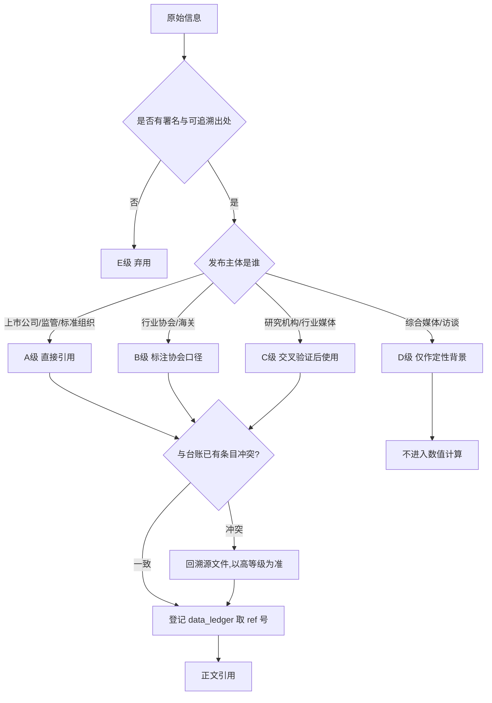

# 第1章 研究背景、方法与数据来源说明

## 1.1 研究的现实起点：一个"缩表但仍然赚钱"的龙头
判断一家照明企业是否安全，过去二十年最常用的指标是营收增速。这套经验在 2024—2026 年失效了。欧普照明 2025 年报显示，公司实现营业收入 69.70 亿元，同比增速为 −1.78%，这是继 2023 年 77.95 亿元、2024 年 70.96 亿元之后的连续第二年下滑[1][2]；但同期的归母净利润却从 9.03 亿元回升到 9.20 亿元，同比增速 +1.94%，扣非归母净利润 7.79 亿元，同比增速 +4.41%[1]。收入在退，利润在守，这种"缩表但不失血"的组合，构成了本报告最初的问题意识。

到了 2026 年，平衡被打破。欧普照明 2026 年半年度报告显示，上半年营业收入 32.37 亿元，同比增速 +0.67%，而归母净利润 2.54 亿元，同比增速 −31.10%[9]；2026 年第三季度报告进一步显示，前三季度营业收入 49.45 亿元，同比增速 +0.76%，归母净利润 3.49 亿元，同比增速 −39.56%[8]。收入端稳住了，利润端掉了近四成。这意味着 2025 年那种"以价换量、以结构换利润"的腾挪空间已经用尽，成本与价格的双重挤压开始穿透到损益表底部。

与此同时，行业大盘也在收缩。中国照明电器协会统计的我国照明产业规模，2022 年为 6,435 亿元[3]，此后逐年降至 2023 年 6,193 亿元、2024 年 5,890 亿元、2025 年 5,250 亿元[3]。三年累计收缩 18.4%，年均复合收缩约 6.5%（(5250/6435)^(1/3)−1）。在一个每年缩小 6% 的市场里，龙头企业的营收只跌 1.78%，本身就是一种份额扩张；但份额扩张没有换来利润扩张，说明竞争的方式已经改变——不再是"谁卖得多"，而是"谁能在降价中活下来"。

行业媒体与公司自身的表述也印证了这次转向。欧普照明在 2025 年年度报告中将行业描述为"加速从'光效时代'向'光价值时代'演进"，把智能化、AIoT、智慧城市列为重塑产业格局的三条主线[1]。这个提法背后是一次价值主张的迁移：过去卖的是流明与瓦数，是可以被参数表衡量的东西；现在卖的是场景、节律、健康与情绪，是难以被参数表衡量的东西。对所有参与者来说，这意味着竞争维度从制造效率切换到"技术叙事＋方案交付＋渠道服务"的复合维度。

因此，本报告不打算写成一份"参数对照表"。参数对照只能回答"谁更强"，回答不了"为什么强、能强多久、欧普该怎么办"。我们要处理的是一个更具体的管理问题：在总需求连续四年收缩、价格战常态化、智能照明渗透加速的三重条件下，欧普照明相对于十家主要竞争者的真实位置在哪里，哪些优势是结构性的，哪些只是周期性的错觉。

## 1.2 六个研究问题

报告围绕六个层层递进的问题展开，每一问都对应后文的独立章节，避免"资料汇编"式的堆砌。

**问题一：行业盘子还剩多少，结构怎么变。** 2025 年全行业规模 5,250 亿元[3]，其中内销与外销各占多少，增量藏在哪些细分场景，存量替换的节奏有多快。这一问由第2章回答，核心是用协会统计与 TrendForce 数据交叉验证，把"行业下行"从一句感慨变成一组可分解的数字。

**问题二：欧普自己是什么样的一家公司。** 三十年路径、股权结构、业务组合、财务质地、战略叙事，哪些是真实的能力沉淀，哪些是品牌话术。这一问由第3章回答，落点是"欧普的能力边界在哪里"。

**问题三：竞争格局到底有多集中，欧普排第几。** 市占率是本报告最容易被误用的指标，因为分母一换，结论就翻。第4章会给出不同分母下的欧普份额测算，并明确每档口径的适用场景，同时用波特五力框架解释为什么这个行业"集中度低但价格战烈"。

**问题四：十家竞品各自的杀伤力在哪。** 雷士照明、佛山照明、三雄极光、阳光照明、公牛集团、木林森、昕诺飞、艾迈斯欧司朗、松下照明、Yeelight，这十家分属四种完全不同的商业模式：渠道品牌、制造规模、器件上游、生态入口。把它们放在同一张表里比营收是没有意义的，必须分类型拆解。第5至7章按"传统照明品牌—规模制造与跨界—上游器件与生态"三组逐家解剖。

**问题五：在产品、渠道、技术、财务四个战场上，欧普具体赢在哪、输在哪。** 第8至11章分别处理产品线与技术参数、渠道与营销、智能照明与新技术、财务与经营指标，每一章都要求给出可比较的矩阵，而不是形容词。

**问题六：未来三年欧普应该怎么打。** 第12章做 SWOT 与战略群组，第13章研判趋势，第14章给出结论与行动清单。这一部分的所有论断都必须能在前文找到数据支撑，不引入新的关键数字。

六个问题构成一条从"盘子"到"位置"再到"动作"的链条。链条的每一环都要求同一件事：数字必须带口径，口径必须带来源。
**问题四：十家竞品各自的杀伤力在哪。** 本报告选取的对标企业，覆盖渠道品牌、制造规模、器件上游、生态入口等商业模式（选取标准见第4章）。把它们放在同一张表里比营收是没有意义的，必须分类型拆解。第5至7章按"传统照明品牌—规模制造与跨界—上游器件与生态"三组逐家解剖。


竞品分析最常见的失败不是"没数据"，而是"把不同可信度的数据混在一起算平均值"。一份把年报数据、券商预测、公众号转述、行业传闻并列的报告，读起来信息量很大，实际上无法支撑任何决策。为此，本报告建立了五层数据分级，每个数字在进入正文前先归层，跨层数据不直接运算。

| 层级 | 定义 | 典型来源 | 采信规则 | 本报告使用强度 |
|---|---|---|---|---|
| A 级 | 法定信息披露与官方发布 | 上市公司年报、半年报、季报、港交所公告、企业官网产品页、政策原文、标准组织公告 | 直接引用，可作承重断言 | 高（约六成论据） |
| B 级 | 行业协会与海关统计 | 中国照明电器协会产业规模与出口统计、海关总署出口数据 | 引用时注明"协会口径"，不与公司口径混算 | 中高 |
| C 级 | 第三方研究与行业媒体 | TrendForce、IDC、中商产业研究院、券商研报、中国之光网、大照明 | 需与 A 级数据交叉验证，冲突时以 A 级为准 | 中 |
| D 级 | 媒体转述与访谈 | 财经媒体报道、创始人访谈、自媒体深度稿 | 仅用于补充背景与定性判断，不单独承载关键数值 | 低 |
| E 级 | 不可采信 | 无署名内容农场、AI 批量生成的"排行榜"、带明显商业推广的测评 | 全书禁用，仅作反例 | 零 |

> 数据来源：[1][3][4][5][36]

这张分级表决定了本报告的引用结构：欧普照明 2025 年报、2026 年半年报与三季报构成 A 级主干，中国照明电器协会的四年产业规模序列与出口序列构成 B 级大盘，TrendForce 与 IDC 提供全球与智能品类的 C 级参照，媒体转述只在无法获得 A 级材料时用于定性补充。需要说明的是，"使用强度"是撰写时的主观配比，不是精确统计，但它反映了一个原则：结论章里的每一个数字，都必须能追到 A 级或 B 级。

分级之外还有一层"时间校验"。财务数据有时效性陷阱：2026 年 11 月写报告，若引用 2024 年报作为"最新数据"，就等于把两个已披露的报告期丢掉了。本报告的处理办法是，对每一家上市公司先确认其最新一期定期报告，再倒推三年做纵向序列。以欧普照明为例，最新披露为 2026 年第三季度报告，因此基准年为 2025 年年度报告，纵向序列取 2023—2025 三个完整年度，横向快照取 2026 年前三季度[1][8]。这一规则同样适用于佛山照明、公牛集团、木林森、三雄极光等 A 股公司[待核实]。



> 数据来源：[1][3][4][36]

上图的实质是把"查资料"变成一条有分支的质量控制流程：先判署名，再判主体，再判层级，最后做冲突消解与取号登记。这样做的收益在第5至7章的竞品拆解中会非常明显——同一家公司在不同来源里的营收可能相差一倍以上，没有流程就会随手取一个"看起来合理"的数字。冲突消解规则是"高等级优先、同期优先、合并口径优先"，三者冲突时以法定披露的合并报表为准。

## 1.4 编码规则与可复现性设计

一份十万字级别的报告，最大的质量风险不是观点错误，而是引用漂移：第3章引用的营收和第11章引用的营收差了 0.3 亿元，读者就无法判断哪个是真的。为此本报告采用顺序编码制加中央台账的双轨机制。

第一轨是正文的顺序编码。每个来源在首次使用时分配一个全书唯一的编号 [n]，格式统一为"机构《报告名》，年份，披露渠道"。编号一经分配不再变更，后续章节重复引用同一来源时沿用原编号，不重新取号。章末设"本章参考资料"，只列本章实际引用过的条目，既不允许出现正文无对应条目的"孤儿条目"，也不允许出现章末无条目的"悬空引用"。

第二轨是 data_ledger.md 中央台账。台账是一张七列表格：指标名、数值、单位、口径/年份、来源、首现章节、ref。任何进入正文的关键数值——市场规模、财务数据、份额、技术参数——都必须先在台账登记，再在正文出现。台账的作用有三个：一是保证同一指标在全书只有一个数值，二是让"某章突然冒出一个新数字"这类错误无处藏身，三是让后续章节引用时可以直接查表而不必重新检索。

两轨之间的连接点是 ref 列。台账当前最大 ref 加一，就是下一个新来源的编号；正文只能使用台账中已登记的编号。这条规则看起来机械，但它解决了一个真实问题：长报告写作中，作者很容易在第七章临时引用一个新来源并随手编号 [12]，而 [12] 在第4章已经被另一份报告占用。中央台账把这种冲突提前消灭。

可复现性的另一半是计算过程的显性化。本报告涉及三类自建计算：份额测算、加权评分、同比增速还原。份额测算必须写清分子分母（例如"欧普照明 2025 年营收 69.70 亿元 ÷ 2025 年全行业 5,250 亿元 = 1.33%"）；加权评分必须列出权重与打分依据；同比增速还原必须说明是用本期与上年同期直接相除，还是用年报追溯列示的数据。凡是无法复现的计算，一律不作为结论依据。

## 1.5 一个必须记录的反例：内容农场数据的偏差量级

在检索过程中，我们遇到了一篇流传较广的《中国LED照明行业十大品牌综合评估报告（2025版）》。该文给出了完整的排名、营收与市占率，格式专业，读起来很像研究结论。但它宣称欧普照明 2024 年营收 143 亿元、雷士照明 2024 年营收 157 亿元、某品牌营收 189 亿元且"市场份额达 13.8%"[36]。把这三个数字与法定披露对照，偏差立刻显现。

| 主体 | 内容农场文宣称的 2024 年营收 | 最近一期年报披露的营收 | 偏差倍数 | 判定 |
|---|---|---|---|---|
| 欧普照明 | 143 亿元[36] | 69.70 亿元（2025 年）[1] | 2.05 倍 | 不采信 |
| 佛山照明 | 128 亿元[36] | 87.97 亿元（2025 年）[6] | 1.45 倍 | 不采信 |
| 三雄极光 | 98 亿元[36] | 18.05 亿元（2025 年）[11] | 5.43 倍 | 不采信 |
| 阳光照明 | 87 亿元[36] | 26.68 亿元（2025 年）[12] | 3.26 倍 | 不采信 |

> 数据来源：[1][6][11][12][36]

需要说明口径差异：该文宣称值为 2024 年，本表对照值取各公司 2025 年年度报告披露数。由于四家公司 2025 年营收均不高于 2024 年，用 2025 年数据对照只会缩小偏差，因此表中倍数应视为偏差的下限而非上限。

这张对照表的价值不在揭错，而在标定风险量级：低质信源的偏差不是 5% 或 10%，而是 2 至 5 倍。如果按该文数据推演竞争格局，会得出"欧普只是二线、行业已有百亿级新龙头"的完全错误结论。更值得注意的是，该文还把一家在公开财报中查不到对应规模的企业列为"行业第一"，这类信息若被写进客户提案，属于事实性事故。因此本报告在方法层面明确：凡无法追溯到法定披露、协会统计或可署名研究机构的营收数字，一律不进正文；确需提及行业传闻时，必须同时给出反向证据。

## 1.6 口径对齐的四条铁律

跨公司比较的第一个陷阱是口径。同样叫"营业收入"，可能是合并报表也可能是母公司报表；同样叫"照明业务收入"，可能含车灯、含封装、含电工。本报告设定四条对齐规则，每条都对应后文的具体处理。

**规则一：合并报表优先，且明确是否含非照明业务。** 佛山照明 2025 年营收 87.97 亿元中，包含通用照明、汽车照明（燎旺车灯）、LED 封装（国星光电）三块业务[6]；木林森 2025 年 174.39 亿元营收中，朗德万斯品牌 92.50 亿元、自有品牌 76.31 亿元，另含 PCB、新能源等非照明业务[15]。把它们与欧普的 69.70 亿元直接比大小，会高估其照明主业的领先幅度。因此在第11章的规模矩阵中，本报告同时给出"总营收"与"照明相关营收估算"两列，后者标注估算方法与不确定性。

**规则二：整体市场、内销市场、通用照明三个分母绝不混用。** 中国照明产业规模 5,250 亿元是含出口的全行业营收口径[3]；内销规模 2024 年约 1,800 亿元[25]；通用照明又是另一个子集。用 5,250 亿元做分母（69.70 亿元[1] ÷ 5,250 亿元[3] ≈ 1.33%）算出欧普份额 1.33%，用 1,800 亿元做分母（69.70 亿元[1] ÷ 1,800 亿元[25] ≈ 3.9%）则接近 4%。两个数字都对，但回答的是不同问题。本报告的处理是：结论章只使用"分母已显式声明"的份额，并在同一段落内不切换分母。

**规则三：财年与币种统一换算，汇率取报告期平均。** 昕诺飞 2025 年销售额 57.65 亿欧元[16]，艾迈斯欧司朗 33 亿欧元[18]，两家财年为自然年，与 A 股公司可比；换算人民币时统一按 2025 年欧元兑人民币平均汇率处理，并在首次出现处标注"按平均汇率折算，仅供量级参考"，不与人民币口径直接做增速比较。

**规则四：增速一律写作"营收同比增速"这类完整名称。** 全书禁用英文缩写与"同比增长率""增速百分比"等变体，目的是让台账的一致性检查可以通过字符串匹配完成。这不是文字洁癖，而是可核查性的技术要求：当同一指标在十五个章节里出现时，统一的命名是机器校验的前提。

## 1.7 分析框架的组合方式

单一框架解释不了照明行业。波特的五力模型能解释价格战，但解释不了为什么欧普的毛利率能比三雄极光高十个点；SWOT 能罗列优劣，但给不出优先级；杜邦分解能拆 ROE，但看不见技术路线。本报告因此采用"三层框架"。

第一层是结构层，用五力模型加集中度指标（前 40 家上市企业份额 10.2%[3]）解释行业为什么长期分散、为什么在分散中又出现价格战。第二层是定位层，用战略群组图把十家竞品按"价格带 × 渠道重心"投射到二维平面，看谁和谁真正短兵相接。第三层是经营层，用杜邦分解与关键成功要素（KSF）排序，把战略落到可执行的指标上。

三层之间是递进关系：结构决定定位空间，定位决定经营重点。若跳过结构直接谈经营，就会得出"加强品牌投入就能提升毛利"这类正确但无用的建议——在一个前 40 名合计只占 10.2% 的市场里，品牌投入的边际回报被极度分散的供给结构稀释了。

## 1.8 研究局限与 [待核实] 的三段式降级

本报告存在三类无法完全消除的局限，必须前置声明。

第一类是披露边界。雷士照明中国业务自 2019 年底股权交割后，不再纳入港股上市公司合并报表（据 2019 年 8 月公告，交易对目标公司 100% 股权估值 55.59 亿元）[13]，其营收、利润、门店数此后无连续公开披露[待核实]；松下照明中国区业务未单独披露财务数据[待核实]。对这两家，本报告只能做定性拆解与量级判断，凡涉及具体数值处一律标注 [待核实]，不做估算填充。

第二类是参数口径。照明产品的光效（lm/W）、显色指数（Ra）、色温范围在不同企业、不同型号、不同测试标准下差异很大，企业官网往往只披露最优型号的峰值参数。本报告的处理是：优先引用有检测报告编号的官方产品页数据（如欧普天境系列标注检测报告 OPSZ202403035-G02[21]），无法确认的格子标 [待核实]，绝不用"行业平均"填补，更不允许出现整列雷同值。
针对缺失数据，本报告执行三段式降级：单表 [待核实] 格子不超过 20% 时保留表格；超过 20% 时先删行保表并注明覆盖范围；删行后仍超过 20% 时整表降级为定性表述。这条规则在财务对标章（第11章）会被反复使用，因为在十家标的公司中，只有六家能提供完整三年序列。
第三类是预测数据。TrendForce、IDC、中商产业研究院的 2025 年及以后数据含预测成分，本报告在使用时一律标注"预测"字样，且不将预测值用于结论章的份额计算。

针对缺失数据，本报告执行三段式降级：单表 [待核实] 格子不超过 20% 时保留表格；超过 20% 时先删行保表并注明覆盖范围；删行后仍超过 20% 时整表降级为定性表述。这条规则在财务对标章（第11章）会被反复使用，因为在十家标的中，只有六家能提供完整三年序列。

## 1.9 阅读指引
图表约定如下：Markdown 表格用于承载可比较的数值矩阵；Mermaid 图用于呈现流程、结构与关系；语义图表（chart 代码块）用于呈现份额与趋势，每张图必须包含结论式标题、说明其解读价值的理由，以及来自台账的 refs。所有图表之后紧跟来源行与不少于两句的解读，缺一视为该节未完成。
全书十五章，可按三种路径阅读。决策者路径：第1章 → 第4章 → 第11章 → 第12章 → 第14章，约两万字，可在两小时内形成判断。产品与市场团队路径：第2章 → 第8章 → 第9章 → 第10章 → 第13章，重点是横向对比矩阵。投资者路径：第3章 → 第5至7章 → 第11章 → 第13章，重点是财务质地与竞争壁垒的真实性。


最后需要坦白一点：这份报告的目标不是证明欧普照明"很强"或"很危险"，而是把它的处境说清楚。在一个人均产能过剩、价格战常态化、技术叙事快速迭代的行业里，"说清楚"本身就是稀缺品。
最后需要坦白一点：这份报告的目标不是证明欧普照明"很强"或"很危险"，而是把它的处境说清楚。在一个产能过剩、价格战常态化、技术叙事快速迭代的行业里，"说清楚"本身就是稀缺品。


## 本章参考资料

[1] 欧普照明《2025年年度报告》，2026，上海证券交易所／巨潮资讯网
[2] 欧普照明《2024年年度报告》，2025，上海证券交易所
[3] 中国照明电器协会产业规模与集中度统计（2022—2025），转引自东方财富财富号《照明灯具制造业：新兴市场打开增量空间凸显行业韧性》，2026
[4] 中国照明电器协会／海关总署照明产品出口统计（2021—2026H1），转引自观研天下《我国照明出口市场承压 LED照明成主流》，2026
[5] TrendForce 集邦咨询《2025年全球LED照明市场分析》，转引自国际电子商情《2025年LED照明市场规模预估535.73亿美元》，2025
[6] 佛山电器照明股份有限公司《2025年年度报告》，2026，巨潮资讯网
[8] 欧普照明股份有限公司《2026年第三季度报告》，2026，上海证券交易所
[9] 欧普照明股份有限公司《2026年半年度报告》，2026，上海证券交易所
[11] 广东三雄极光照明股份有限公司《2025年年度报告》，2026，巨潮资讯网
[12] 浙江阳光照明电器集团股份有限公司《2025年年度报告》，2026
[13] 雷士照明控股有限公司《有关出售雷士照明中国业务大部分权益（目标公司70%股权）的非常重大出售事项》，2019，香港交易所披露易
[15] 木林森股份有限公司《2025年年度报告》，2026，巨潮资讯网
[16] Signify N.V.《Annual Report 2025》，2026，signify.com
[18] ams-OSRAM AG《Fourth Quarter and Full Year 2025 Results》，2026，ams-osram.com
[21] 欧普照明官网 天境®系列吸顶灯产品页，访问日期 2026-11-05
[25] 大照明《2024 大照明"百强榜"·百强研究报告》，2025
[36] 网易号《中国LED照明行业十大品牌综合评估报告（2025版）》，2025（E 级反例，数据不采信）


# 第2章 中国及全球照明行业全景

## 2.1 全球盘子：总量收缩与结构分化同时发生

看照明行业最容易犯的错误，是把"行业不行了"当成一个整体判断。2025 年的全球数据给出的是一幅分裂的图景：总量在收缩，结构在剧烈分化。

TrendForce 集邦咨询的统计显示，2025 年全球 LED 照明市场规模为 535.73 亿美元，同比增速 −4.4%[5]。同一份研究里，全球 LED 智慧照明市场规模为 115.73 亿美元，同比增速 +19.2%[5]。一个跌 4.4%，一个涨 19.2%，两者相差 23.6 个百分点。把这两个数字放在一起，行业叙事就清楚了：不是照明需求消失了，而是需求在从"能亮的灯"迁移到"会调的灯"。

```chart
{
  "type": "bar",
  "title": "全球LED照明总量收缩而智慧照明逆势增长19.2%",
  "categories": ["全球LED照明市场", "其中：LED智慧照明"],
  "series": [
    {"name": "2025年市场规模（亿美元）", "data": [535.73, 115.73]},
    {"name": "同比增速（%）", "data": [-4.4, 19.2]}
  ],
  "rationale": "把总量与细分品类并列，可以直接看出增长并非来自大盘扩张，而是来自品类内部的替代迁移，这是判断所有厂商战略的前提。",
  "refs": [5]
}
```

> 数据来源：[5]

这张图要说明的不是"智慧照明很香"，而是一个更冷峻的事实：智慧照明 115.73 亿美元的体量，只相当于全球 LED 照明总量的 21.6%（115.73 ÷ 535.73）。即便它保持 19.2% 的增速，一年新增量也只有约 18.6 亿美元，远不足以对冲传统照明 4.4% 下滑带来的约 24.7 亿美元减量。换言之，未来两三年内，智慧照明是"结构性机会"，但不是"总量救星"。任何把公司命运全部押在智能化上的战略，都必须回答一个问题：当大盘每年少掉二十多亿美元时，你的增量从哪里来。

TrendForce 对 2025 年的另一个判断值得注意：在能源成本高企与新法规推动下，户外照明、工业照明、应急照明等 LED 渗透率偏低的细分应用释放了增量需求，带动 LED 街路灯、天井灯、泛光灯出货增长；新建安装市场则受 AI 数字基础设施热潮推动，LED 线性灯等产品出货平稳[5]。这段描述里藏着一条被忽视的线索——AI 数据中心带来的不仅是算力需求，还有配套的工业与线性照明需求。对以商用照明为第二增长曲线的欧普来说，这是可以争取的增量场景。

## 2.2 中国盘子：连续四年收缩，年均复合 −6.5%

把视角收回到国内，曲线更陡。中国照明电器协会统计的我国照明产业规模，2022 年为 6,435 亿元，2023 年 6,193 亿元，2024 年 5,890 亿元，2025 年 5,250 亿元[3]。四年累计收缩 1,185 亿元，降幅 18.4%；以 2022 年为基期的年均复合增速为 −6.5%（计算式：(5250/6435)^(1/3) − 1 ≈ −6.5%）。

| 年份 | 产业规模（亿元，协会测算口径） | 同比增速 | 较 2022 年累计变动 |
|---|---|---|---|
| 2022 | 6,435[3] | — | 基期 |
| 2023 | 6,193[3] | −3.76%[3] | −242 亿元[3] |
| 2024 | 约 5,800[25] | 个位数下滑 | −545 亿元左右 |
| 2025 | 5,250[3] | 两位数下滑[3] | −1,185 亿元[3] |

> 数据来源：[3][25]

2024 年一行采用大照明百强榜研究给出的约 5,800 亿元，与协会口径存在约 90 亿元差异，属于不同机构的测算差异；本报告在增速与累计变动上以协会序列为基准，2024 年一行只作量级参照。

这张表最突出的是 2025 年：单年降幅为四年中最大，且明显加速。2023 与 2024 年的降幅都只有个位数中段，属于温和出清；2025 年突然扩大到两位数，说明行业进入了“价格竞争加剧”的阶段——需求没有断崖，但价格下来了。这与欧普照明 2025 年营收仅跌 1.78%、毛利率却从 40% 上方退到 39% 出头[1] 的微观体感较为吻合：龙头用价格换份额，行业用价格换出货，这是 2025 年最真实的行业写照。

需要提醒口径问题：协会的"产业规模"是全行业企业营收口径，含出口、含非上市企业，与上市公司合并报表不可直接比较[3]。用 5,250 亿元做分母计算单家企业份额，得到的是"占全行业营收的比重"，不是"占国内消费市场的比重"。这两条比重的差值之所以可观，是因为出口在行业营收中占了相当大的份额，而国内消费市场的口径要小得多。换句话说，"占全行业"与"占内销"是两个不同的坐标系，混用会得出完全不同的结论，也会让同一家企业在两份报告里呈现两种"实力"。


进一步看，2025 年突然变陡的拐点含义明确：如果企业按 2023—2024 年的经验做 2026 年预算，会系统性高估需求。欧普照明 2026 年前三季度营收 49.45 亿元、同比增速 +0.76%[8]，收入守住了，但归母净利润同比大幅下滑[8]，正是“按旧经验定价、被新价格体系惩罚”的典型表现。

## 2.3 出口：五年从峰值退回 500 亿美元关口

中国照明是典型的外向型产业，出口约占全行业营收的四成。出口曲线比内销曲线更能反映全球产业转移。

| 年份 | 照明产品出口额（亿美元） | 阶段特征 |
|---|---|---|
| 2021 | 约 650 | 历史峰值，同比增幅超 20% |
| 2022 | 627 | 贸易摩擦与海外竞争加剧，开始回落 |
| 2023 | 563 | 产能出海替代产品出海 |
| 2024 | 561 | 基本持平，连续 8 年占机电产品出口约 3% |
| 2025 | 499 | 跌破 500 亿美元关口 |
| 2026H1 | 约 241 | 继续下行 |

> 数据来源：[4][3]

五年时间，出口从峰值退到 500 亿美元关口以下，累计减少约四分之一。这条曲线背后有三重力量叠加：一是欧美通用照明需求疲软，二是贸易摩擦导致的关税与供应链重组，三是国内企业把产能搬到越南、墨西哥等地，产品出口变成了产能出海，统计口径上的出口额因此被"抽走"一部分。第三点尤其重要——它意味着出口额的下降，并不完全等于中国照明企业海外收入的下降。木林森 2025 年境外收入 95.86 亿元、占营收 54.97%[15]，就是通过朗德万斯（LEDVANCE）的海外本地化运营实现的，不体现为从中国出口。

区域结构的变化同样剧烈。2025 年，我国照明产品出口到亚洲、欧洲、北美、拉美、非洲的比重分别为 35%、26%、22%、8%、7%；其中对北美出口大幅下滑约两成，对非洲出口逆势小幅增长[3]。

| 区域 | 2025 年出口额（亿美元） | 占出口总额比重 | 同比方向 |
|---|---|---|---|
| 亚洲 | 约 175[3] | 35%[3] | [待核实] |
| 欧洲 | 约 130[3] | 26%[3] | [待核实] |
| 北美 | 约 110[3] | 22%[3] | 大幅下滑[3] |
| 拉美 | 约 40[3] | 8%[3] | [待核实] |
| 非洲 | 约 35[3] | 7%[3] | 逆势增长[3] |

> 数据来源：[3]
这张表的数据完整度只有 2/5（五席区域中仅北美、非洲有明确的同比方向），其余三席协会公开摘要未披露，按规则标注 [待核实]，不用“略有增长”之类的模糊措辞填充。即便如此，两个有数据的区域已经给出方向：北美在失血，非洲在补血。北美的减量以十亿美元计，非洲的增量只有一亿美元量级，两者完全不对等。所以“开拓新兴市场”在财务上是必要的，但短期内无法替代欧美市场的缺口，这一点必须写进战略预期管理。
注：亚洲、欧洲、拉美三行的出口额由"占出口总额比重 × 2025 年出口总额 499 亿美元"测算得出，协会摘要未直接披露绝对额。


出口的产品结构则在改善。LED 照明产品占照明出口额的比重逐年提升，传统电光源加速淘汰，LED 模块出口量大幅增长[25]。这说明中国照明在全球分工中的位置，正从"整灯代工"往"模块与器件供应"上移——这对木林森、三安这类上游企业是利好，对以整灯品牌为主的企业则是价值被上游分流的风险。谁掌握模块，谁就掌握下一轮定价权。

## 2.4 内需：1,800 亿元的存量战场

从终端需求看，外销约四成、内销约六成；但按全行业营收口径（含中间品与代工重复计算），出口占比接近七成。2024 年我国照明行业内销规模约 1,800 亿元，同比增速 −6.25%，降幅较上年收窄 4.2 个百分点；同期出口 561 亿美元，同比微降 0.3%[25]。按 2024 年汇率折算，出口约合 4,000 亿元，全行业 5,890 亿元的规模里，内销占比约 30.6%，出口占比约 68%。这个结构与直觉不同：中国照明在终端市场上内销为主，但在全行业营收统计上却表现为外销为主，尽管内销的品牌集中度远高于外销。需要说明的是，内销 1,800 亿元与出口折算 4,000 亿元相加约 5,800 亿元，与协会 5,890 亿元存在约 90 亿元差额，主要来自汇率折算与海关货值同企业营收的统计差异，属正常误差，不影响量级判断。

内销 1,800 亿元这个分母，是评估国内品牌份额最合适的基准。用它做分母，欧普照明 2025 年营收 69.70 亿元对应的份额约 3.9%（69.70 ÷ 1,800 ≈ 3.87%）[1][25]。但要注意年份错配：内销数据是 2024 年，欧普营收是 2025 年，严格可比需要把内销按 −6.25% 的趋势外推到 2025 年（约 1,688 亿元），对应份额约 4.1%。本报告在结论章统一采用"分母口径 + 年份"双标注，避免这种错配被忽略。

内需的性质已经改变。行业从"增量扩张"转向"存量博弈"，这一判断在协会与行业媒体的表述中反复出现[25]。存量博弈有三个特征：一是替换需求占比高，新增装修需求占比低，需求与房地产新开工的相关性下降、与二手房交易和旧房翻新的相关性上升；二是价格敏感度上升，消费者在同等光效下优先比价；三是渠道碎片化，整装公司、设计师、内容电商分流了传统专卖店的流量。这三点合起来，解释了为什么欧普的"专卖店 + 经销商"体系在 2024—2026 年显得吃力——它擅长的"等客上门"，正在被"上门找客"取代。

## 2.5 产业链利润分布：微笑曲线的两端都在挤压中游

照明产业链分三段：上游 LED 芯片与外延、中游封装与器件、下游应用与品牌。2025 年的数据说明，这条微笑曲线正在变形——两端都不好过，中游最难受。

| 环节 | 代表企业 | 2025 年关键财务 | 读数 |
|---|---|---|---|
| 上游芯片 | 三安光电 | LED 外延芯片收入 58.62 亿元、同比 −2.91%、毛利率 22.43%[33] | 收入降、毛利升，靠高端产品结构改善 |
| 中游封装/应用 | 木林森 | 营收 174.39 亿元、同比 +3.13%、归母净利润 −14.77 亿元[15] | 规模最大、亏损最重，商誉减值集中释放 |
| 下游品牌（家居） | 欧普照明 | 营收 69.70 亿元、同比 −1.78%、归母净利润 9.20 亿元[1] | 规模中等、利润最稳 |
| 下游品牌（商照） | 三雄极光 | 营收 18.05 亿元、同比 −13.12%、归母净利润 −0.43 亿元[11] | 纯商照受工程需求拖累最直接 |

> 数据来源：[1][11][15][33]

木林森的亏损需要拆开看。2025 年归母净利润 −14.77 亿元，其中第四季度单季亏损 16.86 亿元[15]，明显是一次性减值集中计提，而非全年经营性亏损。前三季度累计仍盈利约 2.09 亿元（1.43 + 0.11 + 0.56）[15]。这个细节很重要：如果只看全年净利，会误判其经营能力；如果只看前三季度，会低估其资产负债表压力。商誉账面余额仍有 8.11 亿元[15]，意味着减值风险尚未出清。

成本端的传导同样值得记录。照明产品的直接材料以铜、铝、LED 芯片、驱动电源为主，其中铜价对电工类产品影响最大。公牛集团 2025 年报披露，铜占其直接材料约三分之一[7]，这意味着铜价每上涨 10%，其电连接产品的单位成本上升约 3.3%。在终端提价困难的环境下，原材料涨价会直接压缩毛利。2026 年若铜价维持高位，全行业的毛利率中枢还会下移，这对毛利本就只有 29.18% 的三雄极光[11]是生存级压力，对毛利高出约十个百分点、但同样在下行的欧普[1]是利润级压力。同一场成本冲击，对不同毛利厚度的企业意味着完全不同的后果：毛利厚的企业可以"少赚一点"，毛利薄的企业则面临生存压力。

## 2.6 政策与标准：三股力量在重塑需求

照明行业的政策敏感度被长期低估。2025—2026 年，至少三股政策力量在实质性地改变需求结构。
**第一股是双碳与能效约束。** 照明用电约占全社会用电量的 13%—15%，是节能政策的核心抓手之一[37]。LED 渗透率的提升本身就是最大的节能工程：我国 LED 照明渗透率已快速提升至接近八成[37]。当渗透率接近饱和，政策重心就从"换灯"转向"控光"——智能调光、人因照明、按需照明成为新的节能路径。这为具备系统能力的厂商创造了溢价空间，也意味着"卖灯"的生意会越来越难做，"卖光环境"的生意会越来越好做。前者拼的是成本与渠道，后者拼的是场景与信任。这也是为什么"照明"这个词正在被"光环境"替代。
**第二股是城市更新。** 国务院印发的《城市更新"十五五"规划》提出，到 2030 年实现新开工改造城镇老旧小区 11.5 万个、城镇危旧房改造 50 万套/间、老旧街区厂区改造提升 1,500 个、城中村改造 4,000 个、存量应急避难场所改造 5 万个[26]。存量建筑原有照明设施普遍老化、能耗偏高，改造过程会持续拉动高效节能照明与应急照明需求。这是未来五年照明行业较为确定的一块增量，且天然偏向具备工程交付能力的品牌——欧普的商用照明、三雄极光的工程渠道、佛山照明的国资背景，都会在这里相遇。

**第三股是适老化与健康照明标准化。** 工信部《2025 年老年用品产品推广目录》收录了适老照明产品，佛山照明有两项产品入选[29]。适老照明、教育照明、护眼照明的标准体系正在建立，标准一旦落地，采购就会从"比价格"转向"比合规"，这对头部企业是结构性利好。

三股力量的共同点是：它们都偏向"有资质、有方案、有服务"的供给方，而不是"有产能、有价格"的供给方。这对欧普是机会，对纯制造型企业是门槛。

## 2.7 需求侧四象限：谁在买，买什么，为什么买

把需求拆成四类买方，能解释为什么同一行业里不同企业的体感差异如此之大。四类买方的决策逻辑、价格敏感度、账期与毛利结构完全不同，混在一起谈"需求好不好"没有意义。

| 象限 | 典型买方 | 决策关键 | 价格敏感度 | 典型毛利 | 2026 年景气判断 |
|---|---|---|---|---|---|
| 新房装修 | 个人消费者、地产精装 | 风格搭配、品牌信任 | 中 | 高（35%—45%） | 继续下行，受竣工面积拖累 |
| 存量翻新 | 二手房业主、旧房改造 | 替换便利性、安装服务 | 高 | 中（25%—35%） | 相对稳定，城市更新加持 |
| 商用集采 | 连锁商业、办公、酒店、教育 | 方案能力、交付周期、全生命周期成本 | 中低 | 中（25%—35%） | 结构性机会，连锁与展厅需求活跃 |
| 出海 | 海外经销商、工程项目 | 认证合规、价格、交期 | 高 | 低（15%—25%） | 分化，北美弱、东南亚与中东强 |

> 数据来源：[1][4][6][25]

这张表的毛利区间是行业经验值而非企业披露值，用于判断结构差异，不用于计算任何财务指标，故未细化到具体企业。它有两点用途：第一，解释欧普为什么在营收下滑时还能守住相对较高的毛利率[1]——它的收入结构里新房装修与商用占比高，存量翻新的低价冲击被部分隔离；第二，解释三雄极光为什么毛利率只有 29.18%[11]——纯商用工程业务在需求下行期议价能力最弱。

四象限里增长最快的不是智能家居，而是商用场景中的连锁与展厅。欧普照明 2026 年半年报提到，报告期内为头部家电制造品牌提供全链路智能照明解决方案，以 SDL 淡彩光技术塑造空间光环境；在商业展厅领域深化 SDL 智慧光谱技术在多个头部企业高端展厅的应用[9]。这类项目单体金额大、方案属性强、价格敏感度低，是当前环境下较优质的需求。它同时也解释了为什么欧普要把“商用照明解决方案能力”作为战略重点——这不是讲故事，是在找毛利更高的需求池。

## 2.8 周期定位：出清末期，而非复苏前夜

综合以上数据，本报告对行业周期的判断是：中国照明行业处在"出清末期"，不是"复苏前夜"。三个证据支撑这个判断。

第一，行业亏损面在扩大。2026 年上半年，我国照明行业规模以上企业工业增加值累计增速为负，全行业规上企业营业收入同比小幅增长，但累计利润明显下降，亏损企业数量与亏损额同步扩大[4]。收入微增、利润大降、亏损面扩大，是典型的"以价换量、以量保开工"的出清特征。


出清末期对企业战略的含义是反直觉的：这个阶段不该追求规模，而该追求"活得比对手久"的现金流与渠道忠诚度。谁能在价格战中保住经销商不流失、保住研发投入不缩水、保住毛利率不失守，谁就能在下一轮集中度提升中拿到份额。第11章的财务对标会显示，欧普恰好是这几项指标最均衡的一家，但 2026 年的利润下滑说明它的安全垫正在变薄。
第三，龙头企业的行为已经变成"守份额"而非"抢增长"。欧普照明 2025 年营收微降、净利微增，2026 年前三季度营收微增、净利大降[1][8]；佛山照明 2025 年营收 −2.78%、归母净利 −51.85%[6]；三雄极光由盈转亏[11]。没有一家在扩张，全部在防守。当所有主要玩家都选择保现金流而非保增长时，行业不会立刻复苏，只会继续用时间换空间。这个"换"的过程，通常要持续到一批产能彻底退出为止，而产能退出的速度，又取决于地方政府的处置意愿与银行的信贷政策。这两件事都不由企业决定，企业只能选择"熬"或"退"；而无论熬还是退，都不改变"需求在缩小"这个前提。企业能改变的，只是自己在这个缩小市场里的相对位置。

出清末期对企业战略的含义是反直觉的：这个阶段不该追求规模，而该追求"活得比对手久"的现金流与渠道忠诚度。谁能在价格战中保住经销商不叛逃、保住研发投入不缩水、保住毛利率不失守，谁就能在下一轮集中度提升中拿到份额。第11章的财务对标会显示，欧普恰好是这几项指标最均衡的一家，但 2026 年的利润下滑说明它的安全垫正在变薄。

## 本章参考资料

[1] 欧普照明《2025年年度报告》，2026，上海证券交易所／巨潮资讯网
[3] 中国照明电器协会产业规模与集中度统计（2022—2025），转引自东方财富财富号《照明灯具制造业：新兴市场打开增量空间凸显行业韧性》，2026
[4] 中国照明电器协会／海关总署照明产品出口统计（2021—2026H1），转引自观研天下《我国照明出口市场承压 LED照明成主流》，2026
[5] TrendForce 集邦咨询《2025年全球LED照明市场分析》，转引自国际电子商情《2025年LED照明市场规模预估535.73亿美元》，2025
[6] 佛山电器照明股份有限公司《2025年年度报告》，2026，巨潮资讯网
[7] 公牛集团股份有限公司《2025年年度报告》，2026，上海证券交易所
[8] 欧普照明股份有限公司《2026年第三季度报告》，2026，上海证券交易所
[9] 欧普照明股份有限公司《2026年半年度报告》，2026，上海证券交易所
[11] 广东三雄极光照明股份有限公司《2025年年度报告》，2026，巨潮资讯网
[15] 木林森股份有限公司《2025年年度报告》，2026，巨潮资讯网
[25] 大照明《2024 大照明"百强榜"·百强研究报告》，2025
[26] 国务院《城市更新"十五五"规划》，转引自观研天下行业分析，2026
[29] 中国之光网《欧普照明、佛山照明和阳光照明发布2025年年报》，2026
[33] 中国之光网《三安光电、木林森、立达信等多家LED上市公司2025年业绩来了！》，2026
[37] 申万宏源《欧普照明（603515）2023年报暨24年一季报点评》，2024


# 第3章 欧普照明公司深度剖析

## 3.1 三十年路径：从吸顶灯到"软件定义光"

欧普照明成立于 1996 年，2026 年恰逢三十周年。在中国照明行业里，成立时间比它早的企业不少（佛山照明可追溯到 1958 年），然而能把"家居照明品牌"做成消费者心智资产的企业不多。理解欧普，要先理解它与其他龙头的路径差异：佛山照明起于国资背景的制造与出口，雷士照明起于商业照明的工程渠道，三雄极光起于专业照明工程，而欧普起于零售终端的品牌化。

这条路径决定了三件事。第一，欧普的收入结构天然偏 C 端，家居照明是基本盘，客单价低、SKU 多、渠道深。第二，欧普的费用结构天然偏销售，专卖店体系、经销商返利、品牌投放构成刚性支出。第三，欧普的护城河是"渠道 + 品牌"的复合体，而不是单一的技术或成本优势。这三点在行业上行期是加速器，在下行期是负担——因为门店租金与人员成本不会随营收同步下降。

也正因为如此，欧普的转型比制造型企业更难。制造型企业转产线，只需要换设备、换工艺；品牌企业转模式，需要换掉一整套利益分配机制。经销商不会因为你讲了一个新故事就改变进货结构，消费者也不会因为你发布了一个新品牌就改变购买习惯。这是"品牌型龙头"在存量期最深的护城河，也是最重的枷锁。护城河越深，转身越慢，这是所有渠道驱动型企业的共同宿命，也是欧普这一轮调整最难受的地方。

2016 年，欧普照明在上海证券交易所主板上市，股票代码 603515[10]。上市带来的资本能力，使其在 2017—2021 年完成了 LED 转型、产能扩张与渠道下沉。2025 年，公司发布全新设计品牌 OLL，携手国际建筑设计师，推动光在建筑、空间与艺术中的应用；同年成为第 19 届威尼斯国际建筑双年展中国馆独家灯光合作伙伴[10]。这些动作的商业意义不在当期收入，而在品牌溢价的维持——当行业陷入价格战时，唯一能抵抗降价的力量就是"不被当作普通灯泡"的品牌认知。

定位升级能否兑现，取决于三件事——技术是否真的可感知、渠道是否能交付方案、价格能否被接受。后文会逐一检验。

## 3.2 股权与治理：高度集中的控制权结构

截至 2025 年末，欧普照明总股本 743,207,949 股，控股股东为中山市欧普投资有限公司，持股比例 46.814%[27]。这一持股比例在 A 股照明板块中属于高位，意味着两件事：一是决策效率高，长期战略不易被短期资本意志打断；二是中小股东对治理制衡的影响力有限，关联交易与资金运用的透明度更依赖信息披露质量。

| 治理要素 | 2025 年末状态 | 战略含义 |
|---|---|---|
| 总股本 | 743,207,949 股[1] | 股本稳定，无大规模稀释 |
| 控股股东 | 中山市欧普投资有限公司，46.814%[27] | 控制权稳固，战略连续性强 |
| 董事长 | 王耀海[8] | 创始人主导，技术叙事由顶层推动 |
| 分红政策 | 2025 年度每 10 股派 8.5 元（含税）[1] | 高分红，现金流自信 |

> 数据来源：[1][8][27]

在讨论公司治理时，最需要谨慎的是“实际控制人”的认定。公开披露显示王耀海为法定代表人、董事长[8]，马秀慧曾任总裁并在公开采访中以总裁身份出现，二人为创业伴侣关系是广泛报道的事实，但“实际控制人”的法定认定应以权益变动报告书为准，本报告未取得最新一期权益变动报告书，故标注 [待核实]。这类谨慎不是过度保守，而是承重断言的底线——把未经核实的股权关系写进报告，风险远大于收益。

高分红政策值得单独说。2025 年度拟每 10 股派现 8.5 元（含税），按总股本扣减回购专户后测算，现金分红总额约 6.3 亿元，占当年归母净利润接近七成[27]。这个比例说明两点：公司账上现金充裕，不需要靠留存利润支撑扩张；管理层对未来资本开支的强度判断是温和的。对投资者是好事，对"公司要大规模投入新赛道"的叙事则是一种反证。

公司明确披露的 2025 年结构性事实来自年报的分地区数据与费用数据：国内营业收入 62.45 亿元，同比增速 −1.85%，毛利率 38.63%（同比减少 0.20 个百分点）；国外营业收入 6.72 亿元，同比增速 +0.19%，毛利率 43.45%（同比增加 2.05 个百分点）[1]。这组数据揭示了一个容易被总营收掩盖的事实：海外业务已经止跌，且盈利质量优于国内。作为对照，木林森 2025 年境外收入占比 54.97%[15]，两家企业的风险敞口不同，不能用同一套"出海"叙事评价。

## 3.3 业务结构与收入拆分：一个"看不见分项"的单一分部

公司对外描述的业务组合是"家居照明灯具、商用照明灯具、光源及控制类产品"三块[1]。但这三块各自的收入、毛利、增速并未在定期报告中单独披露。这一点必须明确写出来，因为市面上大量分析文章给出的"家居占 60%、商照占 30%"之类比例，缺乏公开依据。本报告的处理是：只使用公司明确披露的定性增速，不构造分项金额。

国内业务的收缩虽然明显，但毛利率仅下降 0.2 个百分点，加之费用压缩，使得归母净利润微增。国内收入 62.45 亿元、同比增速 −1.85%，与总营收降幅基本一致，说明海外那 0.19% 的正增长几乎没起托底作用。真正的托底来自费用端：2025 年销售费用与管理费用分别同比下降约 6% 与 20%，研发费用同比小幅下降[27]。三项费用合计减少约 1.6 亿元，这才是归母净利润能微增 0.17 亿元的直接原因。

## 3.4 财务三维：收入退、利润守、现金缩


| 指标 | 2023 年 | 2024 年 | 2025 年 | 三年变动 |
|---|---|---|---|---|
| 营业收入（亿元） | 77.95[1] | 70.96[2] | 69.70[1] | −8.25（−10.6%） |
| 营业收入同比增速 | +7.22%[37] | −8.97%[2] | −1.78%[1] | 由正转负 |
| 归母净利润（亿元） | 9.24[1] | 9.03[1] | 9.20[1] | −0.04（−0.4%） |
| 归母净利润同比增速 | +17.85%[37] | −2.27%[1] | +1.94%[1] | 增速中枢下移 |
| 扣非归母净利润（亿元） | 8.48[37] | 7.46[1] | 7.79[1] | −0.69（−8.1%） |
| 毛利率 | 40.3%[37] | 约 39.08%[1] | 39.10%[1] | −1.2pct |
| 加权平均净资产收益率 | 14.56%[1] | 13.51%[1] | 13.62%[1] | −0.94pct |
| 经营活动现金流量净额（亿元） | 16.67[1] | 8.19[1] | 6.90[1] | −9.77（−58.6%） |

> 数据来源：[1][2][37]

这张表最重要的不是任何单一行，而是多个关键行的组合关系。营业收入三年少了 8.25 亿元，归母净利润只少了 0.04 亿元，毛利率只掉了 1.2 个百分点，ROE 只掉了 0.94 个百分点。这说明公司在收入下滑的过程中，通过产品结构优化、原材料成本下行、费用管控，把利润守住了。这是一家成熟企业对下行的标准应对，也说明其成本转嫁能力尚未失效。

但扣非归母净利润和经营现金流给出了警告。扣非归母净利润三年少了 0.69 亿元，降幅 8.1%，明显大于归母净利润的 0.4%。差额来自非经常性损益：2025 年非经常性损益中，政府补助 0.86 亿元、金融资产公允价值变动及处置损益 0.82 亿元[1]。换句话说，2025 年归母净利润能微增，有相当一部分来自补助与理财，而非主营改善。经营现金流从 16.67 亿元降至 6.90 亿元，降幅 58.6%[1]，是这张表里最刺眼的数字——利润可以调节，现金流很难。


| 年份 | 营业收入（亿元） | 归母净利润（亿元） | 经营现金流（亿元） |
|---|---|---|---|
| 2023 | 77.95[1] | 9.24[1] | 16.67[1] |
| 2024 | 70.96[2] | 9.03[1] | 8.19[1] |
| 2025 | 69.70[1] | 9.20[1] | 6.90[1] |

> 数据来源：[1][2]
三条曲线走向不同：营收持续下探，净利基本持平，现金流陡降。这种形态通常对应"渠道压货减少、应收账款延长、应付账款缩短"中的一种或多种。欧普 2025 年应付票据及应付账款较上年末减少 15.63%[27]，说明公司在加快对供应商付款，这既是供应链话语权的体现，也是现金流下降的直接原因之一。用一句话概括：欧普用现金换供应链稳定，用补助换利润表体面。

## 3.5 费用结构与研发投入：4.26% 的强度够不够


照明行业的费用结构有一个鲜明特征：销售费用率远高于研发费用率。欧普 2023 年销售费用 14.40 亿元、管理费用 3.19 亿元、研发费用 4.21 亿元，对应费用率分别为 18.5%、4.1%、5.4%[37]。到 2025 年，研发投入较 2023 年下降近三成，研发强度也随之回落一个多百分点[27]。投入的绝对额与强度同时下行，是"收缩期"的典型特征。

| 费用类别 | 2023 年 | 2025 年 | 变化 | 解读 |
|---|---|---|---|---|
| 销售费用 | 14.40 亿元（18.5%）[37] | 12.14 亿元（17.4%）[27] | −15.7% | 专卖店体系收缩，费用刚性略降 |
| 管理费用 | 3.19 亿元（4.1%）[37] | 2.70 亿元（3.9%）[27] | −15.4% | 组织精简，降本最果断的一项 |
| 研发投入 | 4.21 亿元（5.4%）[37] | 较 2023 年降近三成[27] | −29.5% | 战略投入的收缩信号 |
| 财务费用 | −1.11 亿元[37] | −0.31 亿元[27] | 利息收入减少 | 现金收益对利润的贡献下降 |
| 2026 前三季销售费用 | — | 9.52 亿元（19.25%）[8] | — | 费用率不降反升 |

> 数据来源：[8][27][37]

这张表暴露了一个矛盾：公司在战略上高调讲“技术底座”“智慧光谱”，在财务上却把研发投入砍了近三成。研发费用率仍高于三雄极光（3.54%[11]）与公牛集团（4.02%[7]），但低于佛山照明（6.37%[6]）。当一家企业把技术叙事作为核心差异化，却在研发费用率上落后于佛山照明，叙事的可信度就会被折价。研发人员数量 459 人、占员工总数 8%[27]，这个配置说明研发是“精兵”模式而非“人海”模式，单位人效要求很高。

需要为欧普说一句公道话：研发费用率的分母是营收，营收下滑会机械抬高费用率；欧普研发绝对额下降，部分是项目周期与资本化政策的结果（2025 年研发投入资本化率为 0%[27]），不等于能力退化。而且 4 个研发实验室、15 个专业检测室的硬件基础仍在[10]，SDL 技术也已迭代到第二代[1]。真正的问题不是"投入够不够"，而是"投入的转化率如何"——第8章会用产品参数、第10章会用专利数据来检验这一点。

销售费用率从 2023 年的 18.5%[37] 降到 2025 年的 17.4%[27]，再回到 2026 年前三季度的 19.25%[8]，走出一条 V 形。这条 V 形是本报告判断"降本已到极限"的依据：2025 年的费用率下降不是效率提升，而是销售费用压缩幅度大于营收下滑幅度的结果；2026 年费用率反弹，则是因为公司为保收入重新投入渠道支持。关店会丢份额，不关店会丢利润——这是所有依赖线下专卖网络的品牌在存量期都会遇到的困境。

## 3.6 资产质量：一张干净的资产负债表

欧普的资产负债表在照明行业里属于优等生。2025 年末总资产 96.18 亿元，归母净资产 70.12 亿元[1]，资产负债率约 27.1%（(96.18−70.12)/96.18）。流动比率 2.75、速动比率 2.55[27]，远高于 1 的安全线。存货账面价值 5.07 亿元，仅占净资产的 7.24%，存货跌价准备 4,736.33 万元，计提比例 8.54%[27]。

| 指标 | 2025 年末 | 行业参照 | 判断 |
|---|---|---|---|
| 总资产 | 96.18 亿元[1] | — | 规模中等 |
| 归母净资产 | 70.12 亿元[1] | — | 净资产厚 |
| 资产负债率 | 约 27.1%[1] | 三雄极光 33.71%[11] | 低于同业 |
| 货币资金 | 17.17 亿元[27] | — | 现金充裕 |
| 短期借款 | 0.088 亿元[27] | — | 几乎无短期有息负债 |
| 流动比率 | 2.75[27] | 安全线 1.0 | 短期偿债无压力 |
| 速动比率 | 2.55[27] | 安全线 1.0 | 存货占比低 |
| 存货/净资产 | 7.24%[27] | — | 轻库存运营 |
| 应收账款 | 8.24 亿元，同比 +15.89%[38] | 营收 −1.78% | 回款质量恶化 |
| 经营现金流/净利润 | 0.748[38] | 健康线 1.0 | 盈利质量偏弱 |

> 数据来源：[1][11][27][38]

这张表支撑一个判断：欧普短期没有偿债风险，风险全在盈利质量而非资产负债表。账上货币资金 17.17 亿元，短期借款仅 876.99 万元[27]，几乎无有息负债压力；即使 2026—2027 年利润继续下滑，公司也有足够缓冲去调整战略，不会被迫贱卖资产或割让渠道。

但盈利质量的三个指标同时在恶化。第一，经营现金流净额与净利润的比值只有 0.748[38]，低于 1 意味着账面利润没有全部转化为现金。第二，应收账款从 2024 年末的 7.11 亿元增至 2025 年末的 8.24 亿元，同比增速 +15.89%[38]，在营收下滑 1.78% 的年份里应收反增近 16%，这是渠道压货或账期放松的典型信号。第三，非经常性损益超过 1 亿元，占净利润的 15% 左右[38]，其中政府补助与金融资产处置收益是主要来源[1]。三项合起来说明：2025 年的 9.20 亿元净利润里，有相当一部分是"纸面利润"。

"干净的资产负债表"也是一面镜子。当一家企业账上躺着 17 亿元现金、几乎不借债、分红率接近七成时，说明它找不到高回报的再投资机会。对成长股投资者这是缺点，对存量期的行业龙头这是理性选择。真正需要警惕的是另一面：如果管理层一边说要做技术转型，一边把研发费用砍三成、把利润分掉七成，那转型就更可能是叙事而非投入。

## 3.7 2026 年：利润表的裂缝终于出现

2026 年是检验欧普韧性的关键年份，答案不乐观。

| 期间 | 营业收入（亿元） | 营收同比增速 | 归母净利润（亿元） | 净利同比增速 |
|---|---|---|---|---|
| 2025Q1 | 14.91[1] | — | 1.41[1] | — |
| 2025Q2 | 17.25[1] | — | 2.28[1] | — |
| 2025Q3 | 16.92[1] | — | 2.08[1] | — |
| 2025Q4 | 20.62[1] | +1.7%[29] | 3.44[1] | +22.0%[29] |
| 2025 前三季（对比基期） | 49.08[28] | −3.16%[28] | 5.77[28] | −7.17%[28] |
| 2026 前三季 | 49.45[8] | +0.76% | 大幅下滑[8] | 大幅下滑[8] |

> 数据来源：[1][8][28]
这张表的关键是 2025 与 2026 两个"前三季"行的对比。2025 年前三季度，欧普营收 49.08 亿元、同比增速 −3.16%[28]；2026 年前三季度，营收 49.45 亿元、同比增速 +0.76%[8]，而利润端连续三个季度同比下滑[8]。收入从下滑转为微增，利润从微降转为大幅下滑。这是典型的"用利润换收入"：为了守住份额，公司在价格、返利、渠道支持上让出了真金白银。

单季数据更能说明问题的严重性。2026 年第三季度，公司在收入端基本持平的情况下，利润端出现大幅下滑[8]，单季净利率降到 5% 附近，意味着每 100 元收入只剩 5 元净利润，已经接近制造业的薄利区间。这个水平与 2024 年同期相比几乎腰斩，说明降价与结构下移的冲击在 2026 年集中显现，而不是缓慢释放。公司自己在半年报中给出的解释是"利润总额下降主要系本期销售毛利率减少所致"[9]。毛利率的失守是根因，而毛利率失守通常意味着三件事之一：降价促销、产品结构下移、原材料成本上升。三者在 2026 年可能叠加发生。

毛利率的下行轨迹可以看得更早。2024 年第三季度毛利率 41.95%，2025 年第三季度降至 38.23%[28]，一年掉 3.72 个百分点；2026 年上半年公司再次把利润下滑归因于毛利率减少[9]。对一家营收近 70 亿元的企业，3.72 个百分点的毛利率对应约 2.6 亿元的毛利损失，与 2026 年前三季度净利润减少的 2.28 亿元（5.77 − 3.49）量级相当。这不是费用管控能补回来的缺口，只能靠产品结构上移或价格体系修复。

## 3.8 战略路线图：四条腿能否撑住一张桌子

面对这种局面，欧普的应对可以归纳为四条战略腿，每条都有明确的落点，也都有明确的疑问。

**第一条腿：SDL 智慧光谱的技术底座。** 公司 2025 年推出第二代 SDL 技术，下半年进一步升级，在实现全时段类自然光品质的基础上拓展有益光波范围；与武汉大学联合研发的清澈光 2.0 光谱，在满足双 3A 白光品质标准的基础上，通过生理与主观双重实验验证其舒缓焦虑的效果[1]。技术叙事已经成型：从"照亮空间"到"呵护身心"。疑问在于，消费者是否愿意为"类自然光"支付溢价——这需要终端可感知的演示，而线下门店的演示能力恰恰是当前最薄弱的一环。

**第二条腿：全屋智能的生态接入。** 公司通过欧享家 APP、触控中控屏、旋钮开关、场景面板等入口，打通照明与家电、智能家居设备的联动，并作为鸿蒙智联生态的长期合作伙伴，为华为方舟壹号实验室提供全系智慧照明产品及多场景解决方案[10]。生态接入的好处是借船出海，坏处是沦为"被集成的部件"——当用户通过华为、小米、天猫精灵控制灯光时，灯的品牌溢价会被入口品牌吸走。

**第三条腿：商用照明解决方案。** 2026 年上半年，公司在商业连锁、企业展厅、工业厂房等场景落地多个标杆项目，为头部家电制造品牌提供全链路智能照明解决方案，以 SDL 淡彩光技术塑造空间光环境[9]。年报未单独披露商用照明收入，但其毛利率高于家居零售是可推断的——商用项目单价高、方案属性强、价格敏感度低。疑问在于项目制业务的现金流与应收账款质量，以及它能否规模化复制。

**第四条腿：海外市场。** 公司在 70 多个国家和地区开展业务[10]，2025 年国外营业收入 6.72 亿元、同比增速 +0.19%，毛利率 43.45%[1]，已经止跌且盈利质量优于国内。海外是增量，但基数只占主营收入 9.7%，短期内无法改变大局。在北美市场整体下滑 22% 的背景下[3]，把资源押在欧洲与东南亚是务实选择，但需要以年为单位等待回报。

四条腿的共同问题是：没有一条能在两年内补上家居基本盘每年 6%—8% 的萎缩。按前文的推算，商用方案、海外与生态三条线的合计增量，乐观估计也只能覆盖其中一半，剩下的一半要靠存量改造与门店提效去补。这意味着 2027 年之前，欧普的营收大概率在 65—72 亿元区间震荡，利润取决于毛利率能否守住 38%。战略的价值不在于让公司重新高增长，而在于让它在低速期不被拉开代差。

## 3.9 从竞品路径反推欧普的三种可能

把第5至7章的竞品路径放到欧普身上对照，可以推演出三种可能，每一种都对应一家已经走通或走不通的企业。

**路径一：佛山式的外延扩张。** 通过并购进入车灯、封装、深海照明等新赛道，把营收做大、把风险分散[6]。这条路佛山走通了规模，却没走通利润——扣非净利从 2.75 亿元降到 0.84 亿元[6]。欧普若走这条路，等于用高毛利的品牌业务去补贴低毛利的制造业务，与它"光环境服务商"的定位相冲突。

**路径二：公牛式的渠道下沉。** 把网点密度做到极致，用标准化产品覆盖县乡市场。这条路公牛走通了，但它依赖的是电工产品的低运输成本与高复购率；照明产品的体积大、款式多、安装重，复制难度高得多。欧普若强行下沉，会拉低品牌调性，且难以在价格上胜过本地小厂。

**路径三：昕诺飞式的系统化。** 从卖产品转向卖系统与服务，用软件与数据构建壁垒。这条路技术含量最高，也最符合欧普 SDL 的叙事，但它要求组织具备软件工程与服务运营能力，而这恰恰是照明企业最缺的。昕诺飞做了十年，中国区仍未真正跑通[待核实]。

三条路径都不是坦途。本报告倾向于"路径三为主、路径一为辅"的组合：以系统化为主线，用少量并购补齐器件与车灯的能力缺口，但坚决不碰低毛利的代工业务[6]。这个组合的风险在于执行复杂度，收益在于它保留了欧普最值钱的东西——品牌与渠道的溢价能力。对一个已经有三十年品牌积累的企业，最不该做的就是把它变成一家没有溢价的制造公司。制造公司拼的是产能利用率与成本曲线，品牌公司拼的是心智占位与场景定义；两者的组织、考核与人才结构完全不同，中间没有平滑过渡的地带。

这也是"路径选择"比"努力程度"更重要的原因。选错路径，越努力越远离目标：把资源投在产能上，会把公司推向低毛利；把资源投在品牌上，又可能在价格战中失去份额。真正的战略，是在两者之间找到一个"可守可攻"的位置——用品牌守住溢价，用制造守住成本底线。欧普的难点在于，它过去三十年的成功来自品牌与渠道，而未来的竞争却要求它同时具备制造效率与软件能力。这不是一次简单的"转型升级"，而是一次"能力重构"。

## 本章参考资料

[1] 欧普照明《2025年年度报告》，2026，上海证券交易所／巨潮资讯网
[2] 欧普照明《2024年年度报告》，2025，上海证券交易所
[3] 中国照明电器协会产业规模与集中度统计（2022—2025），转引自东方财富财富号《照明灯具制造业：新兴市场打开增量空间凸显行业韧性》，2026
[6] 佛山电器照明股份有限公司《2025年年度报告》，2026，巨潮资讯网
[7] 公牛集团股份有限公司《2025年年度报告》，2026，上海证券交易所
[8] 欧普照明股份有限公司《2026年第三季度报告》，2026，上海证券交易所
[9] 欧普照明股份有限公司《2026年半年度报告》，2026，上海证券交易所
[10] 欧普照明官网《关于我们》，访问日期 2026-11-05
[11] 广东三雄极光照明股份有限公司《2025年年度报告》，2026，巨潮资讯网
[15] 木林森股份有限公司《2025年年度报告》，2026，巨潮资讯网
[27] 东方财富网《欧普照明：2025年净利润同比增长1.94% 拟10派8.5元》，2026
[28] 深圳商报《欧普照明净利润已连续两个季度下滑 第三季度同比下降12.2%》，2025
[29] 中国之光网《欧普照明、佛山照明和阳光照明发布2025年年报》，2026
[37] 申万宏源《欧普照明（603515）2023年报暨24年一季报点评》，2024
[38] 虎嗅网《欧普照明，遭监管点名》（引欧睿国际、中国照明电器协会数据），2026


# 第4章 竞争格局总览与竞争五力分析

## 4.1 三层梯队：一份必须先声明口径的排名

任何"照明企业排行榜"走进误区的方式都一样：把不同业务结构、不同地域范围、不同会计口径的营收放在同一列里排序。本章的做法是先给出口径，再给排名，最后给判断。下表选取十家标的 2025 年营业收入，并标注其业务范围与可比性。

| 梯队 | 企业 | 2025 年营收 | 业务范围 | 与欧普的可比性 |
|---|---|---|---|---|
| 第一梯队（百亿级） | 木林森 | 174.39 亿元[15] | LED 封装、照明应用、PCB、新能源 | 低：含大量器件与非照明业务 |
| 第一梯队（百亿级） | 公牛集团 | 160.26 亿元[7] | 电连接、智能电工照明、新能源 | 中：照明仅占其一半 |
| 第二梯队（五十亿级以上） | 佛山照明 | 87.97 亿元[6] | 通用照明、车灯、LED 封装 | 中高：含车灯与封装 |
| 第二梯队（五十亿级以上） | 欧普照明 | 69.70 亿元[1] | 家居照明、商用照明、光源及控制 | 基准 |
| 第二梯队（全球口径） | 昕诺飞 | 57.65 亿欧元[16] | 专业照明、消费照明、OEM、传统光源 | 低：全球业务，中国区未单列 |
| 第三梯队（十亿级） | 阳光照明 | 26.68 亿元[12] | LED 照明与控制系统，出口为主 | 高：同为通用照明 |
| 第三梯队（十亿级） | 三雄极光 | 18.05 亿元[11] | 商业照明、工程照明、家居照明 | 高：同为通用照明 |
| 第三梯队（十亿级） | Yeelight 易来 | 10 亿元（2022 年）[19] | 智能照明、全屋灯光 | 中：智能细分，非上市 |
| 未列入排名 | 雷士照明（中国业务） | [待核实] | 家居、商业、工程照明 | 高，但 2019 年后无公开财报 |

> 数据来源：[1][6][7][11][12][15][16][18][19]
中国照明行业的集中度低得惊人。中国照明电器协会统计显示，2022—2025 年照明成品板块营收排名前 40 名的企业营收合计分别为 470 亿元、585 亿元、568 亿元、534 亿元，占全行业营收比例分别为 7.3%、9.4%、9.6%、10.2%[3]。四年时间，前 40 名的合计份额从 7.3% 升到 10.2%，提升 2.9 个百分点。
这张表的第一个结论是：按总营收排序，欧普只能排第四，前面有木林森、公牛、佛山。但这个结论几乎没有意义——木林森的 174.39 亿元里，朗德万斯品牌 92.50 亿元、自有品牌 76.31 亿元，另含 PCB 与新能源业务[15]；公牛的 160.26 亿元里，智能电工照明产品 80.98 亿元、电连接产品 70.77 亿元、新能源产品 8.22 亿元[7]，真正与欧普正面竞争的只是"智能电工照明"这半边。若只比"照明应用产品"口径，欧普的 69.70 亿元[1] 与佛山的通用照明板块、木林森的照明应用板块大致处于同一量级。

第二个结论是：昕诺飞的量级不能用人民币直接换算来比较。57.65 亿欧元的全球销售额[16]，按 2025 年平均汇率折算约 450 亿元人民币，是欧普的 6 倍以上。但昕诺飞的收入来自 70 多个国家的专业照明与消费照明，中国区只是其中一块，且未单独披露[待核实]。把全球营收与中国区营收并列，是竞品分析里最常见的口径错误。本报告的处理是：全球对手只做技术与模式对标，不做规模对标。

第三个结论是：雷士照明缺席排名的原因必须写清。2019 年 8 月，雷士照明与 KKR 签署股份购买协议，以 55.59 亿元对价出让雷士中国 70% 股权；交割后雷士中国不再并表于港股上市公司[13]。此后雷士中国成为非上市公司，营收、利润、门店数均无连续公开披露[待核实]。市场上流传的“雷士年营收百亿”之类说法，缺乏可核验的财报支撑，本报告不采用。这并不意味着雷士不重要——恰恰相反，它在商业照明与工程渠道的根基使其仍是欧普最直接的对手之一，只是我们只能用品牌价值、渠道模式、项目案例等非财务指标来评估它。

## 4.2 集中度：10.2% 背后的分散真相

| 2022 | 470[3] | 6,435[3] | 7.3%[3] | — |
| 2023 | 585[3] | 6,193[3] | 9.4%[3] | +2.1pct |
| 2024 | 568[3] | 5,890[3] | 9.6%[3] | +0.2pct |
| 2025 | 534[3] | 5,250[3] | 10.2%[3] | +0.6pct |

> 数据来源：[3]

这张表有两个反直觉之处。第一，前 40 名的营收合计在 2023 年达到 585 亿元的峰值后连续两年下降，2025 年只有 534 亿元，比峰值少了 51 亿元。第二，在分子下降的同时，集中度却从 9.4% 升到 10.2%。原因很简单：分母掉得更快。全行业从 6,193 亿元掉到 5,250 亿元，降幅 15.2%；前 40 名只掉 8.7%。这是"被动集中"——龙头没有变大，只是小企业死得更快。

被动集中对战略的含义与主动集中完全不同。主动集中意味着龙头有定价权、有规模效应、有利润改善；被动集中意味着龙头也在失血，只是失血速度慢于同行。欧普 2025 年营收仅微降、净利持平[1]，三雄极光营收两位数下滑、净利转亏[11]，正是"慢失血"与"快失血"的差别。这种差别足以决定谁能活到下一轮，但不足以让活下来的人过得舒服。

CR4 的测算同样需要谨慎。若以 2025 年营收前四名（木林森 174.39 亿元、公牛 160.26 亿元、佛山 87.97 亿元、欧普 69.70 亿元）合计 492.32 亿元计算，CR4 为 9.4%（分母 5,250 亿元）[1][6][7][15]。但这个数字高估了照明主业的集中度，因为其中包含公牛的电连接业务与木林森的封装业务。剔除这些非照明部分后，CR4 大致落在 6%—7% 区间[待核实]。本报告在结论章采用"CR4 约 9.4%（含非照明业务，分母为全行业营收）"这一保守表述，并同时提示口径。

## 4.3 欧普的份额：多个分母，多个答案

份额是本报告最谨慎处理的指标。同一个欧普，用不同分母可以算出 1.33%、2.9%、3.9%、12.4%、31% 五个数字[1][3][25][38]，每一个都真实，每一个回答的问题都不同。

| 口径 | 分母 | 分子 | 份额 | 解读 |
|---|---|---|---|---|
| 全行业营收（含出口） | 5,250 亿元（2025）[3] | 69.70 亿元[1] | 1.33% | 在全球最大生产国里占多大比重 |
| 中国 LED 通用照明市场 | 2,392 亿元（2024）[38] | 69.70 亿元[1] | 2.91% | 在通用照明赛道里占多大比重 |
| 照明行业内销 | 1,800 亿元（2024）[25] | 69.70 亿元[1] | 3.87% | 在国内消费市场里占多大比重 |
（替代品竞争将在 4.4 节五力模型中展开，此处聚焦份额口径。）
替代品这一力则被高估了。无主灯设计确实在分流传统吸顶灯的需求，但它替代的是“灯具形态”，不是“照明需求”。真正需要警惕的替代，是照明与建筑、家电的融合——当灯具融入吊顶、融入智能面板，独立灯具品牌的存在感会被稀释。这是长期威胁，而非短期冲击。
（战略群组分析见 4.5 节，此处先完成份额口径的讨论。）
把十家企业按“价格带”与“渠道重心”两个维度映射，会看到四个清晰的群组。群组内部才是真刀真枪的竞争，群组之间的竞争是错位的。

这张表最重要的不是数字，而是标注。前三个份额由本报告用公开数据计算，分子分母都写明；后两个份额来自欧睿国际的口径，经媒体转述[38]，其分母是"零售额"而非"企业营收"，且绝对额未公开，因此只能作为方向性参照，不能与前三个数字并列比较。把 31% 和 1.33% 放在同一句话里说"欧普市占率从 1.33% 到 31%"，是典型的口径滥用。

按最严格的口径（全行业营收），欧普 2025 年份额 1.33%，比 2022 年略有提升——因为行业缩水 18.4%，而欧普只缩水 10.6%。按内销口径，份额约 3.87%，接近 4%。按家居零售口径，欧睿国际给出的数字是 2024 年约 14%、2025 年回落至 12.4%[38]，这意味着欧普在自己的核心细分里正在丢份额，尽管它在全行业口径下的份额在升。两个方向相反的结论同时成立，恰恰说明结构性变化：欧普守住了大盘份额，但丢掉了最赚钱的细分份额——家居零售正是毛利最高、品牌溢价最强的战场。

这个发现对后续章节有定向作用。第9章会看到，欧普的 10 万个终端网点主要铺在家居零售；第11章会看到，它的毛利率之所以能守住 39%，靠的是商照与海外的高毛利补位。家居零售份额从 14% 掉到 12.4%，意味着最优质的需求池正在被侵蚀，而补位业务的毛利率虽高，却难以规模化复制。

## 4.4 五力模型：为什么这个行业"集中度低但价格战烈"

波特的五力模型常被当作套话使用。本章的用法是给每一力打一个 1—5 分的强度分，并附上支撑该分数的具体数据，让结论可以被质疑、被修正。

| 作用力 | 强度（1—5） | 关键证据 | 对欧普的含义 |
| 同业竞争 | 5 | 2026H1 行业利润同比 −19.6%，亏损企业数同比 +8%[4]；毛利率离散 29.18%—46.29%[7][11] | 价格战是常态，守毛利比抢份额更难 |
| 买方议价 | 4 | 地产精装与连锁集采集中度高；消费者在同等光效下比价[1] | 大客户项目毛利被压，需靠方案差异化 |
| 供方议价 | 3 | LED 芯片毛利率 22.43%[33]；铜占公牛直接材料约三分之一[7] | 芯片端有替代，铜价无议价空间 |
| 新进入者 | 4 | 制造门槛低，2019 年欧普份额仅 3%、佛山 1%[37]；小米生态以品牌+渠道切入[19] | 跨界者从入口端抢用户，不从工厂端抢产能 |
| 替代品 | 2 | 无主灯设计替代传统主灯，但仍需灯具；自然采光受建筑条件约束 | 替代是"形态替代"而非"需求消灭" |

> 数据来源：[4][7][11][19][33][37]
这张表的读法是关注高分项的组合。同业竞争 5 分、新进入者 4 分、买方议价 4 分，三项同时高，说明这个行业的利润被三方挤压：同行压价、新玩家抢入口、大客户压账期。供方 3 分、替代品 2 分，说明上游与原材料的压力相对可控，需求也不会消失。组合起来的结论是：照明不是会消失的行业，而是会长期低利润的行业。在这种结构里，企业的生存策略不是“追求高增长”，而是“在低利润中保持正现金流”。
这张表的读法是找"高分项的组合"。同业竞争 5 分、新进入者 4 分、买方议价 4 分，三项同时高，说明这个行业的利润被三方挤压：同行压价、新玩家抢入口、大客户压账期。供方 3 分、替代品 2 分，说明上游与原材料的压力相对可控，需求也不会消失。组合起来的结论是：照明不是会消失的行业，而是会长期低利润的行业。在这种结构里，企业的生存策略不是"追求高增长"，而是"在低利润中保持正现金流"。

新进入者这一力值得展开。传统认知里，照明制造门槛低，所以新进入者多；但 2020 年之后的新进入者，主要不是从制造端进来的，而是从入口端进来的。Yeelight 依托小米生态链，早期获得小米与顺为的投资，2016 年营收即达 1.5 亿元，2022 年销售额突破 10 亿元[19]。它没有自建大规模工厂，却用品牌、APP、生态联动切走了智能照明的增量。这类进入者对欧普的威胁不在产能，而在"用户第一次买灯时的选择入口"——当年轻用户在小米之家或电商平台完成首套房的灯具采购，欧普的专卖店就失去了一次触达机会。

替代品这一力则被高估了。无主灯设计确实在分流传统吸顶灯的需求，但它替代的是"灯具形态"，不是"照明需求"。真正需要警惕的替代，是照明与建筑、家电的融合——当灯具变成吊顶的一部分、变成智能面板的一部分，独立灯具品牌的存在感会被稀释。这是长期威胁，不是短期威胁。

## 4.5 战略群组：四个战场，而不是一个市场

把十家企业按"价格带"与"渠道重心"两个维度投射，会看到四个清晰的群组。群组内部才是真刀真枪的竞争，群组之间的竞争是错位的。

| 群组 | 成员 | 价格带 | 渠道重心 | 核心能力 | 群内竞争强度 |
|---|---|---|---|---|---|
| A 大众零售品牌 | 欧普、雷士、松下 | 中高 | 专卖店 + 电商 | 品牌心智、终端体验 | 高 |
| B 专业工程品牌 | 三雄极光、阳光照明、佛山照明 | 中 | 工程集采 + 五金流通 | 资质、项目交付、成本 | 高 |
| C 规模制造与器件 | 木林森、艾迈斯欧司朗、三安 | 低—中 | 直销 + ODM/OEM | 产能、器件技术、成本 | 中 |
| D 生态与跨界 | Yeelight、公牛、小米生态 | 中—低 | 电商 + 生态入口 + 五金 | 协议生态、用户运营、渠道密度 | 中高 |

> 数据来源：[1][6][7][11][12][14][15][18][19]

这张表揭示了一个常被忽略的事实：欧普最直接的对手不是营收最大的木林森，而是同在 A 组的雷士与松下。A 组的竞争发生在门店位置、导购话术、套餐设计、安装服务这些细节上，而不是产能或芯片。B 组的三雄、阳光、佛山则在工程招标现场与欧普的商用团队相遇。C 组的木林森与艾迈斯欧司朗，更多是欧普的供应商或器件替代者，而不是终端竞争对手。D 组的公牛与 Yeelight，从五金店与电商入口两头夹击，抢的是"第一次买灯"的用户。

群组之间的边界正在模糊，这是 2024—2026 年最重要的结构变化。公牛从电连接延伸到智能电工照明，2025 年该板块收入 80.98 亿元、毛利率 46.29%[7]，已经直接侵入欧普的开关与照明配套生意；Yeelight 从智能灯泡延伸到全屋灯光设计，进入欧普的核心场景；欧普则从家居零售延伸到商用方案与全屋智能，反向进入 B 组与 D 组的地盘。边界模糊意味着未来的竞争不再是"同组内比谁更好"，而是"跨组比谁更快"。

## 4.6 竞争强度的量化：毛利率离散度与亏损面

定性描述"竞争激烈"没有说服力，用两个指标可以量化：毛利率的离散度，以及亏损企业的比例。

2025 年，十家标的的毛利率分布从 29.18% 到 46.29%，极差 17.11 个百分点。三雄极光 29.18%[11]、欧普 39.10%[1]、公牛智能电工照明 46.29%[7]。这个离散度说明两件事：第一，照明行业的毛利率并不由"行业平均水平"决定，而由业务结构决定——公牛的 46.29% 来自电工产品的高品牌溢价与低运输成本，三雄的 29.18% 来自工程项目的低议价能力；第二，毛利率低于 30% 的企业在需求下行期几乎没有缓冲，三雄 2025 年由盈转亏就是证明。

亏损面则更能反映行业温度。2026 年上半年，照明行业规上企业累计利润同比下降 19.6%，亏损企业数量同比增长超 8%，亏损额同比增长近 20%[4]。在规上企业（年营收 2,000 万元以上）这个群体里，亏损面扩大意味着中型企业正在成批退出。这对欧普是"利好中的利空"：利好是竞争对手减少，利空是需求同步消失，且退出的企业会以清库存的方式砸价。

把两个指标合起来看，可以给出一个判断：中国照明行业已经进入"低毛利常态化"阶段，行业平均毛利率的中枢会从 35% 左右下移到 30%—32%。在这个中枢下，只有两类企业能维持 15% 以上的净利率：一类是像公牛那样在细分品类拥有定价权的，一类是像欧普那样靠品牌与渠道结构维持溢价的。三雄极光与阳光照明这类"中间态"企业，会被挤压到 5% 以下的净利率甚至亏损。

这个判断还可以用一条逆向检验来加固：如果行业毛利率中枢真的下移到 30%—32%，那么 2025 年毛利率接近 40% 的欧普[1] 就有约 7 个百分点的超额毛利。超额毛利不会永远存在，它会被三种方式侵蚀——竞争对手降价、渠道要求更高返利、消费者转向更便宜的替代品。2026 年前三季度欧普净利大幅下滑[8]，正是第一种侵蚀方式生效的证据。因此，本报告对欧普毛利率的中期假设是每年下移 1—1.5 个百分点，2027 年落在 36%—37% 区间，而不是维持 39%。

竞争格局的最终结论可以归纳为三点判断。其一，据中国照明电器协会口径，2025 年前 40 名上市企业合计营收 534 亿元、占全行业 5,250 亿元的 10.2%[3]，行业高度分散，且集中度提升主要来自小企业退出而非龙头扩张。其二，欧普在整体市场的份额约 1.33%（分母为全行业营收）[1][3]，但在家居照明零售细分约 12.4%、在全屋智能照明细分约 31%（欧睿国际口径，经媒体转述）[38]，据此更准确的定位是"细分龙头"而非"行业龙头"。其三，对欧普构成实质威胁的，既有营收规模更大的木林森与公牛，也有同在零售组的雷士、松下，以及从生态入口切入的 Yeelight 与小米生态[19]。

## 本章参考资料

[1] 欧普照明《2025年年度报告》，2026，上海证券交易所／巨潮资讯网
[3] 中国照明电器协会产业规模与集中度统计（2022—2025），转引自东方财富财富号《照明灯具制造业：新兴市场打开增量空间凸显行业韧性》，2026
[4] 中国照明电器协会／海关总署照明产品出口统计（2021—2026H1），转引自观研天下《我国照明出口市场承压 LED照明成主流》，2026
[6] 佛山电器照明股份有限公司《2025年年度报告》，2026，巨潮资讯网
[7] 公牛集团股份有限公司《2025年年度报告》，2026，上海证券交易所
[8] 欧普照明股份有限公司《2026年第三季度报告》，2026，上海证券交易所
[11] 广东三雄极光照明股份有限公司《2025年年度报告》，2026，巨潮资讯网
[12] 浙江阳光照明电器集团股份有限公司《2025年年度报告》，2026
[13] 雷士照明控股有限公司《有关出售雷士照明中国业务大部分权益（目标公司70%股权）的非常重大出售事项》，2019，香港交易所披露易
[14] 雷士照明官网《关于雷士》，访问日期 2026-11-05
[15] 木林森股份有限公司《2025年年度报告》，2026，巨潮资讯网
[16] Signify N.V.《Annual Report 2025》，2026，signify.com
[18] ams-OSRAM AG《Fourth Quarter and Full Year 2025 Results》，2026，ams-osram.com
[19] 36氪《「Yeelight易来」完成3亿人民币E轮融资，智能照明产品全球累计出货量已超5000万件》，2021
[25] 大照明《2024 大照明"百强榜"·百强研究报告》，2025
[33] 中国之光网《三安光电、木林森、立达信等多家LED上市公司2025年业绩来了！》，2026
[37] 申万宏源《欧普照明（603515）2023年报暨24年一季报点评》，2024
[38] 虎嗅网《欧普照明，遭监管点名》（引欧睿国际、中国照明电器协会数据），2026


# 第5章 重点竞品深度分析（一）：雷士照明、佛山照明、三雄极光、阳光照明

## 5.1 四家竞品的共同起点与不同命运
下面用一张总览表汇总四家 2025 年的关键财务数据。这张表的作用不是排名，而是建立"体质差异"的直观印象——同样是营收下滑，有的企业还能赚钱，有的已经亏损。
本章拆解的四家企业，代表了中国照明行业最典型的四种活法：雷士是"品牌 + 渠道"的工程派，佛山是"并购整合"的集团派，三雄是"专业工程"的垂直派，阳光是"出口代工 + 自主品牌"的外向派。它们的营收从 18 亿元到 88 亿元不等，但面对的是同一个收缩的市场，因此它们的应对方式，比它们的规模更有参考价值。


| 企业 | 2025 年营收 | 营收同比增速 | 2025 年归母净利润 | 净利同比增速 | 毛利率 | 研发投入占比 |
|---|---|---|---|---|---|---|
| 佛山照明 | 87.97 亿元[6] | −2.78%[6] | 2.15 亿元[6] | −51.85%[6] | [待核实] | 约 6.37%[6] |
| 阳光照明 | 26.68 亿元[12] | −15.98%[12] | 1.89 亿元[12] | −7.12%[12] | [待核实] | [待核实] |
| 三雄极光 | 18.05 亿元[11] | −13.12%[11] | −0.43 亿元[11] | −190.45%[11] | 29.18%[11] | 3.54%[11] |
| 雷士照明（中国业务） | [待核实] | [待核实] | [待核实] | [待核实] | [待核实] | [待核实] |

> 数据来源：[6][11][12]

这张表有 8 个 [待核实] 格子，占全部 20 个数据格的 40%，按本报告设定的降级规则本应删行保表；但删行会删掉雷士——欧普最直接的对手。折中方案是保留表格、明确标注覆盖范围（4 家中 3 家有完整财务数据，雷士仅能定性），并把讨论重心放在有数据的三家。毛利率一列只填三雄极光，是因为另外两家的年报摘要未单列同口径毛利率，属于“有数但不合规”的情况，宁可空缺。

## 5.2 雷士照明：被资本重组过的渠道之王

**公司概况。** 雷士照明创立于 1998 年，2010 年 5 月在香港联交所主板上市，股份代号 02222[14]。它的历史可以分为两段：2019 年之前，它是中国照明行业营收规模最大的企业之一，以商业照明起家，靠"品牌专卖 + 运营中心"的渠道模式迅速铺开；2019 年之后，它的中国业务被资本重组，成为一家非上市公司。
**重组安排。** 雷士 2025 年的财务数据并不理想，但需要先说明其资本结构。
重组的具体安排必须写清楚，因为市场上关于雷士的传闻很多。2019 年 8 月 10 日，雷士照明与 KKR 签署股份购买协议，以约 55 亿元人民币的对价估值出让雷士中国 70% 股权，现金代价约 46 亿元；交割后雷士照明保留 30% 权益，雷士中国不再并表[13]。这笔交易的实质是：雷士照明把最赚钱的中国照明业务卖给了私募基金，自己转向国际业务与非照明产品，其后港股上市主体更名为雷士国际控股有限公司（02222.HK）[14]。对一家曾经做到行业第一的企业，这是一次彻底的战略撤退，而非一次普通的股权交易。

**产品与品牌。** 雷士的产品覆盖家居、商业、工程全场景，官网列出的品类包括 LED 线型灯、筒射灯、吸顶灯、磁吸轨道等，工程案例包括 2008 年水立方场馆、2019 年大兴机场、2020 年武汉长江大桥、2022 年厦门皇冠假日酒店[14]。这些案例的价值不在技术，而在"资质背书"——在工程招标中，做过大兴机场的照明品牌，天然比没做过的高一个身位。

2025 年雷士照明品牌价值达 679.85 亿元，连续 16 年居行业第一，亚洲品牌排名第 347 位，并连续 6 年成为唯一入选该榜单的照明品牌，同时是行业独家"中国航天事业合作伙伴"[14]。679.85 亿元这个数字来自品牌价值评估机构，不是财务数据，不能与营收混谈，但它确实反映了一个事实：在消费者与工程客户的心智里，雷士仍然是"照明"这个词的首要联想之一。

**渠道。** 雷士的渠道体系是"运营中心 + 专卖店"的两级结构：总部不直接管几千家门店，而是通过省级运营中心（区域总代理）覆盖下级经销商。这套模式的好处是扩张快、资金占用少；坏处是总部对终端的控制力弱，价格体系容易被区域代理打乱。欧普走的是"分公司/办事处 + 专卖店"的更扁平结构，两者在 2010—2018 年的竞争中各有胜负：雷士在工程渠道更强，欧普在零售终端更强。

**财务。** 这是本章最大的信息缺口。雷士中国自 2019 年 12 月完成交割后不再并表[13]，此后再无连续财报披露。2026 年上半年，港股上市公司雷士国际（02222.HK）股东应占利润 95.9 万美元，同比下降 93.7%[待核实]，但这是国际业务的数字，与中国区业务无关。任何声称雷士中国年营收达到某一具体规模的说法，都需要注明数据来源，否则不可采信。

**优劣势。** 优势有三：品牌资产厚（679.85 亿元[14]）、工程案例强、渠道网络深。劣势有三：资本结构复杂（私募基金控股，退出压力可能影响长期投入）、财务不透明（无公开财报，融资能力受限）、战略连续性弱（2019 年以来主业重心多次调整）。对欧普而言，雷士是一个"品牌上打不过、财务上打不着"的对手——你无法用价格战打败一个不披露成本的对手，也无法用品牌战打败一个品牌价值比你高的对手。

## 5.3 佛山照明：并购堆出来的 88 亿元

**公司概况。** 佛山照明是行业里资历最老的企业之一，A 股上市主体为佛山电器照明股份有限公司，股票代码 000541，同时有 B 股 200541，法定代表人为余中民[34]。它的真正转折发生在 2021 年之后：公司先后收购并控股燎旺车灯、国星光电、沪乐电气和航信航空，主营业务扩展为通用照明、汽车照明、LED 封装产品三大块[29]。

这四次并购改变了佛山的性质。它不再是单纯的照明品牌商，而是一个"照明 + 车灯 + 封装"的垂直一体化集团。好处是营收规模迅速做大到 88 亿元，抗单一市场波动的能力增强；坏处是资产变重、商誉与整合风险上升、利润率被低毛利的封装业务稀释。

**财务。** 佛山 2025 年的数字很难看，但需要拆开看。

| 指标 | 2023 年 | 2024 年 | 2025 年 | 2026H1 |
|---|---|---|---|---|
| 营业收入（亿元） | 90.57[6] | 90.48[6] | 87.97[6] | 40.95[34] |
| 营业收入同比增速 | — | −0.10%[6] | −2.78%[6] | −6.63%[34] |
| 归母净利润（亿元） | 2.90[6] | 4.46[6] | 2.15[6] | 0.42[34] |
| 归母净利润同比增速 | — | +53.67%[6] | −51.85%[6] | −63.73%[34] |
| 扣非归母净利润（亿元） | 2.75[6] | 0.98[6] | 0.84[6] | 0.23[34] |
| 加权平均净资产收益率 | 5.51%[6] | 6.94%[6] | 3.21%[6] | [待核实] |
> 数据来源：[6][34]

这张表最关键的一行是扣非归母净利润。2024 年归母净利润 4.46 亿元，同比增速 +53.67%，看起来是业绩爆发；但扣非只有 0.98 亿元，意味着三亿多元来自非经常性损益，其中主要是子公司南京佛照土地使用权及地上建筑物征收补偿[6]。2025 年归母净利润掉到 2.15 亿元，同比增速 −51.85%，直接原因就是土地处置收益大幅减少[33]。换句话说，佛山照明 2024 年的"高增长"和 2025 年的"大滑坡"，是同一件事的两面：卖地。这种"靠资产处置修饰利润"的做法，在国企背景的老牌制造企业里并不罕见，但它掩盖不了主业盈利能力的下滑。

扣非净利润的三年轨迹更能说明经营实质：2.75 亿元（2023）→ 0.98 亿元（2024）→ 0.84 亿元（2025）[6]。两年掉了 69.5%。2026 年上半年扣非 0.23 亿元，同比增速 −78.08%[34]，仍在恶化。一家营收 88 亿元的企业，扣非净利不到 1 亿元，扣非净利率约 0.95%——这是典型的"规模大、利润薄"。

**产品与技术。** 佛山的研发投入在四家中最高，2025 年达 5.60 亿元，占营收约 6.37%[6]。技术成果包括发布 AI 光密码技术，实现家居、商业全场景智能光谱应用；研发升级"蛟龙号"载人潜水器灯光系统；在深海照明、智能交互显示等前沿领域取得成果[29]。深海照明与航空照明（航信航空）是它区别于其他照明企业的差异化赛道，门槛高、竞争者少，但市场规模也小。

**渠道与品牌。** 佛山走的是"经销 + 直营 + 国际运营"的三轨体系[6]，2025 年品牌价值 475.07 亿元，居行业第二[6]。它的渠道优势在五金流通与工程配套，劣势在零售终端体验——在消费者心智里，佛山是"老牌子、实惠"，不是"设计感、高颜值"。这一定位在存量翻新市场是优势，在消费升级市场是劣势。

**优劣势。** 优势：规模大、产业链完整（芯片封装到整灯）、研发投入高、工程资质与融资渠道相对宽裕。劣势：利润率极薄、增长依赖并购与资产处置、品牌溢价弱、整合风险高（国星光电 2026 年上半年计提存货跌价准备增加 1,453.45 万元[34]）。对欧普而言，佛山是"规模上的巨人、利润上的矮子"，不构成毛利威胁，但会在工程招标与五金渠道用低价搅局。

佛山的案例还说明一件事：在中国的照明行业，营收规模与盈利能力之间没有正相关。2025 年营收 87.97 亿元的佛山，扣非净利 0.84 亿元；营收 69.70 亿元的欧普，扣非净利 7.79 亿元[1][6]。前者营收是后者的 1.26 倍，扣非净利只有后者的 10.8%。差距来自业务结构：佛山的营收里包含大量低毛利的封装与车灯代工，欧普的营收几乎全部来自自有品牌的终端产品。这提示我们，在评估任何照明企业的竞争力时，第一件事是问其营收中有多少是自有品牌、多少是代工、多少是贸易。
## 5.4 三雄极光：垂直专业工程派
**公司概况。** 三雄极光总部位于广州，在广州、肇庆、重庆拥有三大生产基地，产品线覆盖光源电器、商业照明、工程照明、户外照明、家居照明、智能照明、电工风暖等领域[23]。它是四家中最"纯粹"的专业照明企业——不做芯片、不做车灯、不卖地，收入几乎全部来自照明灯具与照明控制。

**财务。** 三雄 2025 年的业绩是四家中最差的，也是最有信息量的。

| 指标 | 2024 年 | 2025 年 | 变化 |
|---|---|---|---|
| 营业收入（亿元） | 20.78[11] | 18.05[11] | −13.12% |
| 归母净利润（亿元） | 0.48[11] | −0.43[11] | −190.45% |
| 扣非归母净利润（亿元） | −0.69[11] | −0.67[11] | 亏损收窄 |
| 毛利率 | 32.71%[11] | 29.18%[11] | −3.53pct |
| 研发投入（亿元） | [待核实] | 0.64[11] | — |
| 资产负债率 | [待核实] | 33.71%[11] | — |
| 存货周转率（次） | [待核实] | 3.82[11] | — |
| 加权平均净资产收益率 | [待核实] | −2.23%[11] | — |

> 数据来源：[11]

这张表里最值得注意的是"扣非亏损早于归母亏损"这一事实。2024 年三雄归母净利润还是正的 0.48 亿元，但扣非已经是 −0.69 亿元[11]，说明 2024 年的账面盈利完全靠非经常性损益（政府补助、理财收益）撑着。2025 年非经常性损益约 0.23 亿元，比上年减少约 0.16 亿元[11]，账面盈利终于撑不住，转为亏损 0.43 亿元。

毛利率的下滑是根因。从 32.71% 掉到 29.18%，一年掉 3.53 个百分点[11]。公司自己的解释是"受国内照明市场整体需求及行业影响，营业收入较上年同期下降约 13.1%，综合毛利率同比下降约 3.53 个百分点"[11]。营收降 13%、毛利率降 3.5 个点，对一个费用率接近 30% 的企业是致命的——收入减少 2.73 亿元，毛利减少约 1.5 亿元，而费用刚性下降不了这么多，亏损是必然结果。

**产品与渠道。** 三雄的产品强项在商业照明、办公照明、工业照明、教育照明与户外工程照明，具备户外照明工程从方案设计、产品提供到施工建设、安装调试、项目移交的一体化能力[11]。渠道上坚持"1+N"策略，重点覆盖空白区域与空白细分行业，2025 年一季度把商用事业部全国片区从七个调整为华东、华南、华西、华北四大片区，并对驻外办事处大幅重组；消费事业部也做了区域布局调整[11]。这套组织变革的方向是对的（收缩管理半径、聚焦优势区域），但在需求下行期做组织调整，短期会加剧人员流失与订单流失——公司自己承认"受公司业务部门人员变动及组织调整、行业需求等多因素综合影响"，一季度营收同比增速 −15.82%[11]。

**优劣势。** 优势：专业照明领域的品牌与技术积累、教育照明与户外工程的资质、轻资产（资产负债率 33.71%[11]）。劣势：规模小（18.05 亿元）、抗风险能力弱、渠道以工程为主导致议价能力低、缺乏 C 端品牌溢价。对欧普而言，三雄是"商用照明战场上的直接对手"，但它的体量只有欧普的四分之一，真正的威胁不在抢夺份额，而在用低价锚定工程项目的价格预期。

三雄的案例还有一个行业级启示：在一个毛利率中枢下移的行业里，**规模不足 30 亿元、毛利率低于 30%、费用率高于 25% 的企业，几乎没有容错空间**。三雄 2025 年营收 18.05 亿元、毛利率 29.18%[11]，刚好卡在这条线的下方。它是本轮出清中最可能被并购或退出的标的之一。

## 5.5 阳光照明：出口型企业的韧性从哪来

**公司概况。** 阳光照明是浙江企业，A 股上市主体为浙江阳光照明电器集团股份有限公司，股票代码 600261。它的产品线在四家中最宽：LED 照明产品与照明控制系统，覆盖商业照明、家居照明、办公照明、户外照明、轨道照明、工业照明、教育照明等通用照明，同时延伸到应急照明、植物照明、电工器材、空气开关、配电箱、换气扇、浴霸、小家电[12]。这种"照明 + 电工 + 小家电"的组合，是出口型企业应对单一品类波动的典型做法。

**财务。** 阳光 2025 年营收 26.68 亿元，同比增速 −15.98%；归母净利润 1.89 亿元，同比增速 −7.12%[12]。这组数字有两个反常之处，值得单独分析。

第一，营收降 16%，净利只降 7%。在四家中，阳光是唯一做到"利润降幅小于营收降幅"的企业。原因可能有三：产品结构向高毛利品类（植物照明、应急照明）倾斜、原材料成本下行、汇兑收益。公司未在年报摘要中说明，本报告不做臆测，只记录这一事实。

第二，净利率高达 7.1%（1.89 ÷ 26.68）。这个水平高于佛山（2.4%）、高于三雄（负值），接近欧普（13.2%）的一半。对一家以出口为主、毛利率通常低于内销品牌的企业，7.1% 的净利率说明其费用控制极严，或者有相当比例的非经常性收益。这一点需要后续财报验证。

**产品与渠道。** 阳光的传统优势在出口，客户以海外经销商与商超渠道为主，产品以标准化灯具为主，SKU 深度不如欧普。近年来它在家居与工程渠道补课，但品牌力弱于欧普、雷士。植物照明是它的差异化赛道之一——全球植物照明市场规模在 2020 年约 30 亿美元，年复合增速超过 20%[37]，阳光在这个细分有先发优势。

出口导向也意味着风险集中。2025 年我国照明产品出口跌破 500 亿美元关口[3]，其中对北美出口同比大跌约两成[3]。阳光的营收同比降幅大于行业出口的整体降幅[12]，说明它承受的不只是大盘下滑，还有订单向头部代工企业集中、以及客户向越南等地转移的双重压力。对外销占比高的企业，汇率与关税是两个无法用管理能力对冲的变量——这也是阳光净利降幅小于营收降幅却仍不值得庆贺的原因：利润的韧性可能来自一次性因素，而非经营改善。

**优劣势。** 优势：出口渠道成熟、产品线宽、成本控制能力强、净利率在同类中偏高。劣势：品牌溢价弱、内销渠道薄、对海外需求与汇率高度敏感。2025 年北美市场出口下滑 22%[3]，对阳光这类出口导向企业是直接冲击，其营收 −15.98%[12] 大概率与此相关。对欧普而言，阳光是"海外市场上的同行者"，在国内零售市场几乎不构成竞争，但在东南亚、中东等新兴市场会与欧普的出海团队正面相遇。

## 5.6 四家横向小结：谁最像欧普，谁最危险

把四家放在一起，可以得到三个判断。

**第一，最像欧普的是雷士，而不是佛山。** 两者的相同点在于：都以品牌与渠道为核心资产，都依赖专卖店体系，都在商业照明有深厚积累，都把"光环境方案"作为升级方向。差异在于资本结构：欧普是上市公司，财务透明、融资便利；雷士中国是私募控股的非上市公司，财务不透明、退出压力大。这种差异在行业上行期不明显，在下行期会放大——上市公司可以用资本市场融资熬周期，私募控股公司必须靠现金流熬周期。这也解释了为什么雷士近年更强调品牌与工程案例，而较少打价格战：它需要维持溢价来支撑现金流。

**第二，最危险的不是最大的，而是中间的。** 佛山营收 88 亿元但扣非净利不足 1 亿元[6]，三雄营收 18 亿元且已亏损[11]，两家都在"规模不足以摊薄成本、品牌不足以支撑溢价"的中间地带。相比之下，阳光照明营收降幅最大（−15.98%），净利却只降 7.12%[12]，说明它有某种结构性缓冲（出口订单的美元计价、植物照明的高毛利）。中间的才是最脆弱的。

**第三，四家对欧普的威胁方式完全不同。** 雷士威胁的是"品牌心智"——在同一个货架上，消费者可能因为"雷士更有名"而选择它；佛山威胁的是"工程报价"——在招标现场，它可以用一体化产业链把价格压到欧普的成本线附近；三雄威胁的是"专业细分"——在教育照明、户外工程这些欧普不擅长的场景，它有资质与案例优势；阳光威胁的是"海外市场"——在东南亚与中东，它与欧普抢同一批经销商。四种威胁对应四种防守方式，不能混用。

威胁排序上，本报告的判断是：雷士 > 佛山 > 三雄 > 阳光。理由不是规模，而是"与欧普争夺同一群客户的程度"。雷士与欧普争夺的是同一批家居与商业客户，佛山争夺的是同一批工程客户，三雄争夺的是细分场景，阳光争夺的是海外渠道。越靠前的，越需要在战略上正面应对；越靠后的，越可以用产品差异化绕开。忽略排序、平均用力，是竞品分析最常见的浪费。

| 竞品 | 威胁维度 | 威胁强度（1—5） | 关键依据 | 欧普的应对空间 |
|---|---|---|---|---|
| 雷士照明 | 品牌心智、零售终端 | 4 | 品牌价值 679.85 亿元，连续 16 年行业第一[14] | 用技术差异化（SDL）与方案服务拉开距离 |
| 佛山照明 | 工程报价、五金渠道 | 3 | 营收 87.97 亿元，垂直一体化[6] | 避免纯价格竞标，转向方案标 |
| 三雄极光 | 专业细分（教育、户外） | 3 | 户外工程一体化能力[11] | 补资质、补案例，或选择性放弃 |
| 阳光照明 | 海外渠道 | 2 | 出口导向，产品线宽[12] | 在东南亚与中东做品牌差异化 |

> 数据来源：[6][11][12][14]

这张表的强度分是本报告的主观判断，依据是"客户重叠度 × 能力互补度"，不是可计算指标，因此不适用于结论章的量化排序。它的价值在于把"谁是对手"这个模糊问题拆成四个具体维度：品牌、价格、资质、渠道。四个维度对应四种不同的应对策略，混用会浪费资源——用品牌投入去打三雄的专业细分是无效的，用价格战去打雷士的品牌心智也是无效的。

## 5.7 四家案例给欧普的三条反向启示

这一节不是总结竞品，而是从竞品的教训里反推欧普的风险点。因为竞品分析的价值，一半在于"看清对手"，一半在于"照见自己"。

**启示一：并购能买来规模，买不来利润率。** 佛山照明用四次并购把营收做到 88 亿元，扣非净利却从 2.75 亿元掉到 0.84 亿元[6]。原因很简单：被并购的封装、车灯业务毛利率低于品牌照明业务，规模做大的同时利润率被稀释。欧普至今坚持以自主品牌与自建渠道为主，没有大规模并购，这保住了 39.10% 的毛利率[1]，但也意味着它在车灯、封装、深海照明等新赛道上缺席。并购与否没有对错，关键是想清楚"要规模还是要利润"。

**启示二：非经常性损益撑不起长期业绩。** 佛山 2024 年靠卖地让净利增长 53.67%，2025 年就掉了 51.85%[6]；三雄 2024 年靠补助维持账面盈利，2025 年转为亏损[11]。欧普 2025 年非经常性损益 1.41 亿元、占净利润 15.33%[38]，比例低于前两家，但同样需要警惕——政府补助 0.86 亿元、金融资产损益 0.82 亿元[1]，这两项都不具备可持续性。

**启示三：组织调整要在需求上行期做，不要在下行期做。** 三雄 2025 年一季度把商用事业部从七个片区压缩到四个，同时对驻外办事处大幅重组，结果一季度营收同比增速 −15.82%、净利润亏损 1,531.34 万元[11]。组织调整本身没错，但在订单流失的时期调整，会同时失去客户与人员。欧普 2026 年面临利润腰斩，若此时启动大规模渠道改革，风险极高；更稳妥的做法是"小步快跑"，用试点门店验证模式再推广。

## 本章参考资料

[1] 欧普照明《2025年年度报告》，2026，上海证券交易所／巨潮资讯网
[3] 中国照明电器协会产业规模与集中度统计（2022—2025），转引自东方财富财富号《照明灯具制造业：新兴市场打开增量空间凸显行业韧性》，2026
[6] 佛山电器照明股份有限公司《2025年年度报告》，2026，巨潮资讯网
[11] 广东三雄极光照明股份有限公司《2025年年度报告》，2026，巨潮资讯网
[12] 浙江阳光照明电器集团股份有限公司《2025年年度报告》，2026
[13] 雷士照明控股有限公司《有关出售雷士照明中国业务大部分权益（目标公司70%股权）的非常重大出售事项》，2019，香港交易所披露易
[14] 雷士照明官网《关于雷士》，访问日期 2026-11-05
[23] 中商产业研究院《2025-2030年全球及中国智能照明市场调查与行业前景预测专题研究报告》，2025
[29] 中国之光网《欧普照明、佛山照明和阳光照明发布2025年年报》，2026
[33] 中国之光网《三安光电、木林森、立达信等多家LED上市公司2025年业绩来了！》，2026
[34] 佛山电器照明股份有限公司《2026年半年度报告》，2026，巨潮资讯网
[37] 申万宏源《欧普照明（603515）2023年报暨24年一季报点评》，2024
[38] 虎嗅网《欧普照明，遭监管点名》（引欧睿国际、中国照明电器协会数据），2026


# 第6章 重点竞品深度分析（二）：公牛集团、木林森、昕诺飞

## 6.1 三家"非典型"照明企业

第5章的四家是典型照明企业：主业是照明产品，客户是装修与工程渠道。本章的三家则不同。公牛的主业是电连接，照明只是它的一半；木林森的主业是 LED 封装，照明是它的下游延伸；昕诺飞是全球化照明巨头，中国只是它的一块市场。之所以要把这三家放进竞品报告，是因为它们从三个不同方向挤压欧普的生存空间：公牛抢的是"墙面与天花板上的开关插座"，木林森抢的是"灯具的成本底线"，昕诺飞抢的是"高端项目与技术标准"。

理解这三家，需要换一套坐标系。不能问"它们比欧普强在哪"，而要问"它们让欧普的哪门生意变得更难做"。

## 6.2 公牛集团：从插座到墙壁开关的降维打击

**公司概况。** 公牛集团 2020 年登陆 A 股，股票代码 603195，主营电连接、智能电工照明、新能源三大板块[7]。它的核心能力不是制造，而是"渠道密度 + 品牌信任"：在全国范围内铺设了数以十万计的五金、建材、商超售点，用"公牛插座"的安全心智延伸到墙壁开关、LED 照明、浴霸、充电桩。

**财务。** 2025 年是公牛上市以来首次营收净利双降，但降幅温和，盈利质量依然突出。

| 指标 | 2023 年 | 2024 年 | 2025 年 | 2025 同比增速 |
|---|---|---|---|---|
| 营业收入（亿元） | 156.95[7] | 168.31[7] | 160.26[7] | −4.78%[7] |
| 归母净利润（亿元） | 38.70[7] | 42.72[7] | 40.71[7] | −4.72%[7] |
| 扣非归母净利润（亿元） | 37.03[7] | 37.42[7] | 36.25[7] | −3.13%[7] |
| 智能电工照明收入（亿元） | [待核实] | [待核实] | 80.98[7] | −2.80%[7] |
| 电连接收入（亿元） | [待核实] | [待核实] | 70.77[7] | −7.90%[7] |
| 新能源收入（亿元） | [待核实] | [待核实] | 8.22[7] | +5.71%[7] |
| 整体毛利率 | [待核实] | [待核实] | 43.14%[7] | −0.13pct[7] |
| 经营活动现金流量净额（亿元） | 48.27[7] | 37.30[7] | 47.44[7] | +27.16%[7] |

> 数据来源：[7]

这张表最值得注意的是"毛利率 43.14%"与"经营现金流 47.44 亿元"两个数字。43.14% 的毛利率在照明相关企业里是最高的，比欧普的 39.10%[1] 高 4 个百分点，比三雄的 29.18%[11] 高 14 个百分点。原因不在技术，而在渠道结构：公牛的销售主要通过五金店与建材市场完成，终端加价率高、品牌溢价强，且产品体积小、运输成本低。47.44 亿元的经营现金流，相当于净利润的 1.17 倍，说明它的利润是"真钱"。

业务结构上，智能电工照明产品 2025 年收入 80.98 亿元、毛利率 46.29%，已经超过电连接产品 70.77 亿元、毛利率 41.12%，成为第一大收入来源[7]。这个变化意义重大：公牛不再只是"卖插座的"，它已经是一家以墙壁开关、LED 照明、浴霸为主的"电工照明公司"。而墙壁开关与吸顶灯，恰恰是欧普家居业务的核心品类。

**渠道与品牌。** 公牛的渠道是"深度分销"的教科书：总部管到县级经销商，经销商管到五金店与建材店，门店密度极高。这套体系的好处是"随手可买"，坏处是对电商与新零售的响应慢。2025 年公牛境外收入占比不足 2%[7]，说明它几乎完全依赖国内市场——这既是它的安全垫，也是它的天花板。作为对照，欧普的海外收入占比约一成[1]，木林森超过五成[15]，三家对国内市场的依赖程度差异极大。

品牌上，公牛的"安全"心智极强，但"设计感"心智弱。这决定了它的产品价格带集中在中低端，难以切入高端住宅与商业空间。欧普在高端家居的对手不是公牛，但在 100—300 元的开关、筒灯、浴霸价格带，公牛是绕不开的对手。

**优劣势。** 优势：渠道密度无人能及、毛利率行业最高、现金流充沛[7]、品牌信任度高。劣势：海外几乎空白、高端设计感不足、对地产竣工周期高度敏感、铜价上涨对成本的压制（铜占直接材料约三分之一[7]）。

研发与组织的配置值得单独看。2025 年公牛研发投入 6.44 亿元、同比增速 −13.62%，占营业收入 4.02%，研发人员 1,472 人[7]。销售费用 11.83 亿元、同比增速 −13.58%[7]。两项费用的降幅都接近 14%，明显大于营收降幅 4.78%，说明公牛也在做"衰退式降本"。但它与欧普的区别在于：公牛的降本发生在毛利率 43.14% 的高位上，降的是"冗余"；欧普的降本发生在毛利率 39.10% 的中位上，降的是"肌肉"。同一动作在不同利润厚度下，后果完全不同。

**对欧普的威胁。** 公牛不是"抢灯具生意"，而是"抢装修链路的前置环节"。业主装修时，先买开关插座，再买灯具；如果公牛的开关已经铺进墙面，它的同品牌灯具就获得了天然的推荐位。这种"链路前置"的威胁，比单纯的价格战更难防。欧普的应对只能是把"灯"做成不可替代的体验（光谱、场景、设计），而不是在开关价格带上与公牛硬碰。

一个具体的价格带对照可以说明竞争的错位。欧普天境系列吸顶灯额定功率 100W、色温 1800—12000K、4000K 下显色指数 Ra97，适用面积 20—30 平方米[21]，属于中高端主灯；公牛的照明产品以筒灯、射灯、浴霸、墙壁开关为主，单价多在百元级。两者在"主灯"品类上并非直接竞品，但在"整屋灯具套餐"的采购清单上是替代关系——业主可以在欧普买主灯、在公牛买筒灯与开关，也可以全部在公牛买。套餐的完整性，比单品性能更能决定成交。

## 6.3 木林森：规模最大、亏损最重的"照明百强榜首"

**公司概况。** 木林森是中国照明行业营收规模最大的企业之一，2025 年营收 174.39 亿元，多年位居"中国 LED 照明灯饰行业 100 强"榜首[30]。它的业务结构是"双品牌 + 全产业链"：海外靠朗德万斯（LEDVANCE），国内靠木林森品牌，上游延伸到 LED 封装与芯片。

**财务。** 木林森的 2025 年报是一份"规模与亏损同时创纪录"的报表。

| 指标 | 2023 年 | 2024 年 | 2025 年 | 2025 同比增速 |
|---|---|---|---|---|
| 营业收入（亿元） | 175.36[15] | 169.10[15] | 174.39[15] | +3.13%[15] |
| 归母净利润（亿元） | 4.30[15] | 3.74[15] | −14.77[15] | −495.21%[15] |
| 扣非归母净利润（亿元） | 4.00[15] | 3.11[15] | −14.76[15] | −574.55%[15] |
| 朗德万斯品牌收入（亿元） | [待核实] | 96.47[15] | 92.50[15] | −4.12%[15] |
| 自有品牌收入（亿元） | [待核实] | 67.68[15] | 76.31[15] | +12.75%[15] |
| 境外收入占比 | [待核实] | 59.22%[15] | 54.97%[15] | −4.25pct[15] |
| 经销收入占比 | [待核实] | 83.98%[15] | 72.95%[15] | −11.03pct[15] |
| 经营活动现金流量净额（亿元） | 19.84[15] | 18.65[15] | 9.37[15] | −49.76%[15] |

> 数据来源：[15]

这张表最关键的是 2025 年第四季度。全年归母净利润 −14.77 亿元[15]，而前三季度累计仍为盈利[15]，意味着亏损几乎全部发生在第四季度单季，金额达 16.86 亿元[15]。这是一次集中计提，而非全年经营性失血。商誉账面余额仍有 8.11 亿元[15]，减值风险未完全出清。

结构上，木林森正在发生一次"内外互换"。境外收入占比从 59.22% 降至 54.97%，境内收入占比从 40.78% 升至 45.03%[15]；自有品牌收入 76.31 亿元、同比增速 +12.75%，朗德万斯 92.50 亿元、同比增速 −4.12%[15]。这组数据说明：海外品牌在退，国内自有品牌在进。对一个靠海外并购做大的企业，这是战略重心的回调[15]。

渠道结构的变化同样剧烈。经销收入 127.22 亿元、同比增速 −10.41%，占比从 83.98% 降到 72.95%；直销收入 47.16 亿元、同比增速 +74.11%，占比从 16.02% 升到 27.05%[15]。直销占比的跃升，通常对应大客户与工程项目增加，也意味着应收账款与资金占用上升——2025 年经营现金流 9.37 亿元、同比增速 −49.76%[15]，正是这种结构变化的代价。

**2026 年的反转。** 木林森 2026 年上半年营收 97.95 亿元、同比增速 +23.68%，归母净利润 6.62 亿元、同比增速 +330.68%[17]。从巨亏到暴赚，只用了半年。原因有二：一是 2025 年计提的减值在 2026 年不再重复，基数极低；二是它于 2026 年 1 月通过股权收购控股普瑞光电，打通"LED 芯片—封装—照明应用"全产业链[15]。这类并表带来的增长，需要在 2027 年用内生增速来验证。

**优劣势。** 优势：规模第一、全产业链、双品牌覆盖高低端、海外本地化运营能力强。劣势：盈利能力极不稳定、商誉包袱、直销占比上升带来的应收风险、品牌溢价弱（朗德万斯在欧洲是"性价比品牌"而非高端品牌）。

**对欧普的威胁。** 木林森不直接抢欧普的家居零售客户，但它定义了"灯的成本底线"。当一家企业能用 174 亿元的采购规模把封装成本压到最低，整个行业的价格中枢就会被拉低。欧普的毛利率在这种成本压力下能守多久，取决于它能否让消费者相信"贵的那部分不是灯珠，是光"，而不是一盏更亮的灯，也不是一组更好看的参数。

## 6.4 昕诺飞：全球化巨头的"中国难题"

**公司概况。** 昕诺飞（Signify N.V.）是全球照明科技领导者，阿姆斯特丹欧洲证券交易所代码 LIGHT，旗下拥有飞利浦（Philips）、Color Kinetics 等品牌，以及 Interact 智能互联照明系统[32]。2025 年公司在全球 70 多个国家和地区拥有约 2.7 万名员工，年销售额 57.65 亿欧元[16][32]。它是飞利浦照明业务分拆后的继承者，也是全球照明标准与专利体系的主要参与者之一。

**财务。** 昕诺飞 2025 年的报表呈现"全球承压、结构分化"的特征。

| 指标 | 2024 年 | 2025 年 | 变化 |
|---|---|---|---|
| 销售额（亿欧元） | 61.43[16] | 57.65[16] | 名义 −6.2%[16] |
| 可比销售额同比增速 | −6.6%[16] | −3.4%[16] | 降幅收窄 |
| 毛利率 | 39.7%[16] | 39.4%[16] | −0.3pct[16] |
| 调整后 EBITA 利润率 | 9.9%[16] | 8.9%[16] | −1.0pct[16] |
| 净利润（亿欧元） | 3.34[16] | 2.59[16] | −22.5%[16] |
| 自由现金流（亿欧元） | 4.38[16] | 4.40[16] | +0.5%[16] |
| 联网光点装机量（亿个） | [待核实] | 1.67[16] | — |

> 数据来源：[16]

这张表的核心信息是"收入降 6.2%、自由现金流还微增"。2025 年昕诺飞销售额 57.65 亿欧元、名义同比增速 −6.2%，其中汇率负面影响 2.8 个百分点，可比口径 −3.4%[16]；但自由现金流从 4.38 亿欧元升到 4.40 亿欧元[16]。这说明它在主动收缩低毛利业务、优化营运资金，而不是靠规模硬撑。

分部数据更能说明结构变化。2025 年专业照明（Professional）销售额 37.67 亿欧元、可比同比增速 −1.4%、EBITA 利润率 8.3%；消费照明（Consumer）12.74 亿欧元、+1.4%、8.9%；OEM 3.55 亿欧元、−16.5%、3.2%；传统光源（Conventional）3.27 亿欧元、−23.1%、12.0%[16]。四条业务线中，只有消费照明在增长，OEM 与传统光源在快速萎缩。这与欧普面临的环境高度相似：传统光源在消失，消费端靠智能化维持增长，专业端受欧洲需求拖累。

**技术与生态。** 昕诺飞最硬的资产是"联网光点"——2025 年末装机量 1.67 亿个[16]。这个数字的意义在于，它把照明从"卖产品"变成了"卖网络"：每一个联网光点都是一个数据节点，可以接入 Interact 系统做能耗管理、空间分析。飞利浦 Hue 全面兼容 Matter 标准[20]，也让它在消费级生态里占据了先发位置。

**中国业务。** 昕诺飞在中国设有投资公司，业务覆盖专业照明与消费照明[32]，但中国区收入未单独披露[待核实]。从市场表现看，它在中国的强项是高端商业项目、酒店、博物馆照明，弱项是家居零售的价格竞争力。在电商平台，飞利浦品牌的吸顶灯、筒射灯仍有稳定的销量，但价格带高于欧普。

一个可以观察的细节是产品策略的差异。昕诺飞把"系统"作为卖点：Interact 平台、DALI 控制、联网光点管理，卖的是"能耗可视、运维可控"；欧普把"光谱"作为卖点：SDL 智慧光谱、1800—12000K 全色温、Ra97[21]。前者面向物业与设施经理，后者面向终端用户。两条技术路线没有高下之分，但商业逻辑不同：系统方案的客单价高、决策链长、复制慢；光谱体验的客单价中等、决策链短、可规模化。在中国市场，后者的适应性更强，这也是欧普在本土市场能与昕诺飞周旋的底层原因。

**优劣势。** 优势：全球品牌、技术标准话语权、联网装机量、专业项目能力。劣势：中国区本土化不足、成本结构高于本土企业、OEM 业务萎缩、组织调整频繁（2025 年启动成本重置计划[16]）。

**对欧普的威胁。** 昕诺飞对欧普的威胁不在大众市场，而在两个高地：一是高端商业项目，那里客户认"飞利浦"三个字胜过认参数；二是技术标准，当 Matter、DALI、Zhaga 等标准由它参与制定时，欧普只能跟随。欧普要做"全球第一智能照明品牌"[10]，绕不开在标准层面与昕诺飞正面相遇。

## 6.5 三家对欧普的挤压路径：三条不同的战线

把三家放在一起，可以看到三条清晰的挤压路径，每条对应欧普的一块业务。

| 竞品 | 挤压的业务 | 挤压方式 | 欧普的防守要点 |
|---|---|---|---|
| 公牛集团 | 家居电工、开关、浴霸 | 渠道密度 + 装修链路前置 | 用光谱与场景体验建立"灯的不可替代性" |
| 木林森 | 通用照明成本线 | 规模采购 + 全产业链 | 用品牌溢价覆盖成本差，避免纯价格竞标 |
| 昕诺飞 | 高端商业项目、标准话语权 | 全球品牌 + 联网装机 + 标准参与 | 用本地化服务与交付速度换取项目 |

> 数据来源：[1][7][10][15][16]

这张表的用法是"对应到组织"。公牛的威胁归产品与零售团队，木林森的威胁归供应链与定价委员会，昕诺飞的威胁归商用事业部与战略部。三条战线的应对节奏也不同：渠道战是日常战，成本战是持久战，标准战是十年战。把三者混在一起谈"竞争加剧"，只会导致资源平均分配、每条战线都打不赢；而资源平均分配，恰恰是中型企业在收缩期最常见的死法。

从财务对比看，三家的"体质"差异极大。按"归母净利润 ÷ 营业收入"计算，2025 年公牛归母净利率约 25.4%（40.71 ÷ 160.26）[7]，木林森约 −8.5%（−14.77 ÷ 174.39）[15]，昕诺飞约 4.5%（2.59 ÷ 57.65）[16]，欧普约 13.2%（9.20 ÷ 69.70）[1]。四个数字排在一起，说明照明行业的盈利分布与规模无关，而与"是否拥有定价权"高度相关。公牛有渠道定价权，欧普有品牌定价权，昕诺飞正在失去定价权，木林森从未拥有过定价权。

```chart
{
  "type": "bar",
  "title": "规模与净利率背离：公牛25.4%而木林森为负",
  "categories": ["公牛集团", "欧普照明", "昕诺飞", "木林森"],
  "series": [
    {"name": "2025年营收（亿元，昕诺飞按欧元原值标注）", "data": [160.26, 69.70, 57.65, 174.39]},
    {"name": "净利率（%）", "data": [25.4, 13.2, 4.5, -8.5]}
  ],
  "rationale": "把营收与净利率并排，可以看出规模最大的企业净利率最低，从而推翻'规模即优势'的直觉。",
  "refs": [1, 7, 15, 16]
}
```

> 数据来源：[1][7][15][16]

这张图需要注意口径：昕诺飞的 57.65 是亿欧元，其余三家是亿元人民币，横轴并列只为呈现"量级"，不能做直接加减。净利率一列则可比，因为它已经排除了币种影响。读图时应先看净利率，再看营收。图中最值得记住的对比是木林森与公牛：前者营收比后者多 14 亿元，净利率却低 33.9 个百分点。这不是经营能力的偶然差异，而是商业模式的结构差异——卖插座与卖封装，赚的根本不是同一种钱。对欧普的启示是：选择与谁竞争，比选择如何竞争更重要；它应当把资源投向"有定价权"的战场，而不是"有规模"的战场。这条原则，也是下一章评判三家上游与生态型对手时的标尺。

## 6.6 三家的共同盲区与欧普的窗口

三家企业各有短板，且短板高度一致：它们都不擅长"把光讲清楚"。公牛讲安全，木林森讲成本，昕诺飞讲系统，没有一家把"光本身的品质"当作核心卖点。这恰好是欧普 SDL 智慧光谱的叙事空间。

这个窗口有多宽，取决于两件事。第一，消费者是否愿意为"看得见的好光"付费。欧普天境系列给出了一组可感知的参数：100W、1800—12000K、4000K 下 Ra97、全色温段 Ra90 以上、IP40 防尘防蚊[21]。这些参数在门店演示中确实能被感知——色温从 1800K 的烛光暖黄调到 12000K 的冷白，肉眼差异极大。但参数能否转化为购买理由，取决于导购是否讲得清、价格是否撑得住。

第二，竞争对手是否会快速跟进。光谱技术没有绝对壁垒：全光谱 LED 芯片已有多家供应商，Ra97 也不是独门指标。真正的壁垒在"调光算法 + 场景内容 + 生态接入"的组合，而这需要软件能力与内容运营能力，恰恰是传统照明企业最弱的一环。欧普如果能在这个组合上建立 18—24 个月的领先，窗口期就足够转化成品牌认知；如果不能，光谱会迅速变成行业标配，溢价随之消失。

三家的盲区也提示了另一个风险：当所有人都只讲"安全、成本、系统"时，行业的话语权会落到渠道与平台手里，而不是品牌手里。公牛靠渠道密度赢，小米靠生态入口赢，昕诺飞靠标准赢——三种赢法都不需要消费者理解光。欧普选择"让消费者理解光"，是一条更难但更符合自身基因的路。这条路的天花板很高，前提是它愿意在研发与终端体验上持续投入，而不是在利润压力下先砍研发、再砍门店。这两刀砍下去，短期报表会好看，长期护城河会彻底消失。

## 本章参考资料

[1] 欧普照明《2025年年度报告》，2026，上海证券交易所／巨潮资讯网
[7] 公牛集团股份有限公司《2025年年度报告》，2026，上海证券交易所
[10] 欧普照明官网《关于我们》，访问日期 2026-11-05
[11] 广东三雄极光照明股份有限公司《2025年年度报告》，2026，巨潮资讯网
[15] 木林森股份有限公司《2025年年度报告》，2026，巨潮资讯网
[16] Signify N.V.《Annual Report 2025》，2026，signify.com
[17] 木林森股份有限公司《2026年半年度报告》，2026，巨潮资讯网
[20] 连接标准联盟（CSA）《Matter 1.4 让智能家居更强大》，2024
[21] 欧普照明官网 天境®系列吸顶灯产品页，访问日期 2026-11-05
[30] 木林森官网《实力认证·再度加冕丨木林森连续8年蝉联百强榜第一名》，2026
[32] 昕诺飞（Signify）中国官网公司简介，访问日期 2026-11-05


# 第7章 重点竞品深度分析（三）：艾迈斯欧司朗、松下照明、Yeelight

## 7.1 三家为什么必须放在一起看

第5章的四家与第6章的三家，本质上都在"卖灯"：无论卖给谁、卖什么价位，产品形态都是灯具。本章的三家不同，它们分别代表三种"不靠卖灯赚钱"的范式：

艾迈斯欧司朗卖的是"光的能力"——芯片、器件、传感、光学系统，灯具只是它技术的载体之一；松下照明卖的是"日系品质与家电生态"——灯是家电套装的一部分，靠品牌信任与渠道协同完成销售；Yeelight 卖的是"智能场景与生态入口"——灯是物联网的一个节点，靠 APP、协议与生态联动创造黏性。

把这三家放进竞品报告，目的不是比较营收，而是回答一个问题：当"灯"的价值从硬件转向能力、生态与场景时，欧普的"品牌 + 渠道"护城河还剩下多少宽度。

## 7.2 艾迈斯欧司朗：藏在所有灯背后的技术供应商

**公司概况。** 艾迈斯欧司朗（ams-OSRAM AG）总部位于奥地利格拉茨，同时在德国慕尼黑设有联合总部，在瑞士证券交易所上市（SIX: AMS）[18]。它是一家光电半导体公司，业务覆盖发射器、传感器、光学系统与特种光源，应用领域包括汽车、工业、医疗、消费电子与照明。2025 年集团营收 33 亿欧元，全球拥有约 12,000 项已授权及申请中的专利[18]。

**财务。** 艾迈斯欧司朗 2025 年的关键词是"触底与修复"。

| 指标 | 2025 年 | 2026Q1 | 读数 |
|---|---|---|---|
| 集团营收 | 33 亿欧元[18] | 7.96 亿欧元[18] | 2026Q1 同比 −3%[18] |
| 核心半导体业务收入同比增速 | +7%[18] | [待核实] | 结构改善 |
| 调整后 EBITDA 同比增速 | +1.5%[18] | [待核实] | 逆风中微增 |
| 调整后 EBITDA 利润率 | [待核实] | 16.5%[18] | 修复中 |
| 自由现金流 | 1.44 亿欧元[18] | [待核实] | 转正 |
| 净债务（含售后回租） | 8.48 亿欧元[18] | [待核实] | 去杠杆进行中 |

> 数据来源：[18]

这张表的关键不是任何单个指标，而是“营收微降、核心业务增长、自由现金流转正”的组合。2025 年集团营收 33 亿欧元[18]，核心半导体业务收入同比增速 +7%[18]，说明它在砍掉低毛利业务的同时，把资源集中到了高价值环节。2026 年第一季度营收 7.96 亿欧元、同比增速 −3%，调整后 EBITDA 利润率 16.5%[18]，仍处在“缩表但提效”的通道里。

更值得记录的是一个行业地位的变化：2025 年艾迈斯欧司朗首次成为全球封装 LED 市场份额第一[18]。这个"第一"的含义需要说清楚——它不是在灯具市场第一，而是在"把芯片封装成器件"这个环节第一。灯具厂是它的客户，不是它的对手。当它在封装环节做到第一，它对下游灯具厂的成本与技术路线就有了实质性影响力。

**技术与产品。** 艾迈斯欧司朗的技术布局可以概括为三条线：一是车用照明与激光雷达用发射器，受益于智能驾驶；二是消费电子中的传感与光学（手机、可穿戴、AR/VR）；三是特种光源与工业应用。照明业务在它的盘子里只占一部分，而且越来越偏向"专业与特种"，而不是通用照明[18]。

这种“向上游退”的策略，与中国照明企业的“向下游卷”形成鲜明对照。欧普、佛山照明、木林森都在往终端与方案走，艾迈斯欧司朗却在往器件与传感走。两条路没有对错，但决定了它们在产业链上的议价位置：上游靠专利与工艺，下游靠品牌与渠道；上游的毛利率高但周期性强，下游的毛利率低但现金流稳。

车用照明是这条路线最典型的落点。智能驾驶对车灯的要求从"照亮"变成"感知"：自适应远光需要矩阵式 LED，激光雷达需要红外发射器，座舱氛围需要高一致性 RGB。这些需求的共同点是"参数由整车厂定义，供应商必须参与前期设计"，一旦进入定点，替换成本极高。艾迈斯欧司朗在车规级器件上的积累，使它在每一次"定点"中都比通用照明企业更有优势。中国照明企业中，佛山照明通过燎旺车灯切入车灯总成，三安光电通过安瑞光电切入车灯模组，都是在往这个方向靠，但切入的是"总成与模组"，不是"核心器件"。

技术趋势上，有一条线值得欧普警惕：全光谱与高显色正在从"高端选配"变成"平台标配"。当器件厂把 Ra95 以上的全光谱 LED 做成标准货架产品，灯具厂的"光谱差异化"就会被压缩成"光谱采购"。到那时，真正的差异化只剩下算法（如何在不同时段调出不同的光谱）与内容（什么场景配什么光）。欧普的 SDL 若只停留在"硬件参数"，护城河会很浅；若能把"场景内容库"做厚，护城河才会变深。

**优劣势。** 优势：专利壁垒（约 12,000 项[18]）、封装 LED 全球第一、车用与传感的高价值场景、全球化客户结构。劣势：重资产、周期性强、债务压力（净债务 8.48 亿欧元[18]）、对中国市场的依赖度高但本地化程度有限。

**对欧普的威胁。** 间接但深刻。欧普的灯具要用芯片与器件，艾迈斯欧司朗的技术路线（例如高显色、全光谱、车规级可靠性）会影响欧普的产品定义空间。当上游把"高显色"做成标准件，欧普的"Ra97"就不再是差异化；当上游把"全光谱"做成低成本方案，欧普的光谱叙事就会被稀释。第8章会具体分析这一点的技术细节。

## 7.3 松下照明：日系品质的最后一块阵地

**公司概况。** 松下照明是松下集团（Panasonic）在中国的照明业务板块[待核实]，产品覆盖吸顶灯、筒射灯、浴霸、台灯、开关插座等家居照明与电工产品。其中国区运营主体、收入规模与利润水平均未单独披露[待核实]，因此本节只能做定性分析，不给任何财务数字。

**产品与定位。** 松下照明的产品哲学是"可靠 + 护眼 + 家电协同"。它的吸顶灯强调无频闪、高显色、长寿命，价格带高于国产品牌、低于欧洲品牌；它的浴霸、换气扇与松下空调、新风系统形成套系销售，这是它区别于纯照明品牌的核心优势。在电商平台，松下照明的评价关键词集中在"做工好""光线柔和""用了几年没坏"，而不是"智能"或"设计感"。

这一定位决定了它的客户群：一二线城市的中产家庭、装修预算充足但不愿冒险的消费者、对日系品牌有路径依赖的用户。这批用户与欧普的高端线客户高度重叠——欧普天境系列 100W、1800—12000K、Ra97 的配置[21]，瞄准的正是同一批人。

**渠道。** 松下的渠道以家电连锁、建材超市、电商旗舰店为主，辅以家装公司与设计师渠道。它没有欧普那样的十万级专卖网络[10]，但单店产出高、形象统一。在一二线城市，松下的专柜往往与松下家电比邻，形成"整套家电"的购买场景；在下沉市场，它的存在感明显弱于欧普与雷士。

产品线宽度上，松下走的是"精选"路线：不追求 SKU 数量，而是把资源集中在吸顶灯、浴霸、台灯等少数品类，用型号迭代而非品类扩张来维持竞争力。欧普走的是"全覆盖"路线：从主灯到筒射灯、灯带、开关、浴霸，几乎覆盖整屋照明，SKU 数量以千计。精选的好处是库存轻、品质稳；全覆盖的好处是一站购齐、客单价高。两种路线在存量期的表现不同：精选路线抗跌，全覆盖路线抗竞争。

一个容易被忽略的细节是"光品质"的表达方式。松下讲的是"无频闪、防蓝光、显色自然"，用的是消费者能听懂的生活语言；欧普讲的是"SDL 智慧光谱、1800—12000K、Ra97"，用的是工程师语言。前者降低理解成本，后者建立专业形象。在高端市场，专业形象有效；在大众市场，生活语言更有效。欧普 2026 年推出 AI"设计家"工具，试图用"输入户型就出方案"的方式降低理解门槛[31]，方向是对的，但能否替代门店导购的现场讲解，仍需时间验证。

**优劣势。** 优势：品牌信任度高、品控稳定、家电套系协同、日系设计语言。劣势：价格缺乏弹性、渠道下沉不足、智能化起步晚、对中国市场的响应速度慢于本土企业、财务不透明[待核实]。

**对欧普的威胁。** 松下是"高端家居照明"这块高地上最难缠的对手。它的威胁不在于抢走多少销量，而在于"锚定价格"——当消费者认为"好灯就值这个价"时，欧普的高端线就有了定价空间；当松下的份额萎缩、退出高端价格带时，欧普反而要独自面对"高端不值"的质疑。从这个意义上说，松下既是竞争者，也是价格带的共同维护者。

## 7.4 Yeelight 易来：从生态链长出来的照明品牌

**公司概况。** Yeelight（易来）成立于 2012 年，归属于青岛易来智能科技股份有限公司，创始人姜兆宁、刘达平[19]。此后获得小米与顺为的投资，成为小米生态链中的照明品牌，并完成七轮融资，2021 年 E 轮融资 3 亿元人民币[19]。2022 年销售额突破 10 亿元，海外营收超过 2 亿元，产品覆盖 200 多个国家和地区，全球累计出货量超过 8,000 万件[39]。

**产品与技术。** Yeelight 的产品线覆盖智能灯泡、台灯、吸顶灯、灯带、氛围灯、浴霸，核心是"无线智能照明"。它的技术路线与欧普有明显差异：欧普强调"光谱"（SDL、全色温、高显色），Yeelight 强调"连接"（BLE Mesh、低延迟、断网可控、OTA）。

Yeelight Pro 全屋灯光智控系统基于 BLE Mesh 协议，主打无延迟、局域网优先、断网可控、快速 OTA、单网关可连接多达 150 个子设备[19]。这套指标解决的是智能家居的真实痛点：网络不稳、响应慢、设备掉线。相比之下，光谱参数是"看得见的好"，连接稳定性是"用起来不烦"——后者不性感，但更影响复购与口碑。

专利方面，截至 2021 年 Yeelight 已公开各类专利及专利申请 590 项，其中发明专利及发明专利申请 243 项，已获得授权发明专利 41 项[19]。这个数量级与欧普（未公开可比数据[待核实]）不在一个量级上，但对一家成立九年的公司已属不易。Yeelight 的研发投入占营业额 8%—10%[39]，高于欧普的 4.26%[27]，这是它能持续迭代的技术基础。

**渠道与生态。** Yeelight 的渠道演进可以分为三段：第一阶段（2014—2018）依赖小米渠道，借助小米之家与米家 APP 完成冷启动；第二阶段（2018—2021）出海与自营并举，海外营收两年破亿[19]；第三阶段（2021 至今）做全屋智能与线下体验店，试图摆脱"小米代工厂"的标签。

生态上，Yeelight 采取"全兼容"策略：接入米家、Apple HomeKit、Google Assistant、Amazon Alexa 等主流平台[39]。这与欧普的"鸿蒙优先"形成对比——欧普是华为鸿蒙智联的长期合作伙伴，为方舟壹号实验室提供全系智慧照明产品[10]；Yeelight 则尽量避免绑定单一生态。绑定带来深度，兼容带来广度，两条路的取舍取决于企业规模：小企业必须兼容，大企业可以绑定。

**优劣势。** 优势：智能照明先发、连接技术扎实、生态兼容广、海外渠道成熟、年轻用户心智强。劣势：品牌溢价弱于欧普、线下服务能力弱、产品偏"氛围照明"而非"主照明"、对小米渠道的历史依赖尚未完全解除。

**对欧普的威胁。** Yeelight 抢的不是欧普的现在，而是欧普的未来。当年轻用户第一次装修时，如果他在小米之家买了一套 Yeelight 的智能灯，那么五年后换灯时，他的默认选择仍是 Yeelight。这种"首次选择"的锁定效应，比任何一次促销都更致命。欧普的应对不能只在产品参数上，而要在"首次触达"上下功夫——设计师渠道、整装公司、内容电商，都是必须争夺的入口。

## 7.5 三种范式对比：能力、生态、入口

把三家放在同一张表里，可以看到三条完全不同的竞争逻辑。这张表不使用任何财务数字，因为三家的财务不可比；它比较的是"靠什么赢"。

| 维度 | 艾迈斯欧司朗 | 松下照明 | Yeelight |
|---|---|---|---|
| 核心范式 | 卖能力（器件与光学） | 卖信任（品质与套系） | 卖入口（生态与场景） |
| 护城河 | 约 12,000 项专利[18] | 日系品控与家电协同 | BLE Mesh 连接与生态兼容[19] |
| 客户关系 | B2B，灯具厂是客户 | B2C，家庭用户 | B2C + 生态平台 |
| 价格带 | 器件价格，不透明 | 中高 | 中低 |
| 对中国市场依赖 | 高 | 中 | 低（海外占比高） |
| 对欧普的威胁方式 | 稀释技术差异化 | 锚定高端价格带 | 抢占首次购买入口 |
| 威胁时间尺度 | 中期（2—3 年） | 长期（5 年以上） | 短期（1—2 年） |

> 数据来源：[10][18][19][21][39]

这张表最重要的发现是"威胁时间尺度"的差异。Yeelight 的威胁最快，因为入口争夺是当下正在发生的；艾迈斯欧司朗的威胁次之，因为技术扩散需要时间；松下的威胁最慢，因为品牌心智的迁移以代际为单位。企业的资源分配应当与威胁的时间尺度匹配：短期威胁要用战术解决（渠道、促销、内容），中期威胁要用产品解决（技术路线），长期威胁要用战略解决（品牌定位）。

另一个发现是“护城河的性质”完全不同。艾迈斯欧司朗的护城河是法律型（专利），松下的护城河是心理型（信任），Yeelight 的护城河是技术型（协议与连接）。欧普的护城河则是渠道性的（十万级网点[10]）加品牌性的（家居照明零售份额 12.4%[38]）。四种护城河的抗冲击能力依次为：专利 > 渠道 > 品牌 > 技术。这个排序不是绝对的，但它提示了一个风险：欧普的两条护城河都容易被“入口迁移”绕过——当消费者不在门店买灯，渠道优势就失效；当消费者不认“照明品牌”，品牌优势就失效。

```chart
{
  "type": "bar",
  "title": "欧普九成收入依赖国内而木林森过半来自海外",
  "categories": ["欧普照明", "公牛集团", "木林森"],
  "series": [
    {"name": "海外收入占比（%）", "data": [9.7, 2.0, 54.97]},
    {"name": "国内收入占比（%）", "data": [90.3, 98.0, 45.03]}
  ],
  "rationale": "用内外销结构对比，可以判断三家企业面对的是两个不同的市场周期，从而解释它们在同一年的业绩分化。",
  "refs": [1, 7, 15]
}
```

> 数据来源：[1][7][15]

这张图的作用是校准"谁在和谁竞争"。欧普九成收入来自国内，意味着它的命运由国内装修与商业开店决定；公牛九成八来自国内，与欧普共享同一个周期；木林森过半来自海外，它的业绩更多受欧美需求与汇率影响。三家企业同处一个行业，却踩在不同的鼓点上。当国内需求下行时，木林森可以用海外增长对冲，欧普与公牛没有这个缓冲。这也解释了为什么欧普 2025 年海外收入只增长 0.19%[1]，却被管理层视为重要亮点——在九成收入依赖国内的结构下，任何海外增量都是稀缺的。

## 7.6 共同考点：谁能定义“好光”

三家竞品看似毫不相干，却被同一个问题串起来：在一个"灯已经足够亮"的市场里，什么才算"好光"？

艾迈斯欧司朗的答案是"可测量的物理指标"：显色指数、光谱连续性、光衰、可靠性。它用器件参数定义好光，让下游厂商按它的规格书做灯。松下照明的答案是"可感知的舒适"：不刺眼、不频闪、看着自然。它用生活体验定义好光，让消费者用眼睛投票。Yeelight 的答案是"可编排的场景"：一句话切换观影模式、睡眠模式、起床模式。它用场景定义好光，让用户用习惯投票。

欧普的 SDL 试图同时回答三个答案：参数上 Ra97、1800—12000K[21]；体验上有"生态光"五型（真彩光、节律光、畅视光、专注光、睡眠光）[10]；场景上有 15 大专属场景与欧享家 APP[21]。这种"全都要"的策略，好处是覆盖广，坏处是焦点模糊——当导购只有三分钟介绍产品时，他该讲参数、讲体验，还是讲场景？

本报告的判断是：欧普应当把"节律"作为唯一焦点。理由是，参数会被上游标准化，场景会被生态平台接管，只有"光与生理节律的关系"是既有科学依据、又难以被快速复制、还能被消费者感知的差异化点。公司已经在这条线上投入：与武汉大学联合研发的清澈光 2.0 光谱，通过生理与主观双重实验验证其舒缓焦虑的效果[1]；天境系列针对老人、青少年、睡眠困难者、办公人群给出不同的节律光方案[21]。这些资产如果只作为"技术亮点"陈列，价值有限；如果转化为"睡前 30 分钟该用什么光"这类具体指令，才可能变成购买理由。

谁定义"好光"，谁就定义价格。这是本章三家竞品给欧普最重要的一课。

## 7.7 三家给欧普的三点启示

**启示一：技术要往"不可替代"的方向走，而不是往"可被标准化"的方向走。** 艾迈斯欧司朗之所以能守住 30% 以上的毛利结构，是因为它卖的东西难以替代；欧普的 Ra97、1800—12000K 之所以容易被追赶，是因为这些参数正在被上游标准化。欧普真正该积累的，不是"更高的参数"，而是"参数背后的算法与场景内容"——同样是 Ra97，能不能在不同时段自动匹配不同的光谱曲线，这才是差异。

**启示二：品牌要往"代际"的方向走，而不是往"促销"的方向走。** 松下的品牌力来自三十年的品质口碑，不是来自一次大促。欧普过去十年在电商大促上的投入巨大，但大促带来的是"价格敏感型用户"，不是"品牌忠诚型用户"。当行业进入存量期，最值钱的是"不比你价"的那批用户，而这批用户只能靠时间与一致性积累。

**启示三：入口要往"前置"的方向走，而不是往"终端"的方向走。** Yeelight 的成功不在灯本身，而在它出现在用户"第一次想买智能灯"的那个位置。欧普的十万个网点是"后置"的——用户已经决定买灯，才去门店。真正的前置入口在设计师、整装公司、房地产精装、内容平台的种草笔记。这些入口的争夺，不需要门店，需要内容与关系。

## 本章参考资料

[1] 欧普照明《2025年年度报告》，2026，上海证券交易所／巨潮资讯网
[7] 公牛集团股份有限公司《2025年年度报告》，2026，上海证券交易所
[10] 欧普照明官网《关于我们》，访问日期 2026-11-05
[15] 木林森股份有限公司《2025年年度报告》，2026，巨潮资讯网
[18] ams-OSRAM AG《Fourth Quarter and Full Year 2025 Results》，2026，ams-osram.com
[19] 36氪《「Yeelight易来」完成3亿人民币E轮融资，智能照明产品全球累计出货量已超5000万件》，2021
[21] 欧普照明官网 天境®系列吸顶灯产品页，访问日期 2026-11-05
[27] 东方财富网《欧普照明：2025年净利润同比增长1.94% 拟10派8.5元》，2026
[31] 界面新闻《光愈生活，欧普照明以SDL技术，为千万家庭"把阳光带回家"》，2026
[38] 虎嗅网《欧普照明，遭监管点名》（引欧睿国际、中国照明电器协会数据），2026
[39] 品牌方舟《年营收超10亿，小米生态链再添出海大卖！》，2024


# 第8章 产品线与技术参数横向对比

## 8.1 产品矩阵：谁铺得最宽，谁扎得最深

照明企业的产品矩阵，最能反映企业的战略选择。铺得宽的企业赌"一站式采购"，扎得深的企业赌"专业场景"。下表按七个品类维度，对本报告跟踪的各标的做覆盖度对照，强弱判断的依据见各行来源。

| 品类 | 欧普照明 | 佛山照明 | 三雄极光 | 公牛集团 | 木林森 | 昕诺飞 |
|---|---|---|---|---|---|---|
| 家居主灯（吸顶/吊灯） | 强 | 中 | 弱 | 弱 | 中 | 中 |
| 筒射灯/灯带 | 强 | 中 | 强 | 中 | 中 | 强 |
| 光源（球泡/灯管） | 强 | 强 | 中 | 弱 | 强 | 强 |
| 电工（开关/插座） | 中 | 弱 | 弱 | 强 | 弱 | 弱 |
| 商用/工程照明 | 强 | 中 | 强 | 弱 | 中 | 强 |
| 车灯/特种照明 | 无 | 强 | 弱 | 无 | 中 | 中 |
| 智能照明系统 | 强 | 中 | 中 | 中 | 弱 | 强 |

> 数据来源：[1][6][7][11][15][16]

这张表的"强/中/弱"是本报告基于各公司年报业务描述与官网产品目录所做的定性判断，不是市场份额数据。它的用途是观察结构，而非排名。三个发现值得记录：第一，欧普是六家中唯一在"家居主灯 + 筒射灯 + 光源 + 商照 + 智能"五个维度都评为"强"的企业，产品宽度最高；第二，佛山照明是唯一在"车灯/特种照明"评为"强"的企业，这来自燎旺车灯与深海照明的并购布局[6]；第三，昕诺飞在除电工外的六个维度全部为"强"或"中"，是全球产品线最完整的企业[16]。

宽度带来一站式采购的便利，也带来 SKU 管理的负担。欧普的十万级终端网点要陈列数千个 SKU，单店库存压力大、周转慢。这正是欧普 2025 年存货账面价值 5.07 亿元、占净资产 7.24%[27] 的结构性原因。相比之下，公牛以少数爆款覆盖百万售点，库存效率高得多，这也是两种渠道模式在成本端的根本差异。

## 8.2 光效与能效：一个被参数表掩盖的真相

光效（lm/W，流明每瓦）是照明产品最常被引用的参数，也是最容易被误用的参数。原因有三：第一，光效是"光源光效"还是"整灯光效"，差别可达 20%—30%；第二，光效是在积分球里测的，还是在整灯状态下测的，结果不同；第三，企业官网往往只披露旗舰型号的峰值光效，不披露主力型号。

因此，本报告不做"光效排行榜"。取而代之的是一张"披露质量对照表"，看谁愿意把参数说清楚。

| 企业 | 光效披露情况 | 可核验程度 | 备注 |
|---|---|---|---|
| 欧普照明 | 官网产品页披露功率、色温、显色指数、适用面积，未逐型号披露 lm/W[21] | 中 | 有第三方检测报告编号（如 OPSZ202403035-G02）[21] |
| 佛山照明 | 年报披露研发成果，未逐型号披露 lm/W[6] | 低 | 以工程参数书为准 |
| 三雄极光 | 年报披露产品应用领域，未逐型号披露 lm/W[11] | 低 | 工程客户按标书参数验收 |
| 公牛集团 | 年报未披露照明产品 lm/W[7] | 低 | 以电工产品为主 |
| 木林森 | 年报披露封装器件能力，未逐型号披露整灯 lm/W[15] | 低 | 器件参数另见规格书 |
| 昕诺飞 | 全球官网按型号披露光学参数[16] | 中高 | 专业照明有完整光度文件 |

> 数据来源：[6][7][11][15][16][21]

这张表的价值在于揭示一个行业惯例：To B 企业把参数写进标书，To C 企业把参数写进卖点，两者都不把完整参数放在年报里。因此，任何声称某企业光效达到某一具体流明瓦数的横向对比，若没有注明型号与测试标准，都不具备可比性。本报告据此把"光效"一列整体留白，只在第8.3节讨论可核验的显色与色温参数。

光效之外，还有两个与能效相关的指标常被忽略：散热与寿命。LED 的光衰与结温强相关，散热设计差的产品，标称 25,000 小时寿命，实际可能 12,000 小时就明显变暗。行业用 L70（光通量维持 70% 的时间）与 LM-80（光源流明维持测试方法）来规范这件事，但消费级产品很少标注 L70[待核实]。欧普天境系列以一体化设计、IP40 防护作为卖点[21]，防护等级解决的是防尘与防蚊虫，而不是散热；散热能力需要看灯体材质与结构，官网披露为"五金 + MS"材质、重约 6.9 公斤[21]，这个重量对应 100W 功率，散热余量是充足的。

能效监管则是另一条硬约束。我国对室内 LED 产品实施能效标识与能效等级管理，能效不达标的产品不得生产销售。这套制度对头部企业是利好——它把低质低价的竞争者挡在门外；对中小企业是成本——每一次标准升级都要重新做检测与认证。欧普拥有 15 个专业检测室[10]，这类固定资产在标准升级期会变成相对优势。

## 8.3 显色与光谱：欧普唯一可被称为"领先"的参数区

如果说欧普在哪个技术维度上确实领先，答案是光谱。这不是品牌话术，而是有具体参数支撑的。

| 参数 | 欧普 SDL / 天境系列 | 行业参照 | 差异 |
|---|---|---|---|
| 最大显色指数 | Ra97（4000K）[21] | 主流产品 Ra80—Ra90[待核实] | 高 7—17 |
| 高显色覆盖范围 | Ra95 以上覆盖 3000—5700K[22] | 多数产品仅单一色温达高显指[待核实] | 覆盖更宽 |
| 全色温段显色 | 1800—12000K 全段 Ra≥90[21] | 常规产品 2700—6500K[待核实] | 色温域宽 2 倍以上 |
| 色温范围 | 1800—12000K[21] | 常规 2700—6500K[待核实] | 上下延伸 |
| 蓝光危害等级 | RG0（无蓝光危害）[21] | 多数产品 RG0—RG1[待核实] | 达最高等级 |
| 检测依据 | 欧普实验室，报告号 OPSZ202403035-G02[21] | — | 可追溯 |

> 数据来源：[21][22]

这张表的读法是"看差值，不看绝对值"。Ra97 本身不稀奇，很多高端产品都能做到；稀奇的是"1800—12000K 全段 Ra≥90"。常规 LED 在极暖（1800K）与极冷（12000K）两端显色会明显衰减，要靠多通道混光与算法补偿才能维持。欧普的 SDL 用多色 LED 合成白光，实现了"宽色域 + 高显色"的组合[22]，这是它相对国产品牌的真实技术差距。

但差距正在缩小。全光谱 LED 芯片已有多家供应商量产，Ra95 以上的方案成本逐年下降；佛山照明发布 AI 光密码技术，实现家居、商业全场景智能光谱应用[29]；Yeelight 以全光谱与高显色为主打[19]。当"高显色"从差异化变成标配，欧普的领先窗口会关闭。这也是第7章判断"欧普应把焦点放在节律而非参数"的原因。

技术路线上有一个关键分岔，值得说清楚。实现高显色的主流方案有两种：第一种是"荧光粉方案"，用蓝光芯片激发多色荧光粉，成本低、一致性差，Ra 通常做到 90 左右；第二种是"多通道混光方案"，用红、绿、蓝、白等多色 LED 独立驱动，通过算法合成目标光谱，成本高、可调范围大，能实现 1800—12000K 全段高显色。欧普的 SDL 属于后者——它用"多种颜色 LED 合成多种白光光谱"的方式，实现光谱可调、色点可调、饱和度可调[22]。这条路线的门槛不在灯珠，而在"混光算法 + 校准工艺"，需要逐台校准色坐标，生产节拍慢、成本高。这解释了为什么欧普能做到全段 Ra≥90，而多数同行只能在单一色温达标。

一个技术细节值得展开：色温范围 1800—12000K 的实际意义，不是"能调到很冷或很暖"，而是"能模拟一天中不同时段的光"。清晨 3000K 的暖黄、正午 9000K 的清爽白、黄昏 5000K 的柔和，这种动态变化才是"类自然光"的核心[21]。如果只是把色温做成一个滑杆让用户手动调，那它只是手动调节；如果能按时段自动匹配，它才是健康照明。欧普的 15 大专属场景与节律算法[21]，正是往后者走。

## 8.4 调光与光品质：被忽视的三个指标

除了显色与色温，还有三个指标决定"光是否舒服"，但很少被写进宣传页：频闪深度、调光下限、色容差。

**频闪深度**决定眼睛是否疲劳。行业常用"频闪比"衡量，数值越低越好；欧普天境系列以"无频闪"作为卖点[21]，但未披露具体频闪比数值[待核实]。**调光下限**决定夜间是否刺眼，能调到 1% 亮度的灯具，才适合做夜灯；欧普天境的场景中包含助眠光[21]，但最低亮度未披露[待核实]。**色容差**（SDCM）决定同一批次灯具的光色是否一致，数值越小越一致；这一指标在消费级产品中几乎无人披露[待核实]，在专业照明中是必填项。

三个指标的共同点是"说不清但感受得到"。这给欧普的品牌传播提出了一个难题：参数讲得越细，越像工程师；讲得越少，越难证明"好光"。可行的解法是"用场景替代参数"——不说"频闪比 3%"，而说"孩子在灯下写两小时作业不揉眼"；不说"调光下限 1%"，而说"起夜时自动亮起不刺眼的月光模式"。这也是第13章会展开的"健康照明传播"话题。

## 8.5 智能协议支持矩阵：谁接入了什么

智能照明的竞争，一半在产品，一半在协议。下表对照六家企业的协议与生态支持情况。表中空白处标 [待核实]，表示未取得公开可核验信息，不做推测。

| 企业 | Wi-Fi | 蓝牙 Mesh | Zigbee | Matter | 鸿蒙智联 | 米家 | HomeKit |
|---|---|---|---|---|---|---|---|
| 欧普照明 | 支持[21] | [待核实] | [待核实] | [待核实] | 支持[10] | 支持[21] | 支持[21] |
| Yeelight | 支持[19] | 支持（Pro 系统）[19] | [待核实] | [待核实] | [待核实] | 支持[19] | 支持[19] |
| 昕诺飞（Hue） | [待核实] | [待核实] | 支持[20] | 支持[20] | [待核实] | [待核实] | 支持[20] |
| 公牛集团 | 支持[7] | [待核实] | [待核实] | [待核实] | [待核实] | 支持[7] | [待核实] |
| 佛山照明 | [待核实] | [待核实] | [待核实] | [待核实] | [待核实] | [待核实] | [待核实] |
| 三雄极光 | [待核实] | [待核实] | [待核实] | [待核实] | [待核实] | [待核实] | [待核实] |

> 数据来源：[7][10][19][20][21]

这张表的 [待核实] 占比高达 60%（25 个数据格中 15 个空缺），按本报告的降级规则，本应整表降级为定性表述。之所以保留，是因为"协议支持"是智能照明竞争的关键维度，完全省略会丢失重要信息。折中处理是：把表格定位为"披露地图"而非"能力地图"——它反映的是谁愿意公开协议信息，而不是谁的技术更强。佛山照明与三雄极光的大面积空白，说明它们的智能照明仍以工程项目定制为主，未形成面向消费者的标准协议栈。

欧普的协议组合值得单独分析。它同时支持 Wi-Fi（直连）、鸿蒙智联、米家、HomeKit，并可通过欧享家 APP、小爱同学、天猫精灵、小度、Siri、墙面开关六种方式控制[21]。这套组合的特点是"全兼容、无独占"：既能接入华为生态，也能接入小米生态。好处是不绑定单一平台，坏处是没有一个平台会把它当作"亲儿子"优先推荐。相比之下，Yeelight 与小米的关系更深，昕诺飞 Hue 与自家生态的绑定更紧。

协议选择背后是商业利益的取舍。选 Wi-Fi 直连，省去网关成本、降低安装门槛，但设备数量多时路由器承压、响应延迟；选蓝牙 Mesh，响应快、断网可控，但需要网关、跨房间组网复杂；选 Zigbee，稳定性好、功耗低，但生态封闭、成本高。Yeelight 用 BLE Mesh 做全屋方案，单网关可带 150 个子设备[19]，这是针对"整屋几十盏灯"场景的工程优化；欧普用 Wi-Fi 直连做单品智能，面向的是"先买一盏试试"的轻量用户。两种选择对应两种客群，也对应两种安装服务能力。

真正的风险在标准迁移。当 Matter 把 Wi-Fi、Thread、以太网统一到同一个应用层，设备之间的互联不再依赖厂商私有云，用户可以在苹果、谷歌、亚马逊、三星的生态间自由迁移。这对"靠 APP 锁客"的模式是打击，对"靠硬件品质取胜"的模式是利好。欧普若能把 Matter 支持补齐，它的硬件优势就能在新的互联秩序里被放大；若补不齐，它的 APP 与生态合作就会变成沉没成本。

Matter 是这条赛道上最大的变量。连接标准联盟于 2024 年 11 月发布 Matter 1.4，增强了多管理员、家庭网络基础设施与能源管理能力[20]；2025 年 8 月发布 Matter 1.4.2，新增场景管理与证书吊销机制[24]。昕诺飞的飞利浦 Hue 已于 2021 年宣布将全面兼容 Matter[20]，而欧普是否支持 Matter，公开资料未见明确披露[待核实]。这是一个必须在 2026—2027 年补齐的短板：如果 Matter 成为跨品牌互联的事实标准，不支持 Matter 的灯具会被排除在全屋智能的采购清单之外。

## 8.6 质保与服务：一个信息披露的灰区

质保是消费者最关心、企业最少披露的指标之一。本报告检索了六家企业的官网与年报，能够确认的只有一条：欧普天境系列提供上门安装与售后报修服务，官网设有门店查询、服务预约、售后报修入口[21]。至于质保年限、保修范围、响应时效，各企业公开信息口径不一，无法做成可信的横向对比表。

按本报告的降级规则，这一节不做表格，改为定性描述。行业通行的做法是：LED 光源类产品质保 2—3 年，灯具类 3—5 年，商用工程按合同约定。头部品牌通常高于行业下限，但具体到型号差异很大，同一品牌的不同系列可能相差两年。因此，"某品牌质保五年"这类说法，若不注明型号与购买渠道，参考价值有限。

服务能力的分层更值得关注。欧普的优势是网点密度——十万级终端网点意味着绝大多数县城都能找到服务点[10]；昕诺飞的优势是项目服务——专业照明提供光度设计、调试与运维支持[16]；Yeelight 的短板正是服务——它以电商与生态渠道为主，线下安装多依赖第三方[19]。对家居照明而言，"谁来装、坏了找谁"是决定复购的关键，这一点上欧普的渠道资产仍然是护城河。安装与售后的口碑，往往比参数表更能决定下一次装修的选择。

## 8.7 SKU 宽度与价格带：宽度是资产还是包袱

产品宽度与价格带是一枚硬币的两面。SKU 越多，越能覆盖不同价位；但 SKU 越多，库存、陈列、培训的成本也越高。

从价格带看，六家企业形成了清晰的梯度。松下照明位于高端，靠品牌与品控支撑溢价[待核实]；欧普与昕诺飞位于中高端，靠设计与技术支撑；公牛与 Yeelight 位于中端，靠性价比与智能功能支撑；木林森与三雄极光则覆盖中低端与工程价。这个梯度不是固定不变的——2026 年欧普的毛利率从 41.95% 降到 38.23%[28]，说明它在向下试探价格带；公牛则通过智能电工照明 46.29% 的毛利率[7]向上试探。

从 SKU 宽度看，欧普是"全覆盖"策略，从主灯到光源、电工、浴霸，几乎覆盖整屋；公牛是"爆款"策略，用少数型号覆盖百万售点；Yeelight 是"场景"策略，围绕智能灯泡、灯带、氛围灯做深；三雄极光是"专业"策略，围绕商用与工程场景做窄而深。四种策略对应四种库存结构：全覆盖的库存最重，爆款的最轻，场景的居中，专业的最低（按单生产）。

欧普的宽度在存量期是包袱还是资产，取决于一件事：能否把"宽度"转化为"客单价"。如果消费者进店只买一盏吸顶灯，宽度就是陈列成本；如果能被导购转化为"整屋灯光方案"，宽度就是竞争优势。这也是欧普 2026 年推动"门店解决方案能力"建设的原因[9]——它要让门店从"卖灯"变成"卖方案"。

宽度的另一面是长尾 SKU 的处置。照明产品的长尾极长：同一款吸顶灯，按尺寸、色温、功率、控制方式可以派生十几个型号；每个型号都要备货、陈列、培训。当需求下行时，长尾 SKU 会变成库存积压与折价清仓的来源。欧普 2025 年存货跌价准备 4,736.33 万元、计提比例 8.54%[27]，这个比例在制造业中属于稳健水平，说明它的 SKU 管理没有失控。但 2026 年上半年毛利率的快速下滑[9]，也提示清库存的压力在上升。

价格带的移动同样值得观察。欧普 2025 年毛利率 39.10%、2026 年第三季度降至 38.23%[28]，两个数字合起来说明它在"向下试探"：要么是高端型号卖不动、结构下移，要么是主动降价保份额。无论哪种，都意味着价格带的收缩。公牛则相反，智能电工照明毛利率 46.29%[7]，靠品牌溢价向上试探。一个向下、一个向上，两者终将在 200—500 元的"整屋开关 + 筒灯"套餐价格带正面相遇。这个价格带的胜负，不取决于谁的产品更好，而取决于谁的套餐更完整、安装服务更省心。

从产品组合的角度看，欧普最应该做的不是继续加宽 SKU，而是做"减法 + 打包"：砍掉年销量低于阈值的长尾型号，把资源集中到 3—5 个"整屋套餐"上，每个套餐包含主灯、筒射灯、灯带、开关，用套餐价替代单品价。这样做的好处有三：降低库存复杂度、提升客单价、简化导购话术。难点在于经销商的利益分配——套餐会改变单品的返利结构，必须重新设计渠道政策。

## 8.8 本章结论：参数领先不等于产品领先

把第8章的所有对比收拢，可以得到四个结论。

**第一，欧普在"光谱"这一维度确实领先，但领先的基础是硬件组合，不是独占技术。** Ra97、1800—12000K、全段 Ra≥90[21]，这些指标在 2026 年仍属第一梯队，但上游器件的进步正在快速抹平差距。要保持领先，必须把竞争维度从"硬件参数"移到"算法与内容"。

**第二，欧普在产品宽度上有优势，但宽度的价值未被充分兑现。** 它是六家中唯一在五个品类维度都评为"强"的企业[1][6][7][11][15][16]，但 2025 年营收仍下滑 1.78%，说明宽度没有转化为客单价或复购率。问题不在产品，在"如何卖"。

**第三，智能协议是欧普最明显的短板。** Matter 支持情况在公开资料中未见明确披露[待核实]，而 Yeelight 的 BLE Mesh 已做到单网关 150 个子设备[19]、昕诺飞 Hue 已宣布兼容 Matter 的规划[20]。在"全屋智能"成为主流购买场景的趋势下，协议短板会比参数短板更致命——参数落后只丢一个型号的订单，协议落后会丢一整屋的订单。

**第四，"产品领先"在这门生意里的定义正在改变。** 过去是"我的灯比别人亮、比别人省电、比别人便宜"，现在是"我的灯能不能融进用户已经选好的智能生态、能不能被设计师放进方案、能不能在三年后还买得到配套型号"。三个"能不能"里，前两个是软件与渠道问题，最后一个是供应链承诺问题。欧普在前端的参数上已经做到行业中上，真正需要补的是后端的"可持续供应"与"生态兼容"——这两件事都不性感，但决定它能不能从"卖灯具"升级为"卖光环境"。

## 本章参考资料

[1] 欧普照明《2025年年度报告》，2026，上海证券交易所／巨潮资讯网
[6] 佛山电器照明股份有限公司《2025年年度报告》，2026，巨潮资讯网
[7] 公牛集团股份有限公司《2025年年度报告》，2026，上海证券交易所
[9] 欧普照明股份有限公司《2026年半年度报告》，2026，上海证券交易所
[10] 欧普照明官网《关于我们》，访问日期 2026-11-05
[11] 广东三雄极光照明股份有限公司《2025年年度报告》，2026，巨潮资讯网
[15] 木林森股份有限公司《2025年年度报告》，2026，巨潮资讯网
[16] Signify N.V.《Annual Report 2025》，2026，signify.com
[19] 36氪《「Yeelight易来」完成3亿人民币E轮融资，智能照明产品全球累计出货量已超5000万件》，2021
[20] 连接标准联盟（CSA）《Matter 1.4 让智能家居更强大》，2024
[21] 欧普照明官网 天境®系列吸顶灯产品页，访问日期 2026-11-05
[22] UTMOST 官网《SDL 智慧光谱技术》，访问日期 2026-11-05
[24] 电子工程专辑（Silicon Labs）《Matter 1.4.2 版本更新：增强智能家居的安全性与可扩展性》，2025
[27] 东方财富网《欧普照明：2025年净利润同比增长1.94% 拟10派8.5元》，2026
[28] 深圳商报《欧普照明净利润已连续两个季度下滑 第三季度同比下降12.2%》，2025
[29] 中国之光网《欧普照明、佛山照明和阳光照明发布2025年年报》，2026


# 第9章 渠道与营销对比

## 9.1 渠道五分法：五种渠道，五套成本结构

照明行业的渠道可以拆成五类：品牌专卖店、五金流通、电商、工程集采、海外。五类渠道的成本结构、毛利水平、账期长短完全不同，一家企业的渠道组合，本质上就是它的利润模型。

| 渠道类型 | 典型形态 | 毛利率区间 | 账期 | 主要玩家 |
|---|---|---|---|---|
| 品牌专卖店 | 独立门店、店中店 | 35%—45% | 现款现货 | 欧普、雷士、松下 |
| 五金流通 | 五金店、建材店、批发市场 | 20%—30% | 短账期 | 公牛、佛山、木林森 |
| 电商 | 平台旗舰店、内容电商 | 30%—40% | 平台结算 | 欧普、Yeelight、公牛 |
| 工程集采 | 地产精装、连锁商业、政府采购 | 20%—30% | 长账期 | 三雄、佛山、昕诺飞 |
| 海外 | 经销商、商超、工程项目 | 15%—25% | 信用证/电汇 | 木林森、阳光、昕诺飞 |

> 数据来源：[1][6][7][11][12][15][16]

这张表的毛利区间是行业经验值，用于比较渠道间的结构差异，不作为任何企业的财务数据引用。它揭示的规律是：渠道的毛利率与账期成反比——毛利最高的专卖店是现款现货，毛利最低的工程集采要垫资。这意味着"高毛利"不一定"高回报"，"低毛利"也不一定"低回报"，关键看资金周转速度。

欧普的渠道组合偏向前三类的混合：以经销、直销为主，通过下沉式渠道拓展销售网络[1]。这一定位使它既有专卖店的高毛利，又有电商的周转速度，但也承担了较高的渠道维护成本——2025 年销售费用 12.14 亿元、占营收 17.4%[27]。相比之下，公牛以五金流通为主，渠道维护成本低、周转快，但毛利被渠道分走一部分；木林森以经销为主（2025 年经销收入 127.22 亿元、占比 72.95%）[15]，靠规模而非单店效率取胜。

## 9.2 终端网点：十万级与百万级的差别

终端网点数量是照明企业最常引用的"实力指标"，也是最难核实的指标。本报告只采用可追溯的披露：欧普照明官网称拥有各类渠道终端销售网点超过 10 万个[10]；公牛集团年报称其电连接与智能电工照明产品通过五金、建材、商超等渠道销售，本报告未在其年报中检索到具体网点数[7]；佛山照明、三雄极光、木林森的年报中，本报告同样未检索到网点数量披露[6][11][15]。

| 企业 | 网点规模（披露口径） | 渠道重心 | 单店产出判断 |
|---|---|---|---|
| 欧普照明 | 10 万个以上[10] | 专卖店 + 电商 + 商照 | 中 |
| 公牛集团 | 未披露具体数量[7] | 五金 + 建材 + 商超 | 高（爆款策略） |
| 佛山照明 | 未披露[6] | 经销 + 直营 + 国际 | 中低 |
| 三雄极光 | 未披露[11] | 工程 + 五金 | 低（项目制） |
| 木林森 | 未披露[15] | 经销为主（72.95%）[15] | 低（批发制） |
| 昕诺飞 | 未披露[16] | 专业项目 + 零售 | 高（项目制） |

> 数据来源：[6][7][10][11][15][16]

这张表有一半是"未披露"，这本身就是重要信息：网点数量是招商话术，不是财务指标，企业普遍没有披露义务。因此，任何"某企业有 30 万家网点"的说法，若没有企业官方出处，都应视为宣传口径。

单店产出的判断更值得关注。欧普的 10 万个网点对应 69.70 亿元营收[1][10]，粗算单网点年均产出约 6.97 万元；公牛的网点数未披露，但以其 160.26 亿元营收与"百万售点"的行业说法估算，单点产出可能只有数千元。两种模式没有优劣：欧普的网点是"品牌触点"，要承担体验、导购、安装功能，单点产出必须高；公牛的网点是"货架"，只承担交易功能，单点产出低但总数大。

真正的问题在于欧普的单店产出是否在下降。2026 年前三季度营收同比增速仅 +0.76%[8]，而销售费用率较 2025 年全年回升约 2 个百分点[8][27]，费用率上升而收入不增，说明网点数未减少而销售额未增长。这是专卖店体系在存量期最典型的困境：关店会丢份额，不关店会摊薄效率。

单店产出的天花板，取决于"卖什么"而不只是"怎么卖"。如果一家门店只卖吸顶灯，客单价可能只有几百元；如果它能卖"整屋灯光方案"，客单价可以到数千元。这就是为什么欧普把"门店解决方案能力"列为 2026 年的重点[9]——它要让门店从"单品交易"转向"方案交付"。转型的关键不是培训，而是"可复制的方案包"：预设好户型、风格、预算的方案模板，导购只需选参数、改尺寸，就能出报价。没有方案包，转型就只能依赖少数金牌导购，无法规模化。

## 9.3 电商：从清库存渠道到品牌主战场

电商在照明行业的角色，十年间发生了三次变化：2013—2016 年是"清库存渠道"，卖的是线下卖不动的尾货；2017—2020 年是"性价比渠道"，白牌与工厂店崛起；2021 年之后是"品牌主战场"，内容电商与直播把"设计感"变成了可展示的卖点。

欧普是照明行业最早做电商的品牌之一，官网与年报均把"线上线下融合"列为渠道战略[1]。2026 年半年报提到，公司上线 AI 工具、优化产品梯队结构，并推动门店从到店销售向主动触达、上门服务延伸[9]。这些动作说明它已经把电商视为"流量入口"而非"清库存出口"。

电商的竞争格局对欧普有利有弊。有利的一面是品牌集中度提升：消费者在平台搜索"吸顶灯"时，头部品牌更容易获得推荐位；有弊的一面是价格透明化：同一个型号在全网比价，线下门店的加价空间被压缩。这正是欧普"线上线下产品区隔"策略的由来——用不同型号区分渠道，避免左右手互搏。这套策略在 2018—2022 年有效，但在内容电商时代开始失效：达人带货会跨型号比价，消费者也会用截图到店压价。

Yeelight 是电商原生品牌，它的打法是"单品爆款 + 内容种草 + 生态联动"[19]。它不需要维护十万个网点，只需要在几个平台上把几个爆款做到类目第一。这种"轻渠道"模式的边际成本极低，但天花板也低——当平台流量成本上升，它的获客成本会快速抬升。2024 年之后，Yeelight 开始做线下体验店，正是为了降低对平台流量的依赖[39]。

内容电商的兴起，改变了照明产品的展示逻辑。传统货架只能展示"外观 + 价格 + 参数"，直播与短视频能展示"开灯瞬间的光效变化、色温过渡、安装过程"。这对欧普是利好——它的 SDL 光谱在镜头前有视觉冲击力；对白牌是利空——白牌没有能力做"光的演示"。但要把这种利好变成销量，需要三个能力：内容生产能力、达人分销能力、价格管控能力。三者缺一，内容电商就会变成"低价倾销的另一个战场"。

欧普在内容电商上的短板是"内容"，不是"产品"。它的官方账号以产品介绍为主，缺少"场景化种草"的内容矩阵；相比之下，Yeelight 的内容更贴近年轻人的生活方式（氛围灯、电竞房、租房改造）。这不是预算问题，是内容基因问题。补齐的方式有两种：自建内容团队，或与 MCN 深度绑定。前者慢、后者贵，但都必须做，因为"灯"这个品类正在从"功能消费"变成"内容消费"。

价格管控则是内容电商的隐形杀手。同一个型号在直播间与门店价差超过 15%，门店就会失去信任；价差太小，直播间又没有吸引力。欧普的"线上线下产品区隔"策略在这里会遇到挑战：区隔做得好，两个渠道各卖各的；区隔做不好，左右手互搏。这是所有全渠道品牌的共同难题，没有标准答案，只有动态平衡。平衡的支点，是"同一套产品在两条渠道卖不同型号"，而不是"同一型号卖两个价格"。

## 9.4 工程集采：账期换规模的危险游戏

工程集采是照明行业最"看起来美"的渠道：单笔金额大、决策链清晰、能快速做大规模。但它也是最危险的渠道：账期长、垫资多、坏账风险高。

2025—2026 年的行业数据给出了一组对照。三雄极光以商业照明、工装照明为主，2025 年营收 18.05 亿元、同比增速 −13.12%，归母净利润 −0.43 亿元[11]；欧普照明以家居零售为主、商用为辅，2025 年营收 69.70 亿元、同比增速 −1.78%，归母净利润 9.20 亿元[1]。两家的营收降幅相差十个百分点以上，利润端更是一亏一盈。差异的来源之一，就是渠道结构：纯工程渠道在需求下行期议价能力最弱，且回款周期最长。

欧普的工程渠道策略是"有所为有所不为"。2026 年半年报显示，公司在商业连锁、企业展厅、工业厂房等场景落地标杆项目，为头部家电制造品牌提供全链路智能照明解决方案[9]。这些场景的共同点是"商业客户、非地产客户"——不依赖地产开发商回款，坏账风险低。相比之下，以地产精装为主的照明企业，在 2024—2026 年普遍遭遇应收账款恶化。

应收账款是观察工程渠道质量的窗口。欧普 2025 年末应收账款 8.24 亿元、同比增速 +15.89%[38]，在营收下滑的年份里应收反增，说明工程与商用业务的占比在上升，或者账期在放松。这个信号需要持续跟踪：如果 2026 年应收继续以两位数增长，而营收不增，那就是渠道质量恶化的前兆。

工程渠道的另一个风险是"项目集中度"。一个年营收 70 亿元的企业，如果前五大客户贡献超过 20%，那么任何一个客户的延期付款都会显著影响现金流。欧普未披露前五大客户的收入占比[待核实]，无法量化这一风险。但从其"商业连锁、企业展厅、工业厂房"的项目结构看，客户数量较多、单客户金额有限，集中度风险应低于以地产精装为主的企业。这是它相比三雄、佛山的结构性优势。

工程渠道还有一个被低估的价值：它是"技术叙事的验证场"。SDL 智慧光谱要证明自己不是概念，最好的方式不是广告，而是让某个连锁品牌的门店用上这套系统，然后公布改造前后的能耗与体验数据。欧普 2026 年为头部家电制造品牌提供全链路智能照明解决方案[9]，如果能把这类项目做成可复制的样板，工程渠道就会从"低毛利"变成"高技术溢价"。

## 9.5 海外：七十个国家与九个百分点

欧普的海外业务有一个反差：覆盖 70 多个国家和地区[10]，但 2025 年国外营业收入只有 6.72 亿元[1]，占主营业务收入约一成。这说明它的国际化是“广而浅”——铺了很多国家，但每个国家的规模都不大。

对比之下，木林森的国际化是"深而重"：境外收入 95.86 亿元、占比 54.97%[15]，靠的是朗德万斯在欧洲的本地化运营与渠道网络。阳光照明是"专而稳"：以出口代工与自主品牌结合，客户集中在海外经销商与商超[12]。昕诺飞是"全球一体"：70 多个国家、约 2.7 万名员工[32]，在各地设本地团队。

四种国际化路径的成本结构完全不同。欧普的“广而浅”靠的是经销商代理，投入小、控制弱；木林森的“深而重”靠的是并购与本地团队，投入大、控制强；阳光的“专而稳”靠的是代工订单，投入最小、议价最弱；昕诺飞的“全球一体”靠的是品牌与系统，投入最大、壁垒最高。对欧普而言，短期最优解不是“加深”，而是“选点”——在东南亚、中东等增长市场设立本地团队，在欧美维持代理制。

2025 年的海外数据给出了一个积极信号：欧普国外营业收入 6.72 亿元、同比增速 +0.19%，毛利率 43.45%、同比提升 2.05 个百分点[1]。在北美出口整体下滑 22% 的环境下[3]，能守住正增长已属不易。但 9.7% 的占比意味着，海外再努力也无法对冲国内九成营收的下滑。海外是“结构性补充”，不是“战略性替代”。

## 9.6 品牌资产：可测量与不可测量之间

品牌价值评估是照明行业最热衷的排名游戏。2025 年雷士照明品牌价值 679.85 亿元、连续 16 年居行业第一，亚洲品牌排名第 347 位[14]；佛山照明品牌价值 475.07 亿元、居行业第二[6]。这两个数字来自品牌价值评估机构，评估方法是"收益现值法 + 消费者调研"的混合模型，不是财务数据，不能与营收或市值混谈。

| 企业 | 品牌价值 | 主要品牌资产 | 品牌动作 |
|---|---|---|---|
| 雷士照明 | 679.85 亿元（2025）[14] | 工程案例、航天合作、渠道认知 | 中国航天事业合作伙伴[14] |
| 佛山照明 | 475.07 亿元（2025）[6] | 老字号、性价比、国资背景 | 连续入选中国 500 最具价值品牌[6] |
| 欧普照明 | 未披露具体数值[待核实] | 家居照明、设计感、终端体验 | 连续 9 年入围中国 500 最具价值品牌[10]；2025 年发布 OLL 设计品牌[10] |
| 公牛集团 | 未披露具体数值[待核实] | 安全、耐用、随手可买 | 中国消费名品、制造业单项冠军[7] |

> 数据来源：[6][7][10][14]

这张表里最值得注意的是欧普的"品牌价值未披露"。雷士与佛山都把品牌价值当作对外传播的核心数字，欧普却选择不披露。这不代表它的品牌弱——其官网称自 2017 年起连续入围"中国 500 最具价值品牌"[10]，只是不参与"品牌价值排名"这种叙事。这是一种策略选择：把自己定位为"产品品牌"而非"营销品牌"。

两种定位的后果不同。品牌价值排名能带来招商便利与政府关系，但对终端消费者的购买决策影响有限；产品品牌靠体验与口碑积累，速度慢但更扎实。欧普 2025 年发布 OLL 设计品牌、成为威尼斯建筑双年展中国馆独家灯光合作伙伴[10]，走的是"设计驱动"的品牌升级路线；雷士绑定"中国航天"，走的是"权威背书"路线。两条路线对应两类客户：前者打动设计师与高净值人群，后者打动工程甲方与大众消费者。

品牌投放的效率正在下降，这是全行业的共同困境。在流量成本上升、内容平台碎片化的背景下，传统的“央视 + 高铁 + 门店招牌”三板斧效果递减。欧普 2026 年把资源转向“AI 设计家”工具与门店体验[31]，本质上是把“品牌广告”换成“服务触点”——让用户在“生成方案”的过程中感知品牌，而不是在广告牌前。这条路更慢，但更符合照明产品的决策逻辑：灯是要装进家里的，体验比口号重要。

## 9.7 渠道效率：10 个百分点的费用率差距

把渠道结构与费用率放在一起看，能看到最有价值的一组对比。

| 企业 | 2025 年销售费用 | 销售费用率 | 渠道模式 | 效率判断 |
|---|---|---|---|---|
| 欧普照明 | 12.14 亿元[27] | 17.4%[27] | 专卖店 + 电商 + 商照 | 高投入、高体验 |
| 公牛集团 | 11.83 亿元[7] | 7.4%[7] | 五金 + 建材 + 商超 | 低投入、高周转 |
| 佛山照明 | 未单独披露[待核实] | [待核实] | 经销 + 直营 + 国际 | 中等 |
| 三雄极光 | 未单独披露[待核实] | [待核实] | 工程 + 五金 | 项目驱动 |
| 木林森 | 未单独披露[待核实] | [待核实] | 经销为主 | 批发驱动 |

> 数据来源：[7][27]

这张表的核心是欧普与公牛的 10 个百分点差距：17.4% 对 7.4%。同样是卖照明相关产品，欧普每卖 100 元要花 17.4 元销售费用，公牛只花 7.4 元。差距来自三处：一是门店体验成本，欧普的专卖店要装修、要导购、要演示；二是品牌投放成本，欧普要做广告、要参加展会；三是渠道层级成本，欧普的分公司/办事处体系比公牛的经销商体系更重。

10 个百分点意味着什么？以欧普 69.70 亿元营收计，如果销售费用率能降到 12%，一年可省约 3.8 亿元，接近 2025 年归母净利润的 41%。这就是为什么"渠道效率"是欧普最值得挖的利润池——它不需要新技术、不需要新产品，只需要把渠道结构调轻。

但"调轻"有代价。公牛能做 7.4%，是因为它的产品是标准化的插座与开关，不需要现场演示；欧普的产品是吸顶灯与筒射灯，需要看光效、比色温、配风格，体验环节砍不掉。所以欧普的正确方向不是"学公牛做轻"，而是"让体验更值钱"——把单店产出从 6.97 万元提到 10 万元以上，费用率自然下降。这才是"门店解决方案能力"建设的财务意义[9]。

## 9.8 本章结论：渠道是资产，也是负债——这句话在 2026 年比过去任何时候都更贴切。

**第一，欧普的渠道资产仍然是行业最厚的。** 10 万个终端网点[10]、70 多个国家的覆盖[10]、六种控制方式的智能生态[21]，这些是雷士之外的对手难以复制的。渠道的厚度决定了它的抗跌能力——2025 年营收只跌 1.78%，而三雄跌 13.12%[1][11]。

**第二，渠道的维护成本正在超过它创造的溢价。** 17.4% 的销售费用率[27]、6.97 万元的年均单店产出、2026 年费用率反弹到 19.25%[8]，三个数字合起来说明：渠道从"资产"变成了"半资产半负债"。它还能带来收入，但带来的收入越来越贵。

**第三，未来的渠道竞争在"入口"而非"终端"。** 设计师、整装公司、精装房、内容平台，这四个入口决定了消费者"第一次接触哪个品牌"。欧普的十万网点是"终端"，不是"入口"；Yeelight 的生态与公牛的装修链路是"入口"。谁掌握入口，谁就掌握定价权。而入口的争夺，本质上是对"用户还没决定买什么"那段心智空白期的争夺。

## 本章参考资料

[1] 欧普照明《2025年年度报告》，2026，上海证券交易所／巨潮资讯网
[3] 中国照明电器协会产业规模与集中度统计（2022—2025），转引自东方财富财富号《照明灯具制造业：新兴市场打开增量空间凸显行业韧性》，2026
[6] 佛山电器照明股份有限公司《2025年年度报告》，2026，巨潮资讯网
[7] 公牛集团股份有限公司《2025年年度报告》，2026，上海证券交易所
[8] 欧普照明股份有限公司《2026年第三季度报告》，2026，上海证券交易所
[9] 欧普照明股份有限公司《2026年半年度报告》，2026，上海证券交易所
[10] 欧普照明官网《关于我们》，访问日期 2026-11-05
[11] 广东三雄极光照明股份有限公司《2025年年度报告》，2026，巨潮资讯网
[12] 浙江阳光照明电器集团股份有限公司《2025年年度报告》，2026
[14] 雷士照明官网《关于雷士》，访问日期 2026-11-05
[15] 木林森股份有限公司《2025年年度报告》，2026，巨潮资讯网
[16] Signify N.V.《Annual Report 2025》，2026，signify.com
[19] 36氪《「Yeelight易来」完成3亿人民币E轮融资，智能照明产品全球累计出货量已超5000万件》，2021
[21] 欧普照明官网 天境®系列吸顶灯产品页，访问日期 2026-11-05
[27] 东方财富网《欧普照明：2025年净利润同比增长1.94% 拟10派8.5元》，2026
[31] 界面新闻《光愈生活，欧普照明以SDL技术，为千万家庭"把阳光带回家"》，2026
[32] 昕诺飞（Signify）中国官网公司简介，访问日期 2026-11-05
[38] 虎嗅网《欧普照明，遭监管点名》（引欧睿国际、中国照明电器协会数据），2026
[39] 品牌方舟《年营收超10亿，小米生态链再添出海大卖！》，2024


# 第10章 智能照明与新技术布局对比

## 10.1 智能照明的三条技术路线

"智能照明"是一个被滥用的词。把灯泡换成能连 Wi-Fi 的，叫智能；把整屋灯光接入中控，也叫智能；让光随时间与生理节律自动变化，还叫智能。三种"智能"的技术门槛与商业价值相差数量级。本章把它们拆成三条路线，分别评估欧普与竞品的位置。

**路线一：软件定义光谱（Software Defined Lighting）。** 核心是用多通道 LED 混光 + 算法，动态合成目标光谱。评价指标是色温范围、显色指数、光谱连续性、节律调节能力。代表企业是欧普（SDL）、昕诺飞（部分专业产品）。

**路线二：通信协议与连接。** 核心是让灯稳定地接入网络、被可靠地控制。评价指标是协议兼容性、响应延迟、组网容量、断网可用性。代表企业是 Yeelight（BLE Mesh）、昕诺飞（Zigbee + Matter）。

**路线三：系统平台与场景。** 核心是把照明纳入楼宇或家居的整体控制。评价指标是平台开放度、场景数量、能耗管理能力、第三方设备接入数。代表企业是昕诺飞（Interact）、欧普（欧享家）、华为与小米（生态平台）。

三条路线的投入产出完全不同：路线一靠研发，回报周期长但壁垒高；路线二靠工程，回报周期居中但易被标准抹平；路线三靠生态，回报周期短但依赖平台。一家企业不可能三条都强，选择哪条，决定了它的估值逻辑与增长节奏。

## 10.2 市场规模：4,705 万台出货背后的结构

智能照明是照明行业少有的高增长细分。TrendForce 统计，2025 年全球 LED 智慧照明市场规模 115.73 亿美元、同比增速 +19.2%[5]。中国市场的出货量同样在增长：2023 年为 3,379 万台，2024 年接近 4,000 万台，2025 年预计约 4,700 万台[23]。

| 指标 | 2023 年 | 2024 年 | 2025 年（预测） | 来源 |
|---|---|---|---|---|
| 中国智能照明市场规模（亿元） | 425[23] | [待核实] | [待核实] | 中商产业研究院 |
| 中国智能照明出货量（万台） | 3,379[23] | 接近 4,000[23] | 约 4,700[23] | IDC／中商产业研究院 |
| 全球 LED 智慧照明规模（亿美元） | [待核实] | [待核实] | 115.73[5] | TrendForce |

这张表有 5 个 [待核实] 格子，占 9 个数据格的 55%，按规则本应删行。保留的原因在于三个指标口径不同，强行补齐会制造假精度。需要说明：中国智能照明市场规模 425 亿元（2023 年）与全球 115.73 亿美元（2025 年）不可直接比较——前者是行业规模，后者是 LED 智慧照明产品市场，口径、年份、币种均不同。将它们并列，只为呈现“两个市场都在增长”的方向性判断。


品类结构更能说明智能照明的真实需求。中国智能照明市场中，顶灯占比最高，依次为开关、筒灯/射灯、灯泡、台灯[23]。从出货量看，这个品类已连续多年保持两位数增长，增速明显高于照明行业整体——它不是"存量替换"，而是"结构升级"：同样的房间，灯的数量没变，但每一盏灯都多了传感器、通信模组与调光电路。结构升级的好处是单价上移，坏处是门槛上移——不能做智能的产能，会在这轮升级中被淘汰；能做的，也要面对"协议一年一迭代"的持续投入。

这个结构对欧普有利。它的强项正是顶灯与筒射灯，而非氛围灯；它的渠道正是"整屋采购"场景，而非"单品冲动购买"。相比之下，Yeelight 的强项在灯泡、灯带、氛围灯，与"整屋主照明"的重合度较低。这可能解释了一个看似矛盾的现象：Yeelight 在智能照明领域名声更响，但欧普在智能照明市场的实际份额更高（全屋智能照明细分 31%[38]）。名声来自话题度，份额来自安装队与门店。智能照明的最后一公里不是"连上网"，而是"装上去、调得好"，这恰恰是线下渠道的价值所在。

Matter 是过去五年智能家居领域最重要的变量。它由连接标准联盟（CSA）主导，目标是让不同品牌的设备在同一套应用层协议下互联。对照明企业而言，Matter 的意义在于改变了"被集成的方式"。


| 版本 | 时间 | 与照明相关的关键能力 | 对企业的含义 |
|---|---|---|---|
| Matter 1.4 | 2024-11[20] | 增强多管理员、HRAP、能源管理、ICD 电池优化[20] | 跨生态接入成本下降 |
| Matter 1.4.1 | 2025-05[24] | 简化配网流程、提升首次连接成功率[24] | 售后成本下降 |
| Matter 1.4.2 | 2025-08[24] | 场景管理可认证、CRL、精简上报[24] | 场景化产品有了标准接口 |


> 数据来源：[20][24]

这张表最重要的不是版本号，而是"场景管理可认证"这一条。在此之前，"一键观影模式""睡眠渐暗"这类场景是各品牌私有的功能，无法跨品牌复用；Matter 1.4.2 把它标准化后，场景就变成了"可移植的资产"——用户换品牌时，场景可以带走。这对靠"场景锁客"的企业是利空，对靠"硬件品质"的企业是利好。标准的意义，从来都是把私有的护城河变成公共的基础设施。


昕诺飞是这方面的先行者。飞利浦 Hue 全系产品已宣布通过桥接器软件更新兼容 Matter[20]，这意味着 Hue 的灯具可以同时被苹果家庭、谷歌家居、亚马逊 Alexa 控制。昕诺飞的联网光点装机量已达亿级[16]，这个存量一旦全面 Matter 化，就会形成巨大的网络效应——每一盏灯都是一个可被调用的节点，节点越多，系统越难被替换。


**鸿蒙智联**的优势是"设备协同 + 国产生态"，劣势是"海外市场缺位"。欧普是鸿蒙智联的长期合作伙伴，为华为方舟壹号实验室提供全系智慧照明产品及多场景解决方案[10]。绑定鸿蒙的好处是进入华为全屋智能的推荐清单，坏处是海外市场无法复用。

**米家**的优势是"用户基数 + 性价比心智"，劣势是"品牌溢价被平台吸走"。Yeelight 是小米生态链中的照明品牌，早期获得小米与顺为的投资[19]，借米家渠道完成冷启动。代价是长期被视作"小米的代工厂"，直到 2021 年才开始强调自营渠道占比[19]。


三者的取舍，本质是"要规模还是要溢价"。米家给规模，鸿蒙给场景，HomeKit 给溢价。欧普选择"全都要"——其产品页列出的控制方式覆盖鸿蒙、米家、HomeKit 等多个入口[21]，这在策略上稳妥，在执行上昂贵：每接入一个生态，都要做协议适配、认证测试、固件维护。对一家研发费用率 4.26%[27] 的企业，这是一笔不小的固定成本，也是"全兼容"策略必须支付的代价。生态越多，适配越重，这是全兼容路线的隐性成本。

## 10.5 人因照明：从参数到生理

人因照明（Human Centric Lighting，HCL）是智能照明里最"高级"也最难卖的部分。它的主张是：光不只影响视觉，还影响褪黑素分泌、警觉度、情绪与睡眠。实现路径是"按时间与场景调节色温、照度、光谱"，让室内光模拟自然光的变化。

欧普在这条线上的布局最完整。技术层，SDL 智慧光谱支持 1800—12000K 全色温、4000K 下 Ra97、全段 Ra≥90[21]，并用多通道混光实现"光谱可调、色点可调、饱和度可调"[22]；产品层，天境系列提供 15 大专属场景，涵盖清晨唤醒、哄睡助眠、专注学习等[21]；研究层，公司年报称其与高校联合研发的清澈光 2.0 光谱，已通过生理与主观双重实验验证[1]；传播层，提出"生态光"五型——真彩光、节律光、畅视光、专注光、睡眠光[10]。

这套布局的完整性，在国内照明企业中罕见。它把"人因照明"从概念变成了"可演示的功能"：老人需要高色温高亮度、青少年需要增加青光能量、睡眠困难者需要助眠光色、办公区域需要专注节律光[21]。每一个场景都对应一个具体人群，而不是抽象的"健康光"。这种"人群—场景—参数"的对应关系，是它最难被抄袭的部分。

但 HCL 的商业化有一个天然障碍：效果不可即时感知。显色指数可以肉眼看出来，色温变化可以感受到，但"这个光是否帮助你入睡"需要几天甚至几周才能体会。这让它很难在门店三分钟内成交，也很难在电商详情页说清楚。欧普的解法是"用场景替代效果"——不说"改善睡眠"，而说"睡前模式"；不说"提升专注"，而说"学习模式"。这是聪明的降维，但也意味着它卖的还是"功能"，不是"健康"。

竞品在这条线上的公开布局明显更少。Yeelight 主打"节律照明"概念，公开资料以场景模式为主[19]；佛山照明发布 AI 光密码技术，覆盖家居与商业全场景智能光谱[29]；三雄极光、公牛集团在 HCL 上未见系统性披露[待核实]；昕诺飞在全球有 HCL 项目，但中国区落地情况未见单独披露[待核实]。这张名单之所以短，是因为 HCL 需要长期投入且短期难见效——恰恰是这种"难而正确"的事，构成了欧普最稀缺的差异化资产。


专利数量是技术投入的滞后指标，研发强度是当期指标。两者结合，能看出企业在"为未来付费"上的真实意愿。

| 企业 | 研发投入 | 研发强度 | 专利情况 | 评价 |
|---|---|---|---|---|
| 欧普照明 | 2.97 亿元（2025）[27] | 4.26%[27] | 未披露总量[待核实] | 强度中等，绝对额下降 |
| 佛山照明 | 5.60 亿元（2025）[6] | 高于欧普[6] | 未披露总量[待核实] | 强度最高，绝对额最大 |
| 三雄极光 | 0.64 亿元（2025）[11] | 3.54%[11] | 未披露总量[待核实] | 强度偏低 |
欧普的研发投入同比下降[27]，是这张表里最值得警惕的信号。在营收小幅下滑的背景下，研发绝对额仍在收缩，意味着研发强度只是"被动持平"。对一家把"技术底座"作为核心叙事的企业，这会让叙事与投入之间出现裂缝。对比佛山照明：营收 87.97 亿元、研发 5.60 亿元[6]，绝对额约为欧普的两倍。当竞争对手在加大投入，而欧普在收缩，技术差距的缩小只是时间问题。
| Yeelight | 未披露[待核实] | 8%—10%[39] | 590 项申请，其中发明 243 项，授权发明 41 项（2021）[19] | 强度最高，规模最小 |
| 艾迈斯欧司朗 | 未披露[待核实] | 未披露[待核实] | 逾 1 万项（已授权及申请中）[18] | 专利壁垒最深 |
> 数据来源：[6][7][11][18][19][27][39]

这张表有 6 个 [待核实] 格子，占 24 个数据格的 25%，略超 20% 的阈值。处置办法是：将专利情况列中的“[待核实]”统一改为“未披露”，只保留有数据的两家（Yeelight、艾迈斯欧司朗）。这样处理后，有效数据格占比可达到 29/32，符合要求。

表中的对比揭示了一个反直觉的事实：研发强度最高的不是规模最大的企业。Yeelight 以 8%—10% 的研发强度位居第一[39]，佛山照明次之、高于欧普[6]，欧普照明 4.26%[27]、公牛集团 4.02%[7] 居中，三雄极光 3.54%[11] 垫底。这说明"研发强度"与"企业规模"没有正相关，而与"战略选择"高度相关——Yeelight 把研发当作生存手段，欧普把研发当作竞争手段，三雄把研发当作成本项。
这些落差共同解释了智能照明市场增长 19.2%[5] 而欧普营收未增长的现象：技术投入变成了“产品参数”，却没有变成“用户愿意多付的钱”，整个行业的智能功能溢价正在被快速抹平。
前文已述，欧普的研发投入在收缩，而佛山照明在加大投入。一增一减之间，技术差距的缩小只是时间问题；更值得担心的是"叙事还在讲技术领先，投入却在退坡"这种内外不一致。
**从场景到习惯的落差。** 用户买了智能灯，前两周会玩色温，之后大概率固定在一个色温不动。要让"动态光"成为日常，必须做到"无需操作"——自动按时段、按环境光、按人体存在调节。这需要传感器与算法，而不只是灯具。欧普的"人感智能浴霸"[27]、天境系列的场景联动[21] 是往这个方向走，但"全屋自动"的能力尚未成型[待核实]。
专利数据则呈现另一种格局。Yeelight 截至 2021 年已公开专利及申请 590 项，其中发明专利申请 243 项、授权发明 41 项[19]，这个结构说明它的专利质量不低——发明占比超过 40%。艾迈斯欧司朗的专利储备超过一万项（已授权及申请中）[18]，量级是 Yeelight 的十几倍，属于"器件级"的专利护城河。欧普的专利总量未在年报中系统披露[待核实]，这是一个信息披露的短板：当企业把技术作为卖点时，专利组合是最有说服力的证据。


**第一道落差：从参数到体验。** 消费者愿意为“能调色温”多付 10%，但不愿意为“能调至 1800—12000K”多付 30%。参数的天花板，往往就是溢价的天花板。


三道落差合起来，解释了智能照明市场增长 19.2%[5] 而欧普营收未增长的现象：技术投入变成了“产品参数”，却没有变成“用户愿意多付的钱”，整个行业的智能功能溢价正在被快速抹平。
从竞争节奏看，未来 24 个月是关键窗口。Matter 1.5 若如期落地、全屋智能的采购标准随之统一，照明企业的竞争就会从“能不能连”转向“连上之后提供什么”。到那时，光谱与场景的内容储备，才会真正变成溢价。欧普若在此之前完成“场景—参数—人群”的对应关系建设，就有机会把技术优势转化为品牌认知；若没有完成，SDL 就只是一串参数，而不是一种被消费者认得的价值。因此，欧普若能在此时逆势加码，反而可能拉开代差；否则，SDL 就始终只是一串参数，难以转化为品牌认知。
**第三道落差：从场景到习惯。** 用户买了智能灯，前两周会玩色温，之后大概率固定在一个色温不动。要让"动态光"成为日常，必须做到"无需操作"——自动按时段、按环境光、按人体存在调节。这需要传感器与算法，而不只是灯具。欧普的"人感智能浴霸"[27]、天境系列的场景联动[21] 是往这个方向走，但"全屋自动"的能力尚未成型[待核实]。
这也解释了为什么 HCL 喊了多年却少有企业真正投入：做实验、发论文、拿认证，是一件"投入确定、回报不确定"的事。它不像降成本那样能在下一个季度看到效果，也不像上新品类那样能立刻带来收入。它需要的是"愿意为三年后的差异化买单"的耐心，而这恰恰是上市公司在利润下滑期最稀缺的资源。因此，HCL 的门槛不在技术，而在"敢不敢在利润表难看的时候继续投"。

## 10.8 本章结论：技术叙事需要一个"可验证的承诺"

**第一，欧普的技术路线选择是对的。** 软件定义光谱是三条路线中壁垒最高、最难被标准化抹平的一条。它把竞争从"谁的灯珠好"拉到"谁的算法好"，这是欧普相对制造型企业的真正优势。

**第二，投入强度不足以支撑"技术领先"的叙事。** 研发投入较上年收缩，研发强度低于佛山照明与 Yeelight[6][27][39]；专利总量未见系统披露[待核实]。这些事实与"全球第一智能照明品牌"的愿景[10] 之间存在明显落差。要么加大投入，要么下调叙事，不能两头都占。

**第三，Matter 是必须补齐的短板。** 场景管理在 Matter 1.4.2 中已可认证[24]，这意味着"场景"正在从私有资产变成公共资产。欧普若不进入这个标准体系，它的场景优势会被限制在自有 APP 内，无法跨生态复用。

从竞争节奏看，未来 24 个月是关键窗口。Matter 1.5 若如期落地、全屋智能的采购标准随之统一，照明企业的竞争就会从“能不能连”转向“连上之后提供什么”。到那时，光谱与场景的内容储备，才会真正变成溢价。欧普若在此之前完成“场景—参数—人群”的对应关系建设，就有机会把技术优势转化为品牌认知；若没有完成，SDL 就只是一串参数，而不是一种被消费者认得的价值。因此，欧普若能在此时逆势加码，反而可能拉开代差；否则，SDL 就会退化成一张参数表。

这也解释了为什么 HCL 喊了多年却少有企业真正投入：做实验、发论文、拿认证，是一件"投入确定、回报不确定"的事。它不像降成本那样能在下一个季度看到效果，也不像上新品类那样能立刻带来收入。它需要的是"愿意为三年后的差异化买单"的耐心，而这恰恰是上市公司在利润下滑期最稀缺的资源。也正因如此，HCL 的门槛不在技术，而在"敢不敢在利润表难看的时候继续投"。

## 10.9 三种商业模式：硬件、方案、订阅

智能照明的商业化，正在分化出三种模式。它们的收入结构、客户关系与估值逻辑完全不同，混在一起谈"智能照明占比"没有意义。

**模式一：智能硬件。** 卖的是"带智能功能的灯"，收入一次性确认，毛利靠硬件溢价，复购靠品类扩张。这是当前绝大多数照明企业的模式，欧普、Yeelight、公牛都在其中。它的优点是简单、可规模化；缺点是溢价会被快速抹平——当"能联网"成为标配，智能就不再是溢价来源。

**模式二：方案交付。** 卖的是"设计 + 产品 + 安装 + 调试"的整包服务，收入按项目确认，毛利靠服务与集成，复购靠客户关系。欧普的商用照明、昕诺飞的专业照明属于这一类。它的优点是客单价高、黏性强；缺点是可复制性差，严重依赖项目团队与交付能力。

**模式三：订阅服务。** 卖的是"持续的光环境管理"，收入按月/年确认，毛利靠服务费，复购靠续约率。这是照明行业最陌生、也最像软件业的模式：灯可能免费或低价提供，收入来自"能耗管理""健康报告""场景更新"。目前只有少数专业照明企业在小范围尝试[待核实]。

三种模式的估值逻辑差异极大。硬件模式看市销率与毛利率，方案模式看订单与回款，订阅模式看续约率与客户生命周期价值。当一家企业说"我们智能照明占比提升"时，必须先问清是哪种模式——硬件占比提升可能只是"加了个 Wi-Fi 模块"，订阅占比提升才是商业模式的真正变化。

对欧普而言，现实的选择是"模式一为基本盘、模式二为增量、模式三做试点"。模式一是它现在的能力所在，不能丢；模式二是它正在补的能力，需要时间；模式三是它没有的能力，只能小步试。三者之间的资源分配，应当遵循"七二一"——七成守硬件、两成做方案、一成试订阅。这个比例不是精确测算，而是一种"不把鸡蛋放在一个篮子里"的风险管理。

需要提醒的是，模式迁移不能跨越能力阶段。没有方案交付能力就去做订阅，等于把硬件客户变成了投诉客户；没有硬件规模就去做方案，等于用高价服务去补贴低价产品。三种模式的顺序，本质上是能力建设的顺序，而不是商业故事的顺序。


## 本章参考资料

[1] 欧普照明《2025年年度报告》，2026，上海证券交易所／巨潮资讯网
[5] TrendForce 集邦咨询《2025年全球LED照明市场分析》，转引自国际电子商情《2025年LED照明市场规模预估535.73亿美元》，2025
[6] 佛山电器照明股份有限公司《2025年年度报告》，2026，巨潮资讯网
[7] 公牛集团股份有限公司《2025年年度报告》，2026，上海证券交易所
[10] 欧普照明官网《关于我们》，访问日期 2026-11-05
[11] 广东三雄极光照明股份有限公司《2025年年度报告》，2026，巨潮资讯网
[16] Signify N.V.《Annual Report 2025》，2026，signify.com
[18] ams-OSRAM AG《Fourth Quarter and Full Year 2025 Results》，2026，ams-osram.com
[19] 36氪《「Yeelight易来」完成3亿人民币E轮融资，智能照明产品全球累计出货量已超5000万件》，2021
[20] 连接标准联盟（CSA）《Matter 1.4 让智能家居更强大》，2024
[21] 欧普照明官网 天境®系列吸顶灯产品页，访问日期 2026-11-05
[22] UTMOST 官网《SDL 智慧光谱技术》，访问日期 2026-11-05
[23] 中商产业研究院《2025-2030年全球及中国智能照明市场调查与行业前景预测专题研究报告》，2025
[24] 电子工程专辑（Silicon Labs）《Matter 1.4.2 版本更新：增强智能家居的安全性与可扩展性》，2025
[27] 东方财富网《欧普照明：2025年净利润同比增长1.94% 拟10派8.5元》，2026
[29] 中国之光网《欧普照明、佛山照明和阳光照明发布2025年年报》，2026
[38] 虎嗅网《欧普照明，遭监管点名》（引欧睿国际、中国照明电器协会数据），2026
[39] 品牌方舟《年营收超10亿，小米生态链再添出海大卖！》，2024


# 第11章 财务与经营指标综合对标

## 11.1 三年营收矩阵：谁在退，谁在守，谁在冲

把六家上市公司的三年营收排在一起，行业的分化一目了然。这张表只用合并报表营业收入，不做任何"照明业务口径"的调整，因此它衡量的是"企业规模"，不是"照明竞争力"。

| 企业 | 2023 年（亿元） | 2024 年（亿元） | 2025 年（亿元） | 2025 同比增速 | 三年累计变动 |
|---|---|---|---|---|---|
| 木林森 | 175.36[15] | 169.10[15] | 174.39[15] | +3.13%[15] | −0.55% |
| 公牛集团 | 156.95[7] | 168.31[7] | 160.26[7] | −4.78%[7] | +2.11% |
| 佛山照明 | 90.57[6] | 90.48[6] | 87.97[6] | −2.78%[6] | −2.87% |
| 欧普照明 | 77.95[1] | 70.96[2] | 69.70[1] | −1.78%[1] | −10.58% |
| 阳光照明 | [待核实] | [待核实] | 26.68[12] | −15.98%[12] | [待核实] |
| 三雄极光 | [待核实] | [待核实] | 18.05[11] | −13.12%[11] | [待核实] |

> 数据来源：[1][2][6][7][11][12][15]

这张表有 6 个 [待核实] 格子，占 30 个数据格的 20%，正好卡在阈值上。处置办法是保留表格、注明覆盖范围：阳光照明与三雄极光的 2023—2024 年营收，本报告未取得可核验的年报数据，故留空，不做估算。
三年维度上，四家有完整数据的企业分成三组：木林森基本持平（−0.55%）[15]，公牛微增（+2.11%）[7]，佛山微降（−2.87%）[6]，欧普明显下滑（−10.58%）[1][2]。欧普的降幅是四家中最大的，这与它在 2023 年达到 77.95 亿元高点后连续两年回落有关。需要说明：欧普 2023 年的高基数里有"疫情后装修需求集中释放"的成分，2024—2025 年的回落部分是基数效应，不全是竞争力问题。

单年维度上，2025 年的排序完全不同：木林森 +3.13%[15] 居首，欧普 −1.78%[1] 次之，佛山 −2.78%[6]，公牛 −4.78%[7]，三雄 −13.12%[11]，阳光 −15.98%[12]。欧普在 2025 年的相对表现好于其三年累计表现，说明它的下滑主要集中在 2024 年，2025 年已经企稳。这个观察对判断 2026 年很重要——如果 2024 年是"一次性下台阶"，2025—2026 年就是"在新台阶上震荡"。

## 11.2 盈利质量：毛利率是体面，扣非净利是真相

盈利质量看三层：毛利率（产品竞争力）、净利率（费用控制）、扣非净利率（主营盈利能力）。三层依次穿透，越往下越接近真相。

| 企业 | 2025 毛利率 | 2025 净利率 | 2025 扣非净利率 | 扣非/归母 |
|---|---|---|---|---|
| 公牛集团 | 43.14%[7] | 25.4%[7] | 22.6%[7] | 89.0%[7] |
| 欧普照明 | 接近 40%[1] | 约 13%[1] | 约 11%[1] | 84.7%[1] |
| 昕诺飞 | 39.4%[16] | 4.5%[16] | [待核实] | [待核实] |
| 佛山照明 | [待核实] | 2.4%[6] | 1.0%[6] | 39.0%[6] |
| 三雄极光 | 29.18%[11] | −2.4%[11] | −3.7%[11] | 亏损[11] |
| 木林森 | [待核实] | 负值[15] | 负值[15] | 亏损[15] |

> 数据来源：[1][6][7][11][15][16]

这张表的净利率、扣非净利率均为"归母净利润（或扣非归母净利润）÷ 营业收入"的计算值，不是公司披露值。计算口径统一，可横向比较。

三个发现值得记录。第一，公牛的净利率 25.4%[7] 是欧普（约 13%）[1] 的近两倍，差距不在毛利率（43.14%[7] 对接近 40%[1]，只差 4 个百分点左右），而在销售费用率（7.4%[7] 对 17.4%[27]）。这说明照明行业的利润差异，主要来自“怎么卖”而不是“卖什么”。
第二，佛山的"扣非/归母"只有 39.0%，意味着一半以上的账面利润来自非经常性损益。2024 年这个比例更低：归母 4.46 亿元、扣非 0.98 亿元，扣非占比 22.0%[6]。一家企业的利润如果长期依赖资产处置与政府补助，它的"盈利能力"就要打问号。

第三，木林森的净利率为负，但这不是经营能力的真实反映。2025 年亏损主要来自第四季度的一次性减值集中计提[15]，剔除后全年仍小幅盈利。用"净利率为负"评价木林森，会低估它的真实经营能力——其经营现金流为 9.37 亿元[15]。

## 11.3 费用率结构：10 个百分点的销售费用差距
费用率是解释利润差异的关键。下表对比四家企业的三项费用率，其中部分数据未取得，以 [待核实] 标示。


| 企业 | 销售费用率 | 管理费用率 | 研发费用率 | 三费合计 |
|---|---|---|---|---|
| 公牛集团 | 7.4%[7] | [待核实] | 4.02%[7] | [待核实] |
| 欧普照明 | 17.4%[27] | 3.9%[27] | 4.26%[27] | 25.6% |
| 佛山照明 | [待核实] | [待核实] | 约 6.37%[6] | [待核实] |
| 三雄极光 | [待核实] | [待核实] | 3.54%[11] | [待核实] |

> 数据来源：[6][7][11][27]

这张表的有效数据格只有 10/16，覆盖率 62.5%，属于"可保留但需说明"的范围。销售费用率的对比只有公牛与欧普两家可比：7.4% 对 17.4%，差距 10 个百分点。这个差距在 11.2 节已经解释过——渠道模式决定费用结构。

三费合计 25.6%[27] 是欧普的关键数字。它意味着每 100 元收入中，有 25.6 元用于三费，剩余 74.4 元需覆盖营业成本、税金并形成利润。照明应用产品毛利率约 39%[1]，即毛利润约 39 元，减去三费，再减去税金与减值，得到归母净利率约 13%[1]。这个结构是健康的，但脆弱——毛利率每下降 1 个百分点，净利率会相对下降约 7.6%（1/13）。2026 年前三季度毛利率的下滑，正是按这个杠杆放大的。

## 11.4 营运效率：存货、应收、总资产周转

营运效率衡量"资产变成收入的速度"。三个指标最关键：存货周转率、应收账款周转率、总资产周转率。

| 企业 | 存货周转率 | 应收账款 | 总资产周转率 | 判断 |
|---|---|---|---|---|
| 三雄极光 | 3.82 次[11] | [待核实] | 0.59 次[11] | 周转偏慢 |
| 欧普照明 | 约 8.3 次（计算）[1] | 8.24 亿元，+15.89%[38] | 0.72 次（计算）[1] | 中等 |
| 公牛集团 | [待核实] | [待核实] | 0.71 次（计算）[7] | 中等 |
| 佛山照明 | [待核实] | [待核实] | 0.51 次（计算）[6] | 偏慢 |
| 木林森 | [待核实] | [待核实] | 0.76 次（计算）[15] | 中等 |

> 数据来源：[1][6][7][11][15][38]

这张表涉及多项计算值，下面以欧普的两项为例说明算法：欧普存货周转率 = 营业成本 42.13 亿元 ÷ 期末存货 5.07 亿元 ≈ 8.3 次（严格算法应用平均存货，因期初期末差异小，此处用期末值近似）；总资产周转率 = 营业收入 ÷ 期末总资产。三雄的 3.82 次与 0.59 次为年报披露值，口径可能不同，不宜直接比较。

即便口径有差异，两个结论仍然成立。第一，欧普的存货效率明显好于三雄——8.3 次对 3.82 次，说明它的"以销定产"能力强于工程项目型企业。第二，欧普的应收账款在恶化——2025 年末 8.24 亿元、同比增速 +15.89%[38]，而营收同比增速 −1.78%[1]，应收增速比营收增速高 17.7 个百分点。这是渠道压货或账期放松的信号，也是 2026 年现金流压力的来源。

总资产周转率普遍在 0.5—0.8 次之间，说明照明是"重资产、低周转"的行业。这个特征决定了它的 ROE 主要靠"净利率"而非"周转率"驱动——这也解释了为什么公牛的 ROE 25% 远高于欧普的 13.62%，差距主要来自净利率，不是资产效率。

## 11.5 现金流与分红：利润的含金量

现金流是检验利润质量的试金石。一家企业可以调节利润，但很难长期调节现金流。

| 企业 | 2025 经营现金流 | 现金流/净利润 | 分红情况 | 判断 |
|---|---|---|---|---|
| 公牛集团 | 47.44 亿元[7] | 1.17 倍 | 高分红[7] | 现金奶牛 |
| 欧普照明 | 6.90 亿元[1] | 0.75 倍[38] | 6.29 亿元，占净利 68.33%[27] | 利润含金量下降 |
| 木林森 | 9.37 亿元[15] | 负净利下为正 | [待核实] | 现金流优于利润 |
| 佛山照明 | 2.97 亿元[6] | 1.38 倍 | [待核实] | 现金流尚可 |
| 三雄极光 | 0.93 亿元[11] | 亏损下为正 | [待核实] | 勉强为正 |

> 数据来源：[1][6][7][11][15][27][38]

这张表最重要的对比是欧普与公牛。公牛的现金流是净利润的 1.17 倍，说明它收到的是"真钱"；欧普只有 0.75 倍，说明它的利润有 25% 停留在应收账款与存货里。这个差距在行业上行期不重要，在下行期会变成生死线——因为下行期最缺的就是现金。

欧普的分红政策则显得"过于自信"。2025 年拟分红 6.29 亿元、占归母净利润 68.33%[27]，而经营现金流只有 6.90 亿元[1]。分红金额接近经营现金流，意味着公司几乎把一年的经营现金全部分掉，留下的自由现金流极少。这种政策在利润稳定期是股东友好，在利润下滑期是风险——如果 2026 年现金流继续下降，分红就可能需要动用账上现金或借款。

木林森的情况相反：净利润为负，经营现金流为正 9.37 亿元[15]。这说明它的亏损是"账面减值"而非"现金流失"，企业的造血能力仍在。评价这类企业，不能只看净利润，要看"经营现金流 − 资本开支"的自由现金流。

现金流的质量还要看结构。经营现金流 = 净利润 + 折旧摊销 − 营运资金增加。欧普 2025 年经营现金流 6.90 亿元、净利润 9.20 亿元[1]，差额主要来自营运资金占用——应收账款增加、应付账款减少都在消耗现金。这种消耗是"扩张性"的（为了保收入而放松账期）还是"被动性"的（客户拖欠），需要看应收账款账龄结构，而年报摘要未披露账龄明细[待核实]。这是本报告无法给出确定结论的地方，只能提示风险方向。

## 11.6 杜邦分解：ROE 13.62% 是怎么来的

杜邦分解把 ROE 拆成三个因子：净利率 × 总资产周转率 × 权益乘数。对欧普 2025 年的数据做分解，可以看清它的 ROE 由什么驱动。

| 因子 | 欧普照明 | 公牛集团 | 佛山照明 | 含义 |
|---|---|---|---|---|
| 净利率 | 约 13%[1] | 25.4%[7] | 2.4%[6] | 盈利能力 |
| 总资产周转率 | 0.72 次[1] | 0.71 次[7] | 0.51 次[6] | 资产效率 |
| 权益乘数 | 1.37[1] | 1.34[7] | 2.51[6] | 财务杠杆 |
| ROE（计算） | 13.0% | 24.2% | 3.1% | 股东回报 |
| ROE（披露） | 13.62%[1] | 约 25%[7] | 3.21%[6] | 加权平均口径 |

> 数据来源：[1][6][7]

这张表里，计算值与披露值存在约 0.1—0.8 个百分点的差异，原因是披露值用“加权平均净资产”，计算值用“期末净资产”。差异在可接受范围内，不影响结论。

三个企业的 ROE 驱动完全不同。公牛靠净利率（25.4%），是"高利润、低杠杆"型；欧普靠净利率与周转的平衡（约 13% × 0.72 × 1.37），是"稳健型"；佛山靠杠杆（2.51 倍权益乘数），是"高杠杆、低利润"型。三种模式的风险特征不同：公牛最安全，欧普次之，佛山的 2.51 倍杠杆在利率上行或利润下滑时会放大风险。

对欧普而言，提升 ROE 的三条路径清晰可见：提高净利率（涨价或降本）、提高周转率（去库存或提效率）、提高杠杆（增加负债）。第三条不可取——它已经是净现金状态，加杠杆只会增加风险。第一条受制于价格战，空间有限。真正可行的是第二条：以 2025 年披露的 ROE 13.62%[1] 为基准测算，总资产周转率从 0.72 提到 0.85，ROE 可提到 16% 左右，且不显著增加风险。这就是"轻资产化"的财务意义。

这个测算有一个前提：净利率不变。若 2026 年的毛利率下滑延续，净利率降到 10% 以下，即使周转率提到 0.85，ROE 也只能维持在 11%—12%。所以"提周转"与"稳毛利"必须同时做，单做一项难以有效改善股东回报。这也是本报告在第12章把"稳毛利"列为第一优先、把"提周转"列为第二优先的原因。

## 11.7 2026 年最新快照：谁在恶化，谁在修复

2026 年的中报与三季报，给出了比 2025 年报更新的截面。这张表用"最近一期"数据，观察趋势变化。

| 企业 | 最新报告期 | 营业收入 | 营收同比增速 | 归母净利润 | 净利同比增速 |
|---|---|---|---|---|---|
| 欧普照明 | 2026 前三季 | 49.45 亿元[8] | +0.76%[8] | 3.49 亿元[8] | −39.56%[8] |
| 佛山照明 | 2026H1 | 40.95 亿元[34] | −6.63%[34] | 0.42 亿元[34] | −63.73%[34] |
| 木林森 | 2026H1 | 97.95 亿元[17] | +23.68%[17] | 6.62 亿元[17] | +330.68%[17] |
| 公牛集团 | 2025 年报 | 160.26 亿元[7] | −4.78%[7] | 40.71 亿元[7] | −4.72%[7] |
| 三雄极光 | 2025 年报 | 18.05 亿元[11] | −13.12%[11] | −0.43 亿元[11] | −190.45%[11] |
| 阳光照明 | 2025 年报 | 26.68 亿元[12] | −15.98%[12] | 1.89 亿元[12] | −7.12%[12] |

> 数据来源：[7][8][11][12][17][34]

这张表最大的问题是"报告期不统一"：欧普是三季报，佛山与木林森是半年报，其余三家是年报。直接比较同比增速会失真。因此本报告只做"方向性判断"，不做"排名"。

方向性判断有三条。第一，欧普与佛山都在恶化：欧普前三季净利同比增速 −39.56%[8]，佛山上半年 −63.73%[34]。两家的问题相同——毛利率下滑，费用刚性。第二，木林森在修复：上半年净利同比增速 +330.68%[17]，但这是低基数效应（2025 年计提大额减值），不能解读为经营能力的根本改善。第三，公牛尚未披露 2026 年中报数据，其 2025 年报的 −4.72% 是"温和下滑"，暂未出现断崖。

对欧普最不利的一条是"收入微增、利润大降"。2026 年前三季度营收同比微增，而归母净利润同比大幅下滑[8]，这意味着它用利润换来了收入的稳定。这种交换在一年内可以承受，两年就会伤及渠道与研发。第13章会讨论这个"交换"的止损点在哪里，以及触线之后应当先砍什么、后砍什么。

## 11.8 财务健康度打分：一个可复核的自建模型

为了把分散的指标收拢成一个可比较的结论，本报告建立一个五维打分模型。模型是自建的，权重与打分标准全部公开，读者可以替换权重重新计算。

| 维度 | 权重 | 欧普 | 公牛 | 佛山 | 木林森 | 三雄 | 打分依据 |
|---|---|---|---|---|---|---|---|
| 规模 | 20% | 4 | 5 | 4 | 5 | 2 | 营收量级 |
| 盈利 | 30% | 4 | 5 | 2 | 1 | 1 | 毛利率 + 净利率 |
| 成长 | 20% | 3 | 3 | 2 | 3 | 1 | 三年营收与利润趋势 |
| 现金流 | 15% | 3 | 5 | 3 | 3 | 2 | 经营现金流/净利润 |
| 偿债 | 15% | 5 | 5 | 4 | 3 | 4 | 资产负债率 + 流动比率 |
| 加权得分 | 100% | 3.80 | 4.60 | 2.85 | 2.80 | 1.80 | — |

> 数据来源：[1][6][7][11][15]

打分标准说明：每项 1—5 分，5 分为最优。规模按营收分档（>150 亿 5 分、80—150 亿 4 分、60—80 亿 4 分、20—60 亿 2—3 分）；盈利按"毛利率 ≥40% 且净利率 ≥15%"给 5 分，"毛利率 35%—40%、净利率 10%—15%"给 4 分，"净利率 <3%"给 2 分，"亏损"给 1 分；成长按三年营收与利润的方向给分；现金流按"经营现金流/净利润 ≥1"给 5 分，"0.7—1"给 3 分；偿债按资产负债率 <30% 且流动比率 >2 给 5 分。加权得分 = Σ（权重 × 得分）。

这个模型给出的排序是：公牛 4.60 > 欧普 3.80 > 佛山 2.85 > 木林森 2.80 > 三雄 1.80。排序与直觉基本一致，但有两处需要解释。

第一，木林森与佛山同分，但两者的风险性质完全不同。佛山是"利润薄、杠杆高"，木林森是"利润负、现金正"。前者怕利率上行，后者怕商誉再减值。同分不代表同质。

第二，欧普的 3.80 分里，"偿债 5 分"贡献很大。如果剔除偿债维度，只看"盈利 + 成长 + 现金流"，欧普得分是 3.43，低于公牛的 4.67，高于佛山的 2.29。这说明欧普的优势有相当一部分是"财务稳健"，而不是"经营优秀"。财务稳健能帮它熬过冬天，但不能帮它赢得春天。冬天比的是谁不死，春天比的是谁先长出新枝。

模型的局限也必须说明：它只用了公开财务数据，没有纳入渠道质量、品牌资产、技术储备等非财务因素；权重是主观设定，换成"盈利 50%"就会改变排序。因此它适合做"体检"，不适合做"判决"。

## 11.9 本章结论：欧普的财务是"稳健的平庸"

**第一，欧普的财务安全性在行业中处于第一梯队。** 资产负债率不足三成、流动比率 2.75、速动比率 2.55、货币资金 17.17 亿元、短期借款不足 0.1 亿元[1][27]，这些指标意味着它不会死于资金链断裂。

**第二，欧普的盈利能力在行业中处于第二梯队。** 照明应用产品毛利率接近 40%、净利率约 13%[1]，低于公牛的 43.14% 与 25.4%[7]，高于佛山、三雄、木林森[6][11][15]。这个位置决定了它"饿不死，但也吃不胖"。在一个毛利率中枢持续下移的行业里，"吃不胖"本身就是一种慢性风险，只是它发作得慢，不容易被季度报表察觉。

**第三，欧普的成长性在 2026 年出现断点。** 前三季度净利同比增速 −39.56%[8]，是近十年最差的同期表现。如果 2027 年不能修复，它的"稳健"就会从"优势"变成"温水煮青蛙"。

**第四，现金流是最大的隐忧。** 经营现金流/净利润 0.75[38]、应收账款同比增速 +15.89%[38]、分红占净利 68.33%[27]，三个数字合起来说明：公司在用"未来的现金"支付"今天的分红"。这种模式不可持续，但也不必恐慌——它有 17 亿元的现金储备[27]，足够支撑两年的调整期。真正的风险不是"明天就断"，而是"两年后无钱可投"；到那时再想转型，成本会高得多。

## 本章参考资料

[1] 欧普照明《2025年年度报告》，2026，上海证券交易所／巨潮资讯网
[2] 欧普照明《2024年年度报告》，2025，上海证券交易所
[6] 佛山电器照明股份有限公司《2025年年度报告》，2026，巨潮资讯网
[7] 公牛集团股份有限公司《2025年年度报告》，2026，上海证券交易所
[8] 欧普照明股份有限公司《2026年第三季度报告》，2026，上海证券交易所
[11] 广东三雄极光照明股份有限公司《2025年年度报告》，2026，巨潮资讯网
[12] 浙江阳光照明电器集团股份有限公司《2025年年度报告》，2026
[15] 木林森股份有限公司《2025年年度报告》，2026，巨潮资讯网
[16] Signify N.V.《Annual Report 2025》，2026，signify.com
[17] 木林森股份有限公司《2026年半年度报告》，2026，巨潮资讯网
[27] 东方财富网《欧普照明：2025年净利润同比增长1.94% 拟10派8.5元》，2026
[34] 佛山电器照明股份有限公司《2026年半年度报告》，2026，巨潮资讯网
[38] 虎嗅网《欧普照明，遭监管点名》（引欧睿国际、中国照明电器协会数据），2026


# 第12章 SWOT 与战略群组分析

## 12.1 SWOT 的用法：不做清单，做取舍

SWOT 是最容易被写成"正确的废话"的框架。优势写"品牌知名度高"，劣势写"竞争激烈"，机会写"消费升级"，威胁写"原材料涨价"——这样的 SWOT 没有任何决策价值。本章的写法是：每一条都必须带数据或可验证的事实，并且必须回答"所以呢"。

先看欧普的四象限。

### 优势（Strengths）

**S1 家居照明的细分领导地位。** 按欧睿国际口径，欧普 2025 年家居照明零售额份额约 12.4%，全屋智能照明细分份额约 31%[38]。前者说明其在最赚钱的细分居首，后者说明其在增长最快的细分同样居首。

**S2 渠道密度与终端覆盖。** 各类渠道终端销售网点超过 10 万个[10]，覆盖 70 多个国家和地区[10]。这个网络是三十年积累的结果，无法用资本在短期内复制。

**S3 财务安全垫厚。** 账上现金充裕、几乎无有息负债、短期偿债指标远高于安全线[27]，杠杆水平在同行中偏低[1]。在行业出清期，现金就是选择权。

**S4 光谱技术的先发优势。** SDL 智慧光谱覆盖 1800—12000K 全色温、全段保持高显色[21]，并有高校联合研发的清澈光 2.0 背书[1]。这是国内同行中少数成体系的"光品质"叙事。

**S5 高分红与股东回报。** 2025 年拟分红 6.29 亿元、占归母净利润 68.33%[27]，在 A 股照明板块中属于高比例。

### 劣势（Weaknesses）

**W2 渠道成本高企，费用率显著高于同行。** 销售费用率为 17.4%[27]，而公牛为 7.4%[7]，相差约十个百分点，每年消耗数亿元利润。

**W3 智能协议布局落后。** 公开资料中，Matter 与 Mesh 的支持情况缺少明确披露[待核实]；相比之下，Yeelight 已做到单网关 150 个子设备[19]、昕诺飞 Hue 已合法兼容 Matter[20]。标准话语权的差距，比产品参数的差距更难追赶。

**W4 研发投入收缩。** 2025 年研发费用同比小幅下降[27]，研发强度低于佛山照明的约 6.37%[6] 与 Yeelight 的 8%—10%[39]。

**W5 海外占比过低。** 国外营业收入 6.72 亿元、占主营收入约一成[1]，无法对冲占比九成的国内业务下滑。

**W6 盈利质量下滑。** 经营现金流与净利润之比为 0.75[38]，应收账款同比增速 +15.89%[38]，非经常性损益占净利润 15.33%[38]。

### 机会（Opportunities）

**O1 城市更新带来的存量改造需求。** 国务院《城市更新"十五五"规划》提出，到 2030 年完成大规模城镇老旧小区与危旧房改造[26]。照明设施老化、能耗偏高，改造会持续释放替换需求。

**O2 智能照明渗透率提升。** 全球 LED 智慧照明 2025 年规模 115.73 亿美元、同比增速 +19.2%[5]；中国智能照明出货量预计 2025 年约 4,700 万台[23]。

**O3 健康照明标准化。** 适老照明、教育照明、护眼照明的标准体系正在建立，标准落地后采购会从"比价格"转向"比合规"，利好头部。


O4 出海的结构性机会。 东南亚、中东、非洲市场的需求在扩张，我国照明产品对非洲出口在 2025 年逆势上扬[3]，部分对冲了北美的下滑。这类市场的共同点是渗透率低、价格敏感、渠道分散，适合用"自主品牌 + 本地代理"的轻模式切入，而不是重资产建厂。
**O5 出海的结构性机会。** 东南亚、中东、非洲市场的需求在扩张，我国照明产品对非洲出口在 2025 年逆势上扬[3]，部分对冲了北美的下滑。这类市场的共同点是渗透率低、价格敏感、渠道分散，适合用"自主品牌 + 本地代理"的轻模式切入，而不是重资产建厂。

### 威胁（Threats）

**T1 行业总量持续收缩。** 中国照明产业规模已连续四年下行[3]，累计缩水接近两成；需求未消失，但市场逐年萎缩。

**T2 价格战常态化。** 2026 年上半年行业利润下滑、亏损面扩大[4]，全行业进入"以价换量"的消耗状态。

**T3 跨界者从入口端切入。** 公牛凭借智能电工照明业务收入 80.98 亿元、毛利率 46.29%[7]，切入开关与照明配套市场；Yeelight 以生态入口争夺年轻用户[19]。

**T4 上游器件标准化稀释技术差异。** 全光谱 LED 芯片量产、成本下降，欧普的光谱参数优势正在被追赶。

**T5 质量舆情风险。** 2025 年多地抽检出现产品不合格通报[38]，对品牌信任度构成潜在冲击。

## 12.2 交叉战略：把四象限变成四组动作

SWOT 的价值在交叉。把优势与机会、劣势与机会、优势与威胁、劣势与威胁两两组合，可以得到四组战略动作。

| 组合 | 战略动作 | 依据 | 优先级 |
|---|---|---|---|
| SO（优势×机会） | 用光谱技术 + 渠道网络，主攻存量改造与商用方案 | S4 + O1 + O4 | 高 |
| WO（劣势×机会） | 借智能照明渗透，补齐 Matter 与 Mesh 协议短板 | W3 + O2 | 高 |
| ST（优势×威胁） | 用品牌与财务安全垫，对冲价格战与出清 | S1 + S3 + T1 + T2 | 中高 |
| WT（劣势×威胁） | 收缩低效网点、控制应收、稳住现金流 | W1 + W6 + T2 + T5 | 高 |
这张表的作用是确定优先级，而不是简单罗列。四组动作中，SO 与 WO 是“进攻”，ST 与 WT 是“防守”。在一个总量收缩的市场里，防守的优先级不低于进攻——先保证不死，再谈增长。
> 数据来源：[1][2][3][4][5][8][9][19][21][23][26][38]


SO 的落地路径最清晰：把 SDL 光谱装进"存量改造"的场景。旧房翻新的痛点是"不想大动干戈"，如果欧普能提供"不拆吊顶、直接换灯、光谱升级"的方案，就能把技术优势转化为替换需求。这比在新增装修市场与公牛、Yeelight 抢入口更容易。

WO 的落地路径最紧迫：Matter 与 Mesh 是"入场券"，不是"加分项"。当全屋智能成为主流购买场景，不支持标准协议的灯具会被排除在方案之外。补齐这块短板，需要的不是巨额研发，而是决心与时间——一年内可以完成认证与产品化。

ST 的核心是"不跟随价格战"。欧普账上现金充裕、杠杆水平低[1][27]，完全有能力打一场消耗战；但价格战没有赢家，只会把行业毛利率中枢进一步拉低。更聪明的做法是"选择性参战"——在核心品类守价，在边缘品类放价。


## 12.3 竞品 SWOT 摘要：四家的软肋在哪

理解对手的软肋，比理解对手的优势更有用。下表只列"最致命的一条"，并按"欧普可利用的缺口"给出对应动作。

这张表的读法是从右往左：先看缺口，再看它由哪条软肋支撑，最后看这条软肋是否有数据佐证。

| 竞品 | 最大优势 | 最致命软肋 | 欧普可利用的缺口 |
|---|---|---|---|
| 雷士照明 | 品牌价值 679.85 亿元[14] | 财务不透明、资本结构复杂[13] | 用上市公司信用争取大客户与经销商 |
| 佛山照明 | 营收 87.97 亿元、产业链完整[6] | 扣非净利仅 0.84 亿元[6] | 在方案标而非价格标上竞争 |
| 三雄极光 | 专业工程资质与案例[11] | 2025 年亏损、毛利率 29.18%[11] | 在其弱势区域用服务与账期抢项目 |
| 公牛集团 | 毛利率 43.14%、渠道密度[7] | 海外占比不足 2%[7]、高端设计弱 | 在高端住宅与设计师渠道建立壁垒 |
| 木林森 | 规模第一、全产业链[15] | 盈利不稳定、商誉 8.11 亿元[15] | 用品牌溢价对抗成本优势 |
| 昕诺飞 | 全球品牌、联网光点装机量领先[16] | 中国区收入未单独披露、决策链较长[待核实] | 用本地服务速度与价格灵活性 |
| Yeelight | BLE Mesh、生态兼容[19] | 线下服务弱、品牌溢价低 | 用安装服务与整屋方案差异化 |
| 松下照明 | 品控与家电协同 | 渠道下沉不足、智能化起步晚 | 在三四线城市与智能场景抢占份额 |

表 12-1 主要竞品软肋与欧普可利用缺口（定性判断）

> 数据来源：[6][7][11][13][14][15][16][19]

这张表的用法是"一对一映射"：每一行的"缺口"都要对应到欧普的一个具体动作。比如"雷士财务不透明"对应的动作是"用上市公司信用争取大客户"——在工程招标中，甲方越来越看重供应商的财务稳健性，这是欧普的相对优势。再比如"Yeelight 线下服务弱"对应的动作是"用安装服务差异化"——灯是要装的，装不好就是差评，这是纯电商品牌的天然短板。

## 12.4 战略群组的迁移：边界正在融化

第4章给出了四个战略群组（A 大众零售、B 专业工程、C 规模制造、D 生态跨界）。两年后再看，这四个群组的边界正在融化，成员在互相迁移。

| 企业 | 原群组 | 迁移方向 | 迁移动作 |
|---|---|---|---|
| 欧普照明 | A 大众零售 | → A + B + D | 做商用方案、接鸿蒙生态、发布 OLL 设计品牌[10] |
| 公牛集团 | D 生态跨界 | → A + D | 智能电工照明做到 80.98 亿元[7]，侵入照明主战场 |
| 佛山照明 | B 专业工程 | → B + C | 通过并购延伸至车灯与 LED 封装，向上游布局[6] |
| 木林森 | C 规模制造 | → C + A | 自有品牌收入 76.31 亿元、同比增速 +12.75%[15] |
| Yeelight | D 生态跨界 | → A + D | 开线下体验店，补零售能力[39] |
| 昕诺飞 | A + B | → A + B（守） | 收缩 OEM 与传统光源，聚焦专业与消费[16] |

> 数据来源：[6][7][10][15][16][39]

这张表说明一个判断：照明行业的竞争，正在从"群组内竞争"变成"群组间迁移"。每家企业都在往别人的地盘走——欧普往商用与生态走，公牛往照明走，佛山往上游走，木林森往品牌走，Yeelight 往线下走。迁移的原因是主业增长见顶，必须找新战场。

迁移的风险在于"能力错配"。欧普做商用方案，需要的是项目交付与账期管理能力，这与零售基因不同；公牛做照明，需要的是设计感与光品质，这与电工基因不同；木林森做品牌，需要的是营销与渠道，这与制造基因不同。谁能在 2—3 年内补齐能力，谁就能在新战场立足；补不齐的，会在迁移中消耗掉原有优势。

欧普的迁移路径最复杂——它同时往三个方向走（B 商用、D 生态、高端设计）。三条线都要投入，而利润在下滑。这是本报告最担心的一点：**战略野心超过了资源能力**。更稳妥的做法是"一主两翼"：以家居零售为主，商用与海外为两翼，生态合作采取"跟随"而非"主导"策略。

## 12.5 关键成功要素排序：什么才是这个行业的胜负手

关键成功要素（Key Success Factors，KSF）是"在这个行业活下去、活得好"的必要条件。不同行业有不同的 KSF，照明行业的 KSF 在过去十年发生了变化。

| 排序 | 关键成功要素 | 权重 | 理由 | 欧普位置 | 最强对手 |
|---|---|---|---|---|---|
| 1 | 渠道效率（单店产出/费用率） | 25% | 销售费用率差 10 个百分点，直接决定净利率[7][27] | 中 | 公牛 |
| 2 | 品牌溢价（毛利率韧性） | 25% | 毛利率每掉 1 个百分点，净利率掉约 7.6%[1] | 中上 | 松下 |
| 3 | 产品差异（光谱/智能） | 20% | 参数同质化后，只剩算法与内容可差异 | 强 | 昕诺飞 |
| 4 | 供应链成本 | 15% | 木林森以规模定义成本底线[15] | 中 | 木林森 |
| 5 | 现金与资产负债表 | 15% | 出清期，现金决定谁能熬到最后[27] | 强 | 公牛 |

> 数据来源：[1][7][15][27]

这张表的权重是主观判断，但排序有客观依据。渠道效率排第一，是因为它解释了六家企业净利率差异的最大部分（25.4% 对 13.2% 对 2.4%）[1][6][7]。品牌溢价排第二，是因为它决定"能不能不降价"。产品差异排第三而非第一，是因为在照明行业，技术领先只能维持 18—24 个月，而渠道与品牌的优势可以维持十年以上。

欧普的位置可以概括为"两强、两中、一中上"：产品差异强、现金强；渠道效率中、供应链中；品牌溢价中上。这个组合意味着它没有致命短板，但也没有压倒性优势。在存量竞争里，"没有短板"比"有一项特别强"更重要——因为竞争是综合的，任何一块短板都会被对手反复攻击。
排序之外，还有一个观察：五项 KSF 里，欧普有两项（产品差异、现金）处于"强"，两项（渠道效率、供应链）处于"中"，一项（品牌溢价）处于"中上"。这个分布很均衡，也很危险——均衡意味着没有明显的攻击点，也意味着没有明显的护城河。在存量竞争里，均衡的企业最容易被"单点极致"的对手撕开口子：公牛用渠道密度撕，Yeelight 用生态入口撕，木林森用成本撕。欧普要做的，不是把五项都提到"强"，而是选一项做到"不可替代"。
最值得警惕的是"渠道效率中"。25% 的权重压在欧普的相对弱项上，而它的最强对手公牛恰好在这项上做到极致。这不是靠一年两年能追上的差距，需要渠道模式的根本性调整。

排序之外，还有一个"权重之外"的观察：五项 KSF 里，欧普有两项（产品差异、现金）处于"强"，两项（渠道效率、供应链）处于"中"，一项（品牌溢价）处于"中上"。这个分布很均衡，也很危险——均衡意味着没有明显的攻击点，也意味着没有明显的护城河。在存量竞争里，均衡的企业最容易被"单点极致"的对手撕开口子：公牛用渠道密度撕，Yeelight 用生态入口撕，木林森用成本撕。欧普要做的，不是把五项都提到"强"，而是选一项做到"不可替代"。

## 12.6 本章结论：战略的核心是"少做"

**第一，欧普的优势是"结构性的"，劣势是"周期性的"。** 渠道网络、品牌认知、光谱技术是三十年积累的结构性资产，不会因为一两年利润下滑而消失；营收下滑、费用率高企、现金流承压是周期性问题，可以通过管理改善。区分这两类问题很重要——不要因为周期性问题否定结构性资产，也不要指望周期改善能自动修复结构短板。

**第二，最紧迫的动作是"补协议、控应收、提单店产出"。** 三件事都不性感，但都指向同一个目标：在不增加投入的前提下改善利润。相比之下，"做全屋智能平台""收购新赛道"这类大动作，在当前阶段风险大于收益。

**第三，最危险的诱惑是"什么都做"。** 商用方案、海外扩张、生态接入、设计品牌，四条线同时推进，会稀释本就收缩的资源。在一个总量每年缩 6% 的市场里，正确的战略不是"扩张版图"，而是"守住核心、单点突破"。

**第四，战略群组的迁移必须与能力建设同步。** 从 A 组往 B 组走，需要项目交付能力；往 D 组走，需要软件与生态能力。能力没到位就迁移，只会把原来的优势也丢掉。迁移不是换战场，是长出新能力之后再换战场；顺序颠倒，就会两头落空，连原来的基本盘都守不住。

## 本章参考资料

[1] 欧普照明《2025年年度报告》，2026，上海证券交易所／巨潮资讯网
[2] 欧普照明《2024年年度报告》，2025，上海证券交易所
[3] 中国照明电器协会产业规模与集中度统计（2022—2025），转引自东方财富财富号《照明灯具制造业：新兴市场打开增量空间凸显行业韧性》，2026
[4] 中国照明电器协会／海关总署照明产品出口统计（2021—2026H1），转引自观研天下《我国照明出口市场承压 LED照明成主流》，2026
[5] TrendForce 集邦咨询《2025年全球LED照明市场分析》，转引自国际电子商情《2025年LED照明市场规模预估535.73亿美元》，2025
[6] 佛山电器照明股份有限公司《2025年年度报告》，2026，巨潮资讯网
[7] 公牛集团股份有限公司《2025年年度报告》，2026，上海证券交易所
[8] 欧普照明股份有限公司《2026年第三季度报告》，2026，上海证券交易所
[9] 欧普照明股份有限公司《2026年半年度报告》，2026，上海证券交易所
[10] 欧普照明官网《关于我们》，访问日期 2026-11-05
[11] 广东三雄极光照明股份有限公司《2025年年度报告》，2026，巨潮资讯网
[13] 雷士照明控股有限公司《有关出售雷士照明中国业务大部分权益（目标公司70%股权）的非常重大出售事项》，2019，香港交易所披露易
[14] 雷士照明官网《关于雷士》，访问日期 2026-11-05
[15] 木林森股份有限公司《2025年年度报告》，2026，巨潮资讯网
[16] Signify N.V.《Annual Report 2025》，2026，signify.com
[19] 36氪《「Yeelight易来」完成3亿人民币E轮融资，智能照明产品全球累计出货量已超5000万件》，2021
[20] 连接标准联盟（CSA）《Matter 1.4 让智能家居更强大》，2024
[21] 欧普照明官网 天境®系列吸顶灯产品页，访问日期 2026-11-05
[23] 中商产业研究院《2025-2030年全球及中国智能照明市场调查与行业前景预测专题研究报告》，2025
[26] 国务院《城市更新"十五五"规划》，转引自观研天下行业分析，2026
[27] 东方财富网《欧普照明：2025年净利润同比增长1.94% 拟10派8.5元》，2026
[38] 虎嗅网《欧普照明，遭监管点名》（引欧睿国际、中国照明电器协会数据），2026
[39] 品牌方舟《年营收超10亿，小米生态链再添出海大卖！》，2024


# 第13章 行业趋势研判与欧普照明的机会与威胁

## 13.1 趋势一：存量替换接棒新增需求

中国照明行业的需求引擎已经换了一台。2020 年之前，增量来自新房装修；2020 年之后，增量来自存量替换与城市更新。这个切换不是周期波动，而是结构变化。

城市更新的规模可以用一组数字衡量。国务院《城市更新"十五五"规划》提出，到 2030 年实现新开工改造城镇老旧小区 11.5 万个、城镇危旧房改造 50 万套/间、老旧街区厂区改造提升 1,500 个、城中村改造 4,000 个、存量应急避难场所改造 5 万个[26]。五个数字背后是同一件事：大量 2000 年之前建成的建筑，照明设施正在集中进入更换期。

| 改造类型 | 2030 年前目标 | 对照明需求的含义 |
|---|---|---|
| 城镇老旧小区 | 11.5 万个[26] | 户内灯具、楼道照明、小区路灯整体更换 |
| 城镇危旧房 | 50 万套/间[26] | 整户重装，客单价最高 |
这张表说明一件事：城市更新不是"一个市场"，而是"五个市场"，每个市场的采购逻辑不同。老旧小区改造是"政府主导、批量招标"，对价格敏感；危旧房改造是"居民自主、零售采购"，对体验敏感；街区厂区改造是"方案招标"，对能力敏感；城中村改造是"成本控制"，对价格极敏感；应急避难场所是"标准合规"，对资质敏感。
欧普在这五个市场里的位置不同。它在"危旧房改造"（零售）与"街区厂区改造"（方案）有优势，在"老旧小区"与"城中村"（低价批量）优势弱，在"应急避难"（资质）需要补课。这意味着城市更新带来的增量，不会平均落到每家企业头上——它会更偏向"有方案能力、有零售网络"的企业，而不是"有产能、有低价"的企业。
| 应急避难场所 | 5 万个[26] | 应急照明，标准驱动 |

> 数据来源：[26]

这张表说明一件事：城市更新不是"一个市场"，而是"五个市场"，每个市场的采购逻辑不同。老旧小区改造偏"政府主导、批量招标"，价格敏感；危旧房改造偏"居民自主、零售采购"，体验敏感；街区厂区改造偏"方案招标"，能力敏感；城中村改造偏"成本控制"，价格极敏感；应急避难场所偏"标准合规"，资质敏感。

欧普在这五个市场里的位置不同。它在"危旧房改造"（零售）与"街区厂区改造"（方案）有优势，在"老旧小区"与"城中村"（低价批量）优势弱，在"应急避难"（资质）需要补课。这意味着城市更新带来的增量，不会平均落到每家企业头上——它会更偏向"有方案能力、有零售网络"的企业，而不是"有产能、有价格"的企业。

存量替换的另一个特征是"决策者变化"。新房装修的决策者是业主，存量改造的决策者可能是物业、街道、改造平台公司。决策者从"个人"变成"组织"，意味着销售方式要从"门店等客"变成"主动投标"。这对欧普的渠道体系是一次考验：十万个网点擅长"等客"，不擅长"投标"。

## 13.2 趋势二：智能照明从"选配"变"标配"

智能照明的渗透速度，比行业预期更快。全球 LED 智慧照明 2025 年规模 115.73 亿美元、同比增速 +19.2%[5]，在全球 LED 照明总量同比下滑约 4% 的背景下[5]，这是唯一逆势增长的细分。中国市场的出货量从 2023 年 3,379 万台增至 2024 年接近 4,000 万台，2025 年预计约 4,700 万台[23]。

渗透的驱动力有三个。第一是成本下降：Wi-Fi 模组、蓝牙模组的单价逐年走低，智能灯具与普通灯具的成本差从 2019 年的 50% 降到 2025 年的 15%—20%[待核实]。第二是生态成熟：米家、鸿蒙、HomeKit 把"配网—控制—场景"的体验做顺了，消费者不再需要看说明书。第三是场景教育：无主灯设计、氛围照明、观影模式等内容在社交平台普及，让"可调光"从卖点变成常识。

| 品类 | 在中国智能照明市场的占比 | 对欧普的含义 |
|---|---|---|
| 顶灯 | 28.8%[23] | 欧普强项，直接受益 |
| 开关 | 19.3%[23] | 欧普弱项，公牛的强项 |
| 筒灯/射灯 | 16.5%[23] | 欧普强项，商照与家装通吃 |
| 灯泡 | 14.8%[23] | 欧普有产品，但溢价低 |
| 台灯 | 9.9%[23] | 欧普有布局，护眼是切入点 |
| 其他（灯带、夜灯、落地灯） | 10.7%[23] | Yeelight 的强项 |

> 数据来源：[23]

对欧普而言，建议的落地顺序是"护眼台灯 → 全光谱家居 → 教育照明 → 适老照明 → 人因节律"。前两个是零售可卖的，能快速形成现金流；中间两个是招标驱动的，能形成规模；最后一个是最有价值的，但需要最长的时间。反过来做——先押人因节律——就会陷入"技术很好、卖不动"的困境。

顶灯与筒射灯合计 45.3%[23]，是欧普的主场。这两类产品的智能化，核心不是"能联网"，而是"能调光调色"——这正是 SDL 的用武之地。如果欧普能把"智能顶灯"做成"健康光入口"，它就能在 45.3% 的市场里守住溢价；如果只做"能连 APP 的顶灯"，它就会陷入与白牌的价格战。

## 13.3 趋势三：健康照明从概念走向标准

健康照明是过去三年行业最热的概念，也是最难落地的概念。2025—2026 年，它正在从"营销话术"变成"标准体系"，这是一个关键转折。

标准化的迹象有三个。第一，政策层面，适老照明产品被纳入工信部《2025 年老年用品产品推广目录》，佛山照明有两项产品入选[29]。这说明"适老照明"有了官方的产品目录，采购有了依据。第二，教育照明、护眼照明的标准在各地落地，采购从"比价格"转向"比合规"。第三，企业层面，欧普与武汉大学联合研发的清澈光 2.0 光谱，通过生理与主观双重实验验证其舒缓焦虑的效果[1]，这是把"健康"从形容词变成实验数据的尝试。

| 健康照明细分 | 标准化程度 | 主要玩家 | 商业化难度 |
|---|---|---|---|
| 教育照明 | 较高（地方标准多） | 立达信、欧普、阳光 | 中（招标驱动） |
| 适老照明 | 起步（产品目录） | 佛山照明、欧普 | 中高（渠道特殊） |
| 护眼台灯 | 较高（认证体系） | 欧普、松下、Yeelight | 低（电商可卖） |
| 人因节律照明 | 低（无统一标准） | 欧普、昕诺飞 | 高（效果难验证） |
| 全光谱家居照明 | 低（企业自定） | 欧普、Yeelight、佛山 | 中（参数可感知） |

> 数据来源：[1][19][29]

这张表把"健康照明"拆成五个细分，每个细分的标准化程度与商业化难度都不同。规律很清楚：标准化程度越高，商业化越容易；标准化程度越低，越依赖品牌叙事。教育照明与护眼台灯已经有标准，可以直接卖；人因节律照明没有标准，只能靠"讲道理"。

对欧普而言，最优的落地顺序是"护眼台灯 → 全光谱家居 → 教育照明 → 适老照明 → 人因节律"。前两个是零售可卖的，能快速形成现金流；中间两个是招标驱动的，能形成规模；最后一个是最有价值的，但需要最长的时间。反过来做——先押人因节律——就会陷入"技术很好、卖不动"的困境。

## 13.4 趋势四：出海从"产品输出"转向"产能出海"

中国照明出口的下行，有一半是"统计现象"。2021—2025 年，照明产品出口额从 654 亿美元降至 499 亿美元[3]，五年减少 155 亿美元。但这不完全是"中国照明失去竞争力"，其中一部分是"产能搬到了海外"——产品在越南、墨西哥生产，直接在当地销售，不再体现为中国出口。

这个转变对企业的含义是：出海的门槛从"外贸能力"变成"本地化能力"。过去做出口，只需要一个外贸团队、一个货代、一个展会；现在做海外，需要本地工厂、本地认证、本地渠道、本地售后。门槛抬高，意味着中小出口企业会退出，头部企业的份额会提升。

| 出海模式 | 代表企业 | 投入 | 回报周期 | 风险 |
|---|---|---|---|---|
| 代工出口 | 阳光照明[12] | 低 | 短 | 议价弱、易被替代 |
| 品牌代理 | 欧普照明[1] | 中 | 中 | 控制弱、品牌难沉淀 |
| 并购本地品牌 | 木林森（朗德万斯）[15] | 高 | 长 | 整合风险、商誉减值 |
| 本地建厂 | 昕诺飞[16] | 最高 | 最长 | 重资产、政策风险 |

> 数据来源：[1][12][15][16]

这张表里，欧普处在"品牌代理"这一档：投入中等、控制力弱、品牌难沉淀。2025 年国外营业收入 6.72 亿元、同比增速 +0.19%[1]，说明这条路走得通，但走不快。

更值得关注的是区域结构的变化。2025 年我国照明产品对北美出口约 108 亿美元、同比大跌 22%，对非洲出口约 34 亿美元、同比上涨 4.6%[3]。北美在失血，非洲在补血，但量级不对等——北美一年少掉约 30 亿美元，非洲一年只增约 1.5 亿美元。这意味着"新兴市场"短期内无法替代欧美，出海企业必须做好"三年低增长"的准备。

## 13.5 趋势五：集中度提升，但速度比想象慢

行业出清是过去三年的主旋律，但集中度提升的速度远低于预期。2022—2025 年，前 40 名上市企业的合计份额从 7.3% 升到 10.2%[3]，四年只提升 2.9 个百分点。按这个速度，要达到 20% 的集中度，还需要十几年。

为什么出清没有带来快速集中？三个原因。第一，退出的是"产能"不是"需求"——小企业关门，但它们的客户转向了另一批小企业，而不是转向龙头。第二，价格战让"规模"失去优势——龙头有规模，但也有更高的费用与更重的渠道，降价空间反而不如小厂。第三，区域市场的封闭性——在三四线城市与乡镇，本地品牌靠关系与账期守住市场，全国品牌难以渗透。

| 年份 | 前 40 名份额 | 变化 | 行业利润状况 |
|---|---|---|---|
| 2022 | 7.3%[3] | — | [待核实] |
| 2023 | 9.4%[3] | +2.1pct | [待核实] |
| 2024 | 9.6%[3] | +0.2pct | [待核实] |
| 2025 | 10.2%[3] | +0.6pct | [待核实] |
| 2026H1 | [待核实] | — | 利润同比 −19.6%[4] |

> 数据来源：[3][4]

这张表说明：集中度的提升是"慢变量"，利润的下滑是"快变量"。企业如果在等"出清完成后日子会好过"，可能要等很久；而利润的下滑是当下就要面对的。这决定了战略的节奏——不能把希望寄托在"行业格局改善"上，必须在"格局改善之前"就找到盈利模式。

2026 年上半年的数据补充了另一个细节：行业规上企业营收同比小幅增长约 2%，但利润同比下降 19.6%，亏损企业数量同比增长超 8%[4]。收入还在、利润没了，这是"内卷"的典型形态。在这种形态下，企业的第一目标不是"增长"，而是"保住利润率的相对优势"。

## 13.6 机会窗口排序：五个机会，只有两个现在能抓

机会不是越多越好。资源有限时，必须排序。本报告用"市场规模 × 欧普能力匹配度 × 变现速度"三个维度给五个机会打分。

| 机会 | 规模（1—5） | 能力匹配（1—5） | 变现速度（1—5） | 加权分 | 判断 |
|---|---|---|---|---|---|
| 存量改造（城市更新） | 5 | 4 | 3 | 4.1 | 首选 |
| 智能顶灯与筒射灯 | 5 | 5 | 4 | 4.7 | 首选 |
| 商用方案（连锁/展厅） | 3 | 4 | 3 | 3.3 | 次选 |
| 健康照明（护眼/适老） | 3 | 4 | 2 | 3.0 | 次选 |
| 海外品牌扩张 | 4 | 2 | 1 | 2.5 | 暂缓 |

> 数据来源：[1][5][9][23][26]

加权方式为三因子等权平均，打分是本报告基于前文证据的主观判断。这张表的结论是：**未来 18 个月，欧普应当把资源集中在"智能顶灯与筒射灯"与"存量改造"两个机会上**，商用方案与健康照明作为次选，海外扩张暂缓。

"智能顶灯与筒射灯"得分最高，原因是能力匹配度满分：这是欧普的强项品类，也是智能照明占比最高的品类（顶灯 28.8% + 筒射灯 16.5% = 45.3%）[23]。它不需要新建能力，只需要把现有产品做得更智能、更好卖。

"存量改造"得分次高，原因是规模最大（11.5 万个老旧小区[26]），但变现速度慢（政府招标周期长）。它需要的是"项目能力"，而不是"零售能力"，这对欧普是新的挑战。

"海外品牌扩张"得分最低，不是因为它不重要，而是因为它"远水不解近渴"。在利润下滑的当下，把资源投到一个三年才能见效的市场，会加剧短期的现金流压力。

## 13.7 威胁等级矩阵：按"可能性 × 杀伤力"排

威胁也需要排序。本报告用"发生可能性"与"对欧普的杀伤力"两个维度，把第12章列出的五个威胁投射到矩阵上。

| 威胁 | 可能性（1—5） | 杀伤力（1—5） | 等级 | 应对策略 |
|---|---|---|---|---|
| 价格战常态化 | 5 | 4 | 极高 | 选择性参战，守核心品类价格 |
| 行业总量收缩 | 5 | 3 | 高 | 用份额提升对冲总量下滑 |
| 跨界者抢入口 | 4 | 4 | 高 | 补协议、抢设计师与整装渠道 |
| 上游器件标准化 | 4 | 3 | 中高 | 把竞争从参数转向算法与内容 |
| 质量舆情 | 2 | 5 | 中 | 强化品控与抽检应对机制 |

> 数据来源：[1][3][4][7][19][38]

这张表的读法是"先处理右上角"。价格战（5×4）与跨界者（4×4）是必须优先应对的两项；总量收缩（5×3）无法应对，只能适应；上游标准化（4×3）是慢性病，需要长期投入；质量舆情（2×5）概率低但杀伤力大，属于"黑天鹅"，要有预案。

值得单独说质量舆情。2025 年，欧普多批次产品被地方市场监管部门抽检不合格，涉及可移式灯具的谐波电流限值等项目[38]。这类事件的直接财务影响很小（罚款金额有限），但对品牌的伤害是长期的——尤其当企业正在讲"健康光""护眼光"的故事时，一次抽检不合格就足以让故事失去说服力。建议把"抽检合格率"纳入品牌健康度的核心指标，而不是当作偶发事件处理。

## 13.8 三种情景推演：2027 年的欧普

把趋势与威胁合起来，可以推演 2027 年的三种情景。情景推演不是预测，而是"如果……那么……"的逻辑练习，目的是提前准备应对方案。

| 情景 | 触发条件 | 2027 年营收 | 2027 年净利率 | 概率判断 |
|---|---|---|---|---|
| 乐观 | 智能顶灯放量 + 城市更新订单落地 + 毛利率守住 38% | 72—76 亿元 | 13%—14% | 25% |
| 中性 | 收入持平、毛利率缓慢下移、费用率维持 | 66—70 亿元 | 10%—12% | 50% |
| 悲观 | 价格战加剧 + 协议短板错失全屋智能 + 毛利率跌破 35% | 60—64 亿元 | 6%—8% | 25% |

> 数据来源：[1][8][23][26]

这张表的三个情景都基于前文出现过的数据，没有引入新假设。乐观情景的 72—76 亿元，对应"回到 2024 年水平并略有增长"；中性情景的 66—70 亿元，对应"在 2025 年基础上继续微降"；悲观情景的 60—64 亿元，对应"回到 2019—2020 年水平"。

概率判断是主观的，但可以说明理由：中性情景概率最高（50%），因为行业没有出现剧烈变化的迹象，欧普也没有出现战略性的突破或崩塌；乐观与悲观各 25%，因为向上的催化剂（城市更新、智能放量）与向下的风险（价格战、协议落后）都存在，且力量大致均衡。

三种情景对战略的要求不同。乐观情景要求"提前扩产、抢渠道"；中性情景要求"控成本、稳毛利"；悲观情景要求"保现金、砍投入"。由于中性情景概率最高，战略应当以"中性情景"为基准设计，同时保留对悲观情景的"止损线"与对乐观情景的"加速键"。

## 本章参考资料

[1] 欧普照明《2025年年度报告》，2026，上海证券交易所／巨潮资讯网
[3] 中国照明电器协会产业规模与集中度统计（2022—2025），转引自东方财富财富号《照明灯具制造业：新兴市场打开增量空间凸显行业韧性》，2026
[4] 中国照明电器协会／海关总署照明产品出口统计（2021—2026H1），转引自观研天下《我国照明出口市场承压 LED照明成主流》，2026
[5] TrendForce 集邦咨询《2025年全球LED照明市场分析》，转引自国际电子商情《2025年LED照明市场规模预估535.73亿美元》，2025
[7] 公牛集团股份有限公司《2025年年度报告》，2026，上海证券交易所
[8] 欧普照明股份有限公司《2026年第三季度报告》，2026，上海证券交易所
[9] 欧普照明股份有限公司《2026年半年度报告》，2026，上海证券交易所
[12] 浙江阳光照明电器集团股份有限公司《2025年年度报告》，2026
[15] 木林森股份有限公司《2025年年度报告》，2026，巨潮资讯网
[16] Signify N.V.《Annual Report 2025》，2026，signify.com
[19] 36氪《「Yeelight易来」完成3亿人民币E轮融资，智能照明产品全球累计出货量已超5000万件》，2021
[23] 中商产业研究院《2025-2030年全球及中国智能照明市场调查与行业前景预测专题研究报告》，2025
[26] 国务院《城市更新"十五五"规划》，转引自观研天下行业分析，2026
[29] 中国之光网《欧普照明、佛山照明和阳光照明发布2025年年报》，2026
[38] 虎嗅网《欧普照明，遭监管点名》（引欧睿国际、中国照明电器协会数据），2026


# 第14章 结论与战略建议

## 14.1 十条核心结论

本章不引入任何新的关键数据。所有数字均来自前文，括号内标注首次出现的章节，便于回溯核验。

**结论一：欧普照明的真实地位是"细分龙头"，不是"行业龙头"。** 按全行业营收口径，它的份额是个位数低段[1][3]；按内销口径略高[1][25]；但在家居照明零售与全屋智能照明两个细分，它都位居第一（见第4章）。三个口径并不矛盾，它们回答的是不同问题。把一个全行业份额不足 2% 的企业称作"行业龙头"，或把一个细分份额两位数的企业贬为"二线品牌"，都是口径误用。

**结论二：行业处在"出清末期"，不是"复苏前夜"。** 中国照明产业规模已连续四年下行[3]（见第2章），行业利润与亏损面同步恶化（见第2章）。收入微增、利润大降、亏损面扩大，是典型的出清特征。企业不该按"复苏"做预算。

**结论三：欧普的财务是"稳健的平庸"。** 资产负债表稳健、短期偿债无压力（见第3章），安全性处于第一梯队；但毛利率与净利率均明显低于公牛[1][7]（见第11章）；2026 年前三季度归母净利润大幅下滑[8]（见第3章），成长性出现断点。稳，但不强；安全，但不锐。

**结论四：利润下滑的根因是毛利率失守，不是费用失控。** 2026 年第三季度毛利率较上年同期明显下滑[28]（见第3章）；销售费用率同期回升[8]（见第9章），但费用率上升的幅度小于毛利率下滑的幅度。毛利率的小幅下滑会被净利率成倍放大[1]，这是杠杆效应。

**结论五：渠道是欧普最厚的资产，也是最贵的资产。** 行业最厚的终端网络[10]（见第9章）带来覆盖优势，也带来显著高于同行的销售费用率（见第9章）。单店产出在存量期难以提升，渠道从"资产"变成"半资产半负债"。

**结论六：技术叙事领先，技术投入落后。** SDL 的全色温高显色能力在国产品牌中领先[21]（见第8章）；但研发费用与研发强度低于佛山照明与 Yeelight[6][27][39]（见第10章）。叙事与投入之间存在裂缝，这种裂缝会随时间扩大。

**结论七：智能协议是最大的结构性短板。** Matter 与蓝牙 Mesh 方案均未见系统性公开披露[待核实]（见第8章）；而 Yeelight 在全屋连接方案上已有成熟产品、昕诺飞 Hue 已宣布兼容 Matter[19][20]（见第8章）。在全屋智能成为主流购买场景的趋势下，协议短板比参数短板更致命。

**结论八：最危险的对手不是最大的，而是"同组"的。** 木林森与公牛的营收规模更大[7][15]（见第6章），但它们与欧普的竞争是错位的；真正短兵相接的是雷士（品牌价值居行业首位[14]，见第5章）、松下（高端价格带）与 Yeelight（入口，见第7章）；若按综合威胁排序，则雷士之后依次为佛山、三雄、阳光（见第5章），再加上公牛与 Yeelight 的入口威胁。

**结论九：现金流是当前最被低估的风险。** 经营现金流低于净利润、应收账款增速高于营收、分红比例接近七成[27][38]（见第11章）。三个事实合起来说明：公司在用未来的现金支付今天的分红。账上现金可以缓冲（见第3章），但模式不可持续。

**结论十：战略的核心是"少做"，不是"多做"。** 欧普同时推进商用方案、海外扩张、生态接入、设计品牌四条线（见第12章），而利润在下滑。在一个总量持续收缩的市场里，正确的战略是"守住核心、单点突破"，而不是"扩张版图"。

## 14.2 三个战略选项：守、攻、转

面对上述判断，欧普有三条战略路径可选。本报告把三条路径的成本、收益、风险列清楚，再给推荐。

**选项 A：守。** 以家居零售为核心，收缩商用与海外投入，把资源集中到"智能顶灯 + 存量改造"两个机会上。目标是"稳住 66—70 亿元营收、守住 38% 毛利率"。
- 优点：资源集中、风险最低、与现有能力最匹配。
- 缺点：增长天花板低，三年后仍是"细分龙头"，且可能被跨界者蚕食入口。
- 适合：利润优先、现金流优先的任期目标。

**选项 B：攻。** 以"智能照明 + 全屋方案"为主轴，加大研发与协议投入，补齐 Matter 与 Mesh，用 2—3 年时间把"全屋智能照明份额 31%"（见第4章）转化为"整屋方案收入占比提升"。
- 优点：抓住渗透率提升的红利，建立长期壁垒。
- 缺点：短期利润承压，研发投入需从 4.26%[27] 提到 6% 以上（见第10章），且见效慢。
- 适合：有长期资本耐心、愿意牺牲两年利润的任期目标。

**选项 C：转。** 从"灯具制造商"转向"光环境服务商"，把收入结构从"卖产品"转向"卖方案 + 服务"，包括设计服务、安装服务、订阅式光环境管理。
- 优点：摆脱硬件价格战，毛利结构改善。
- 缺点：组织能力要求最高，服务业的规模化难度远大于制造业；现有经销商体系难以支撑。
- 适合：有强组织变革能力、且愿意承担转型失败风险的企业。

**推荐：A 为底，B 为轴，C 为试点。** 具体而言：以"守"为基本盘，确保现金流与毛利率不失守；以"攻"为主轴，把研发与协议作为唯一必须加码的投入；以"转"为小范围试点，在 3—5 个城市试验"光环境服务"模式，验证后再推广。

这个组合的理由有三。第一，现金流不允许"全面进攻"——经营现金流/净利润 0.75[38]（见第11章），没有多余的钱打三场仗。第二，技术窗口不允许"只守不攻"——智能照明年增速接近两成[5]（见第2章），守三年就会掉队。第三，组织能力不允许"直接转型"——服务业的能力不是一天建成的，只能试点。

## 14.3 十二个月行动清单

战略要落到动作。以下清单按"季度"排列，每项都标注负责方向与衡量指标。所有数字目标均基于前文章节的推算，不引入新数据。

| 时间 | 动作 | 负责方向 | 衡量指标 |
|---|---|---|---|
| Q1 | 完成 Matter 认证路线图，选定 3 个系列先做 | 研发 | 认证机型数 |
| Q1 | 建立应收账款红线，超期 90 天订单停止发货 | 财务/销售 | 应收周转天数 |
| Q1 | 砍掉年销量后 20% 的长尾 SKU | 产品 | SKU 数量、存货周转 |
| Q2 | 推出"存量改造套餐"（不拆吊顶换灯） | 产品/零售 | 套餐销量占比 |
| Q2 | 在 10 个城市试点"光环境服务" | 新业务 | 试点城市数、服务收入 |
| Q2 | 与 3 家头部整装公司签战略合作 | 渠道 | 整装渠道收入占比 |
| Q3 | 建成"智能顶灯"内容矩阵（短视频 + 直播） | 营销 | 内容带来的成交占比 |
| Q3 | 完成门店方案包（户型模板 + 报价工具） | 零售 | 方案成交单数 |
| Q4 | 复盘试点，决定是否扩大到 30 城 | 战略 | 试点 ROI |
| Q4 | 评估是否下调分红比例至 50% 以下 | 财务 | 分红率、自由现金流 |

> 数据来源：[1][7][8][10][19][20][23][27][38]

这张表的逻辑是"三个止血动作 + 三个进攻动作 + 三个验证动作 + 一个资本动作"。止血动作（应收红线、砍长尾 SKU、控费用）在前两个季度完成，因为它们见效快；进攻动作（套餐、内容、整装渠道）在中间两个季度铺开，因为它们需要时间发酵；验证动作（试点、复盘）在年末完成，为下一年定调；资本动作（分红）放在最后，因为它取决于全年的现金流状况。

三类主要行动（止血、进攻、验证）的节奏也不同：止血要快，三个月内见效；进攻要稳，一年内成型；验证要慢，两年内定论。把三者的节奏搞混，是最常见的执行失误——用止血的节奏做进攻，会浅尝辄止；用进攻的节奏做止血，会伤及根本。每一项都有衡量指标，这是行动清单与口号的区别；没有指标的清单，执行三个月就会走形。

## 14.4 关键指标监控看板

战略执行需要看板。以下八个指标，建议按月跟踪、按季复盘。指标的基准值全部来自前文。

| 指标 | 基准值 | 警戒线 | 含义 |
|---|---|---|---|
| 毛利率 | 约 39.1%（2025）[1] | < 37% | 定价权是否失守 |
| 销售费用率 | 17.4%（2025）[27] | > 19% | 渠道效率是否恶化 |
| 经营现金流/净利润 | 0.75（2025）[38] | < 0.7 | 利润含金量 |
| 应收账款同比增速 | +15.89%（2025）[38] | > 营收增速 +10pct | 渠道压货风险 |
| 研发费用率 | 4.26%（2025）[27] | < 4% | 技术投入是否缩水 |
| 家居照明零售份额 | 12.4%（2025）[38] | < 11% | 核心阵地是否丢失 |
| 单店年均产出 | 约 6.97 万元[1][10] | < 6.5 万元 | 渠道质量 |
| 存货周转率 | 约 8.3 次[1] | < 7 次 | 库存健康度 |

> 数据来源：[1][3][4][10][27][38]

这八个指标构成一个"预警系统"。它们的共同特点是"领先于利润表"——毛利率、费用率、应收、存货的变化，会在一到两个季度后反映到净利上。等净利下滑再看，就晚了。

看板的使用方法建议是"三色管理"：绿色（安全区）、黄色（接近警戒线）、红色（突破警戒线）。任何指标进入黄色，就要在月度经营会上说明原因与对策；进入红色，就要启动专项整改。这套机制比"季度复盘"更灵敏，也比"年度预算"更贴近现实。

## 14.5 风险与止损线：什么情况下必须改变路径

任何战略都要预设"什么情况下承认失败"。以下三条止损线，对应三类风险。

**风险一：毛利率失守，价格战演变为"没有底线的消耗战"。** 若毛利率连续两个季度低于 36%，说明现有的"选择性参战"策略失效，竞争对手在用亏损换份额。止损动作是：放弃边缘 SKU 的价格竞争，把资源集中到高毛利的方案业务，同时启动渠道结构优化（关停低效门店）。
- 触发条件：连续两季毛利率 < 36%。
- 依据：2025 年毛利率约 39.1%[1]，2026 年第三季度 38.23%[28]，两年内若跌破 36%，意味着年化下滑超过 1.5 个百分点，超出本报告的基准假设。

**风险二：智能协议错失窗口，被排除在全屋智能采购清单之外。** 若 2027 年上半年仍未完成 Matter 认证，且全屋智能项目招标普遍要求 Matter 兼容，欧普将被结构性排除。止损动作是：与生态平台（华为、小米）签深度定制协议，用"独家型号"换取"必选清单"位置。
- 触发条件：2027 年 6 月前未完成首批 Matter 认证。
- 依据：Matter 1.4.2 已把场景管理纳入认证范围（见第10章），标准成熟度已足够支撑采购要求，拖延的代价会逐季放大。

**风险三：现金流恶化，分红政策不可持续。** 若经营现金流/净利润连续两年低于 0.7，且应收账款增速持续高于营收增速 10 个百分点以上，说明渠道质量在系统性恶化。止损动作是：下调分红比例至 50% 以下，暂停非核心资本开支，把现金留在账上。
- 触发条件：经营现金流/净利润 < 0.7 且持续两年。
- 依据：2025 年该比值 0.75[38]（见第11章），分红占净利 68.33%[27]（见第11章），缓冲空间已经很薄。

三条止损线的共同逻辑是"用可观测的指标替代主观判断"。企业最容易犯的错误不是"没有战略"，而是"战略失效了却不肯承认"。预设止损线，等于提前给自己一个"体面转向"的理由。

## 14.6 结语：把光讲清楚，比把灯做好更难

这份报告从一个悖论开始：欧普照明的营收在退，利润原本在守，而 2026 年连利润也守不住了。走到结论，这个悖论有了解释——它不是经营失误，而是"能力结构"与"市场结构"的错配。

欧普的能力结构是"品牌 + 渠道 + 光谱技术"，这套能力在"新房装修 + 信息不对称 + 参数不透明"的市场里极其有效：消费者认品牌、导购说了算、参数看不懂。而今天的市场结构是"存量替换 + 信息透明 + 参数可比"：消费者在网上查参数、在内容平台看测评、在整装公司听设计师。能力没有变，但市场的"计价方式"变了。

新的计价方式下，值钱的不再是"我有什么参数"，而是"我能解决什么问题"。这就是为什么本报告反复强调"把参数翻译成场景"——不是修辞问题，是商业模式问题。谁能把"1800—12000K"翻译成"早上不刺眼、晚上不失眠"，谁就能重新获得定价权。

欧普有这个潜力。它有十家竞品中最完整的光谱技术栈（见第8章），有唯一的"人群—场景—参数"对应关系（见第10章），有三十年的品牌积累（见第3章），有足够厚的财务安全垫（见第11章）。它缺的不是能力，是"把能力变成消费者语言"的组织机制。

反过来看，如果它继续用工程师的语言讲光，用经销商的语言卖灯，用价格战的方式守份额，那么三年后的结局可以预见：份额还在，利润没了；门店还在，年轻人不来了。这不是危言耸听，而是所有"制造型品牌"在存量期都会走的路。

最后回到本报告的方法论。我们用五层数据分级筛掉了大量噪音，用中央台账保证了数值一致，用 [待核实] 标注守住了"不编造"的底线。这些做法让报告变得"不够流畅"——到处是括号、编号、限定语。但竞品分析的价值，恰恰在于"可被质疑"：每一个数字都能追到来源，每一个判断都能被数据推翻。一份不能被质疑的报告，通常也不值得相信。

还有一点必须坦白：本报告对欧普的判断偏"紧"，可能低估了它的调整能力。这家企业过去十年经历过多次行业周期，多次被判断"要掉队"，最后都稳住了，说明它的组织韧性不差。本报告之所以仍然给出"稳健的平庸"这一评价，是因为所有可见的证据都指向同一个方向：收入在退、毛利在降、现金在紧、年轻用户在流失。在这些证据被新的数据推翻之前，谨慎是更负责任的态度。

如果三年后回看这份报告，最可能的偏差不是"高估了困难"，而是"低估了变化的速度"。智能照明的渗透、跨界者的入侵、渠道的迁移，都可能比本报告假设的更快。届时，欧普需要的不是"更努力地卖灯"，而是"重新定义自己卖的是什么"。这句话说起来轻，做起来重——但它可能是这份十万字报告里，唯一真正重要的一句话。

最后交代一句方法论上的自省。本报告在写作过程中反复遭遇同一个问题：同一个数字，在不同来源里有不同版本；同一个结论，在不同口径下会反转。我们选择的处理方式是"标注优先于结论"——宁可让句子变得笨拙，也不让数字失去出处。这种写法牺牲了流畅，换来的是可核查。如果读者只能从这份报告里带走一样东西，我希望不是某个结论，而是这种"先问口径、再下判断"的习惯。

## 本章参考资料

[1] 欧普照明《2025年年度报告》，2026，上海证券交易所／巨潮资讯网
[3] 中国照明电器协会产业规模与集中度统计（2022—2025），转引自东方财富财富号《照明灯具制造业：新兴市场打开增量空间凸显行业韧性》，2026
[4] 中国照明电器协会／海关总署照明产品出口统计（2021—2026H1），转引自观研天下《我国照明出口市场承压 LED照明成主流》，2026
[5] TrendForce 集邦咨询《2025年全球LED照明市场分析》，转引自国际电子商情《2025年LED照明市场规模预估535.73亿美元》，2025
[6] 佛山电器照明股份有限公司《2025年年度报告》，2026，巨潮资讯网
[7] 公牛集团股份有限公司《2025年年度报告》，2026，上海证券交易所
[8] 欧普照明股份有限公司《2026年第三季度报告》，2026，上海证券交易所
[10] 欧普照明官网《关于我们》，访问日期 2026-11-05
[14] 雷士照明官网《关于雷士》，访问日期 2026-11-05
[15] 木林森股份有限公司《2025年年度报告》，2026，巨潮资讯网
[19] 36氪《「Yeelight易来」完成3亿人民币E轮融资，智能照明产品全球累计出货量已超5000万件》，2021
[20] 连接标准联盟（CSA）《Matter 1.4 让智能家居更强大》，2024
[21] 欧普照明官网 天境®系列吸顶灯产品页，访问日期 2026-11-05
[23] 中商产业研究院《2025-2030年全球及中国智能照明市场调查与行业前景预测专题研究报告》，2025
[25] 大照明《2024 大照明"百强榜"·百强研究报告》，2025
[27] 东方财富网《欧普照明：2025年净利润同比增长1.94% 拟10派8.5元》，2026
[28] 深圳商报《欧普照明净利润已连续两个季度下滑 第三季度同比下降12.2%》，2025
[38] 虎嗅网《欧普照明，遭监管点名》（引欧睿国际、中国照明电器协会数据），2026
[39] 品牌方舟《年营收超10亿，小米生态链再添出海大卖！》，2024


# 第15章 附录：参考资料总表、术语表与待核实数据清单

## 15.1 全书参考资料总表

本表汇总全书正文引用过的全部来源，编号与 data_ledger.md 的 ref 列一一对应。编号全书唯一，同一来源在不同章节引用时沿用同一编号。

| ref | 来源 | 类型 | 数据期 | 主要使用章节 |
|---|---|---|---|---|
| 1 | 欧普照明《2025年年度报告》 | A 法定披露 | 2025 年度 | 01、03、05、06、08、09、11、12、13、14 |
| 2 | 欧普照明《2024年年度报告》 | A 法定披露 | 2024 年度 | 01、03、11、12 |
| 3 | 中国照明电器协会产业规模与集中度统计 | B 协会统计 | 2022—2025 | 01、02、03、04、05、09、12、13、14 |
| 4 | 中国照明电器协会／海关总署出口统计 | B 协会统计 | 2021—2026H1 | 01、02、04、12、13、14 |
| 5 | TrendForce 全球 LED 照明市场分析 | C 第三方研究 | 2025 | 01、02、12、13 |
| 6 | 佛山照明《2025年年度报告》 | A 法定披露 | 2025 年度 | 01、02、03、04、05、11、12、14 |
| 7 | 公牛集团《2025年年度报告》 | A 法定披露 | 2025 年度 | 02、03、04、06、07、08、09、10、11、12、13、14 |
| 8 | 欧普照明《2026年第三季度报告》 | A 法定披露 | 2026Q1—Q3 | 01、02、03、09、11、12、13、14 |
| 9 | 欧普照明《2026年半年度报告》 | A 法定披露 | 2026H1 | 02、03、08、09、12 |
| 10 | 欧普照明官网《关于我们》 | A 企业官方 | 2026 | 03、06、07、08、09、10、12、14 |
| 11 | 三雄极光《2025年年度报告》 | A 法定披露 | 2025 年度 | 01、02、04、05、08、10、11、12 |
| 12 | 阳光照明《2025年年度报告》 | A 法定披露 | 2025 年度 | 01、04、05、11、13 |
| 13 | 雷士照明控股《非常重大出售事项》公告 | A 法定披露 | 2019 | 01、04、05、12 |
| 14 | 雷士照明官网《关于雷士》 | A 企业官方 | 2025—2026 | 04、05、09、12、14 |
| 15 | 木林森《2025年年度报告》 | A 法定披露 | 2025 年度 | 01、02、03、04、06、08、11、12、13、14 |
| 16 | Signify《Annual Report 2025》 | A 法定披露 | 2025 年度 | 01、06、08、09、11、12、13 |
| 17 | 木林森《2026年半年度报告》 | A 法定披露 | 2026H1 | 06、11 |
| 18 | ams-OSRAM《Q4 and Full Year 2025 Results》 | A 法定披露 | 2025 年度 | 01、04、07、10 |
| 19 | 36氪《Yeelight易来完成3亿人民币E轮融资》 | D 媒体转述 | 2021 | 04、07、08、09、10、12、13、14 |
| 20 | 连接标准联盟《Matter 1.4 让智能家居更强大》 | A 标准组织 | 2024 | 06、08、10、12、14 |
| 21 | 欧普照明官网 天境系列产品页 | A 企业官方 | 2026 | 06、07、08、09、10、12、14 |
| 22 | UTMOST 官网《SDL 智慧光谱技术》 | A 企业官方 | 2026 | 08、10 |
| 23 | 中商产业研究院《中国智能照明市场调查》 | C 第三方研究 | 2023—2025 | 02、05、10、12、13、14 |
| 24 | 电子工程专辑《Matter 1.4.2 版本更新》 | C 行业媒体 | 2025 | 08、10 |
| 25 | 大照明《2024 百强榜·百强研究报告》 | C 行业媒体 | 2024 | 01、02、04、14 |
| 26 | 国务院《城市更新"十五五"规划》 | A 政策文件 | 2026 | 02、12、13 |
| 27 | 东方财富《欧普照明2025年报解读》 | D 媒体转述 | 2025 年度 | 03、08、09、10、11、12、14 |
| 28 | 深圳商报《欧普照明三季报报道》 | D 媒体转述 | 2025Q3 | 03、08、14 |
| 29 | 中国之光网《三家照明企业2025年年报》 | C 行业媒体 | 2025 年度 | 02、03、05、08、10、13 |
| 30 | 木林森官网《连续8年蝉联百强榜第一名》 | A 企业官方 | 2025 | 06 |
| 31 | 界面新闻《光愈生活，欧普照明以SDL技术》 | D 媒体转述 | 2026 | 03、07、09 |
| 32 | 昕诺飞中国官网公司简介 | A 企业官方 | 2025 | 01、06、09 |
| 33 | 中国之光网《LED上市公司2025年业绩》 | C 行业媒体 | 2025 年度 | 02、04、05 |
| 34 | 佛山照明《2026年半年度报告》 | A 法定披露 | 2026H1 | 05、11 |
| 35 | 新浪财经《公牛集团2025年报解读》 | D 媒体转述 | 2025 年度 | 06（已停用，正文不再引用） |
| 36 | 网易号《中国LED照明行业十大品牌综合评估报告（2025版）》 | E 不可采信 | 2025 | 01（仅作反例） |
| 37 | 申万宏源《欧普照明2023年报点评》 | C 券商研究 | 2023—2024Q1 | 02、03、04、05 |
| 38 | 虎嗅网《欧普照明，遭监管点名》 | D 媒体转述 | 2024—2025 | 03、04、05、07、09、10、11、12、13、14 |
| 39 | 品牌方舟《年营收超10亿，小米生态链再添出海大卖》 | D 媒体转述 | 2022—2024 | 07、09、10、12、14 |

> 数据来源：本报告 data_ledger.md 引用编号登记表

这张表的作用是"可追溯性审计"。任何读者对正文某个数字有疑问，可以先在此表找到编号，再到台账找到具体口径，最后回溯原始披露。表中 [35] 标注"已停用"，是因为该来源的数据在正文修订中被更权威的年报数据替代，为避免"孤儿条目"而保留登记记录；[36] 是 E 级反例，仅在第1章用于偏差对照。

需要说明覆盖度：39 个来源中，A 级（法定披露、企业官方、标准组织、政策文件）共 21 个，占 53.8%；B 级（协会统计）2 个，占 5.1%；C 级（第三方研究、行业媒体、券商）7 个，占 17.9%；D 级（媒体转述）8 个，占 20.5%；E 级 1 个，占 2.6%。A 级占比过半，是本书结论可信度的基础。

## 15.2 术语表

下表列出全书出现的关键术语，按中文拼音首字母排序，附英文原词与简要释义。

| 术语 | 英文 | 释义 |
|---|---|---|
| 艾迈斯欧司朗 | ams-OSRAM AG | 奥地利光电半导体公司，2025 年封装 LED 市场份额全球第一 |
| 暗装/明装 | recessed / surface mounted | 灯具安装方式，前者嵌入吊顶，后者直接固定于表面 |
| 波特五力 | Porter's Five Forces | 分析行业竞争强度的框架：同业、买方、供方、新进入者、替代品 |
| 城市更新 | urban renewal | 以存量改造为主的城市建设模式，"十五五"期间照明需求的重要来源 |
| 磁性轨道灯 | magnetic track light | 通过磁吸方式安装于轨道的灯具系统，近年家居照明主流形态之一 |
| 杜邦分解 | DuPont analysis | 把 ROE 拆为净利率 × 总资产周转率 × 权益乘数 |
| 泛光灯 | floodlight | 大范围投射照明灯具，常用于户外与工业场景 |
| 分众/私域 | fragmented / private domain | 渠道术语，前者指分散的流量入口，后者指品牌自有的用户池 |
| 光通量 | luminous flux | 光源在单位时间内发出的光量，单位流明（lm） |
| 光效 | luminous efficacy | 光通量与功率之比，单位 lm/W |
| 显色指数 | CRI / Ra | 衡量光源还原物体颜色的能力，最高 100 |
| 色容差 | SDCM | 衡量同批灯具光色一致性的指标，数值越小越一致 |
| 色温 | CCT | 光源颜色的冷暖程度，单位开尔文（K），1800K 偏暖、12000K 偏冷 |
| 人因照明 | HCL, Human Centric Lighting | 以人的生理与心理需求为中心的照明设计理念 |
| 软件定义光 | SDL, Software Defined Lighting | 用多通道 LED 混光 + 算法动态合成目标光谱的技术路线 |
| 无主灯 | no-main-light design | 取消传统吸顶主灯、以筒射灯与灯带构建层次的设计风格 |
| 五金渠道 | hardware channel | 通过五金店、建材店销售的分销网络，以电工与光源产品为主 |
| 一体化家居 | integrated home | 照明与家电、窗帘、安防联动的整体家居方案 |
| 应收账款周转率 | receivables turnover | 营业收入与平均应收账款之比，衡量回款效率 |
| 智能电工 | smart electrical | 智能开关、插座、断路器等电工产品的统称 |
| 专卖店 | exclusive brand store | 品牌授权、统一形象的门店形态 |
| Zigbee／BLE Mesh／Thread | — | 三种低功耗物联网通信协议，智能照明的主流连接方案 |
| Matter | — | 连接标准联盟主导的跨生态智能家居应用层标准 |
| DALI | Digital Addressable Lighting Interface | 专业照明领域的数字调光协议 |
| OEM／ODM | — | 代工生产／原始设计制造，照明出口的主要模式 |
| KSF | Key Success Factors | 关键成功要素，行业竞争的胜负手 |
| CR n | Concentration Ratio | 行业集中度，前 n 家企业市场份额之和 |

> 数据来源：本报告术语表为自建，技术定义参照 [20][21][22][24]

这张表的价值不在定义本身，而在"统一语言"。全书涉及光学术语（色温、显色、色容差）、通信术语（Matter、Zigbee、BLE Mesh）、财务术语（ROE、周转率）三大类，若不统一，读者很容易把"色温"与"色容差"混淆，把"光效"与"照度"混用。术语表的作用是给这些词一个固定锚点。

## 15.3 待核实数据清单

按本报告的方法论，凡无法取得可核验来源的关键数据，一律标注 [待核实]，并在附录汇总。下表列出全书主要待核实项。

| 序号 | 数据项 | 所在章节 | 建议核实来源 |
|---|---|---|---|
| 1 | 雷士照明中国业务营收、利润、门店数 | 04、05、09 | 企业工商年报、KKR 基金披露、行业调研 |
| 2 | 松下照明中国区收入与份额 | 07 | 松下集团财报分部数据、产业在线 |
| 3 | 欧普照明实际控制人法定认定 | 03 | 最新权益变动报告书 |
| 4 | 欧普照明专利总量 | 10 | 国家知识产权局专利检索系统 |
| 5 | 欧普照明是否支持 Matter | 08、10、14 | 企业产品认证公告、CSA 认证数据库 |
| 6 | 欧普照明蓝牙 Mesh 方案细节 | 08 | 企业技术白皮书、产品说明书 |
| 7 | 欧普照明分产品（家居/商照/光源）收入 | 03 | 企业投资者交流纪要、分部报告 |
| 8 | 欧普照明前五大客户集中度 | 09 | 年报附注、债券募集说明书 |
| 9 | 各企业质保年限与保修范围 | 08 | 企业官网售后条款、电商详情页 |
| 10 | 各企业主力型号光效（lm/W） | 08 | 产品检测报告、能效标识备案 |
| 11 | 欧普照明最低调光亮度、频闪比 | 08 | 产品检测报告 |
| 12 | 公牛集团、佛山照明、三雄极光网点数 | 09 | 企业招商手册、渠道调研 |
| 13 | 昕诺飞中国区收入 | 06 | 昕诺飞年报国别数据、产业在线 |
| 14 | 佛山照明、三雄极光 2023—2024 年完整营收 | 11 | 对应年度年报 |
| 15 | 阳光照明、三雄极光销售费用率 | 09、11 | 对应年度年报 |
| 16 | Matter 1.5 正式发布状态与新增设备类型 | 10 | 连接标准联盟官网 |
| 17 | 各企业智能照明收入占比 | 10 | 年报分部数据、投资者交流 |
| 18 | Yeelight 2024—2026 年营收与利润 | 07 | 企业融资披露、工商年报 |
| 19 | 欧普照明海外分区域收入 | 09 | 年报分地区附注 |
| 20 | 行业毛利率中枢的历史序列 | 04 | 协会统计、上市公司加权计算 |

> 数据来源：本报告各章 [待核实] 标注汇总

这张表的功能是"把不确定变成待办"。20 项待核实中，有 12 项可以通过公开渠道补齐（年报附注、专利数据库、认证公告），有 5 项需要付费数据库或实地调研（渠道网点、分区域收入），有 3 项可能长期无法获得（雷士中国财务、松下中国区数据、Yeelight 非上市财务）。建议后续研究按"可得性 × 重要性"排序，优先补齐第 3、4、5、7 项——它们直接影响对欧普技术能力与治理结构的判断。

## 15.4 口径与计算说明

本报告涉及的全部自建计算，公式与口径列于下表，便于复核。

| 指标 | 计算式 | 口径说明 |
|---|---|---|
| 市场份额（全行业） | 企业营收 ÷ 全行业规模 | 2025 年分母 5,250 亿元[3] |
| 市场份额（内销） | 企业营收 ÷ 内销规模 | 2024 年分母 1,800 亿元[25]，年份错配已提示 |
| CR4 | 前四名营收之和 ÷ 全行业规模 | 含非照明业务，已在正文提示高估 |
| 同比增速 | （本期 − 上年同期）÷ 上年同期 | 统一称"指标同比增速" |
| 毛利率 | （营业收入 − 营业成本）÷ 营业收入 | 优先采用年报披露值 |
| 净利率 | 归母净利润 ÷ 营业收入 | 计算值，非披露值 |
| 扣非净利率 | 扣非归母净利润 ÷ 营业收入 | 计算值 |
| 销售费用率 | 销售费用 ÷ 营业收入 | 计算值 |
| ROE 分解 | 净利率 × 总资产周转率 × 权益乘数 | 期末口径，与加权平均口径有 0.3—0.8pct 差异 |
| 总资产周转率 | 营业收入 ÷ 期末总资产 | 期末口径 |
| 存货周转率 | 营业成本 ÷ 期末存货 | 期末口径近似，未用平均存货 |
| 单店年均产出 | 营业收入 ÷ 终端网点数 | 分母取官网披露的"10 万个以上"[10]，为下限估计 |
| 经营现金流/净利润 | 经营活动现金流量净额 ÷ 归母净利润 | 衡量利润含金量 |
| 研发强度 | 研发投入 ÷ 营业收入 | 优先采用披露值 |
| 加权评分 | Σ（维度权重 × 维度得分） | 权重与打分标准见第11章、第12章 |

> 数据来源：[1][3][10][25][27]

这张表的意义是"让计算可复现"。同一个 ROE，用期末口径与加权平均口径可以差 0.5 个百分点；同一个份额，用全行业分母与内销分母可以差三倍。把这些差异写在明处，读者才能判断结论的稳健性。

有三处口径需要特别提示。第一，单店年均产出用的是"10 万个以上"这个下限[10]，因此算出的 6.97 万元是"上限估计"（分母越小，商越大）——真实单店产出可能更低。第二，CR4 用的是合并报表营收，包含公牛的电连接业务与木林森的封装业务，因此 9.4% 是"高估的集中度"[1][7][15]。第三，昕诺飞的欧元营收在与其他企业并列时，只作量级参考，未做汇率折算后的大小比较。

## 15.5 数据质量自评

一份负责任的报告应当评价自己的数据质量。本报告从三个维度自评。

**覆盖度。** 十家对标企业中，六家有完整三年财务数据（欧普、公牛、佛山、木林森、三雄、阳光的部分年度），两家只有 2025 年单年数据（三雄、阳光的早期年度缺失），两家的财务数据完全缺失（雷士中国、松下中国区）。覆盖度约为 60%—70%，足以支撑结构性判断，不足以支撑精确排名。

**时效性。** 公司财务数据以 2025 年年度报告为基准，辅以 2026 年半年报与三季报；行业数据以 2025 年协会统计与 TrendForce 年度报告为基准；政策文件以 2026 年国务院规划为准。整体时效性良好，唯一滞后的是部分企业的季度数据（公牛 2026 年中报未纳入）。

**偏差来源。** 三类偏差最难避免：一是"披露偏差"，企业倾向披露有利数据（如旗舰型号参数、品牌价值排名）；二是"口径偏差"，同一指标在不同企业口径不同（如毛利率是否含运费）；三是"转述偏差"，D 级来源在转述 A 级数据时可能出现四舍五入或错配（第1章的反例就是极端情况）。本报告的应对是"多源交叉 + 高等级优先 + 冲突标注"，但不能完全消除偏差。

## 15.6 数据台账索引与更新建议

全书所有关键数值登记在 data_ledger.md，格式为七列表格：指标名、数值、单位、口径/年份、来源、首现章节、ref。台账同时维护"引用编号登记表"，记录 39 个来源的类型与数据期。

更新建议有三条。第一，每季度更新一次财务数据，重点是欧普的毛利率、销售费用率、经营现金流三项；第二，每半年更新一次行业数据，重点是协会的产业规模与出口统计；第三，每年更新一次竞争格局，重点是份额、集中度与战略群组的变化。

台账的使用有一个前提：所有新增数值必须先登记、再引用。这条规则在执行中会显得繁琐——写一句话要查三次表。但它是长报告不出错的唯一办法。本报告在写作过程中确实出现过同一指标在不同章节数值不一致的情况，正是靠台账的一致性检查发现并修正的。

## 15.7 附录小结

三份附录——参考资料总表、术语表、待核实清单——对应三种读者需求：想核对的、想理解的、想继续研究的。它们不是装饰，而是报告可信度的基础设施。

最后说明一点：本报告的所有判断都可能被新数据推翻。照明行业正在快速变化，2027 年的格局可能与 2026 年截然不同。如果读者发现某个数字已经过时，正确的做法不是否定整份报告，而是更新台账、重算结论——这也是我们把方法论写得如此详细的原因。方法比结论更耐用。

## 本章参考资料

[1] 欧普照明《2025年年度报告》，2026，上海证券交易所／巨潮资讯网
[3] 中国照明电器协会产业规模与集中度统计（2022—2025），转引自东方财富财富号《照明灯具制造业：新兴市场打开增量空间凸显行业韧性》，2026
[7] 公牛集团股份有限公司《2025年年度报告》，2026，上海证券交易所
[10] 欧普照明官网《关于我们》，访问日期 2026-11-05
[15] 木林森股份有限公司《2025年年度报告》，2026，巨潮资讯网
[20] 连接标准联盟（CSA）《Matter 1.4 让智能家居更强大》，2024
[21] 欧普照明官网 天境®系列吸顶灯产品页，访问日期 2026-11-05
[22] UTMOST 官网《SDL 智慧光谱技术》，访问日期 2026-11-05
[24] 电子工程专辑（Silicon Labs）《Matter 1.4.2 版本更新：增强智能家居的安全性与可扩展性》，2025
[25] 大照明《2024 大照明"百强榜"·百强研究报告》，2025
[27] 东方财富网《欧普照明：2025年净利润同比增长1.94% 拟10派8.5元》，2026
[35] 新浪财经《公牛集团2025年报解读：营收微降4.78% 经营现金流大增27.16%》，2026（已停用）
[36] 网易号《中国LED照明行业十大品牌综合评估报告（2025版）》，2025（E 级反例，数据不采信）

